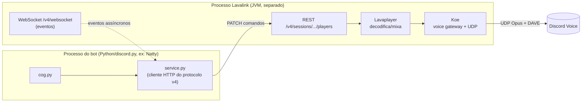
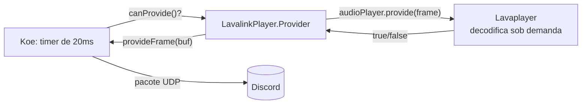
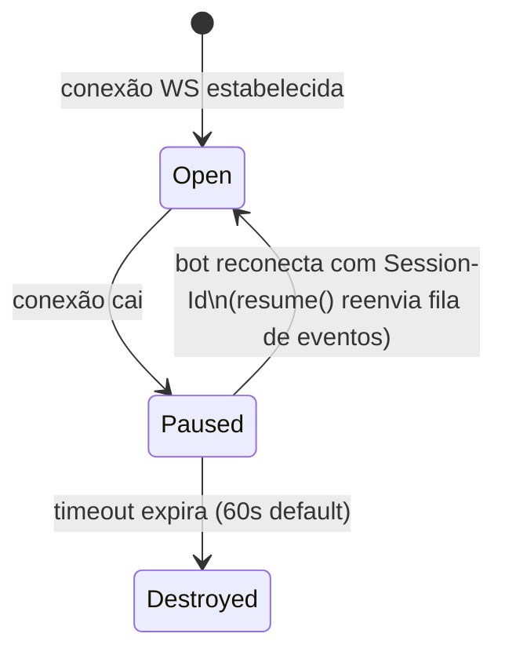

# Lavalink — Perspectiva Natty: O que ele pode aproveitar

**Documento de síntese:** Análise do Lavalink através da lente de Natty. O objetivo é extrair padrões, decisões arquitetônicas e trade-offs relevantes para o módulo futuro de áudio/Bardo, seguindo o mesmo formato de `kenku-perspective.md` para permitir comparação direta entre os dois modelos.

---

## 1. O que é Lavalink (resumido)

Lavalink é um **servidor standalone escrito em Kotlin (Spring Boot + Undertow)** que resolve identificadores de música (URLs, buscas, playlists), decodifica o áudio via Lavaplayer, aplica um pipeline de filtros DSP opcional, recodifica para Opus e fala o protocolo de voz do Discord diretamente via Koe (WebSocket de gateway + UDP + criptografia, incluindo DAVE) — tudo isso **fora do processo do bot**. O bot cliente só troca comandos e eventos por REST/WebSocket com o nó Lavalink; nunca vê um byte de áudio.

**Problema que resolve** (`ANALYSIS_REPORT.md`, seção 1): bots de música em produção não podem ter o áudio rodando dentro do mesmo processo que atende comandos e eventos de gateway — um pico de CPU decodificando áudio atrasa todo o resto, e um deploy do bot mata a música de todo mundo. A resposta, nascida do FredBoat por volta de 2017, foi extrair essa responsabilidade para um processo separado que qualquer linguagem pode falar via HTTP/WS.

**Stack técnica** (seção 2 do relatório):
- Kotlin + Spring Boot 3 + Undertow (servidor)
- Lavaplayer (fork mantido pelos mesmos devs) — decodificação/mixagem
- Koe — voice gateway + UDP + DAVE
- kotlinx.serialization — protocolo REST/WS v4 tipado
- Empacotamento: JAR único + Docker

---

## 2. Filosofia do Lavalink: "processo separado, protocolo de rede como fronteira"

Se a filosofia do Kenku é "o Chromium é o motor, nós escrevemos a cola", a do Lavalink é o oposto simétrico: **"o processo é a fronteira, o protocolo tipado é a cola"**. Três corolários:

### 2.1 Zero navegador, zero UI — tudo é servidor headless

Lavalink não tem interface gráfica, não renderiza nada, não depende de um usuário logado em lugar nenhum. Ele resolve URLs de áudio (YouTube, SoundCloud, HTTP, arquivo local) e decodifica programaticamente, sem jamais precisar de uma sessão de navegador autenticada. Isso é possível justamente porque as fontes que ele suporta nativamente **não têm DRM** — não existe "servidor headless que baixa Spotify" sem violar DRM (seção 9 do relatório), então o Lavalink nem tenta.

### 2.2 Multi-tenant por desenho

Um único nó Lavalink serve **N bots**, cada um com **M guilds**, cada guild com seu próprio player e sua própria conexão UDP de voz (`SocketContext` mapeando `guildId -> LavalinkPlayer`, seção 4.1). Isso é o oposto do modelo do Kenku, que é single-tenant por construção (um usuário, uma máquina, uma sessão). O Lavalink foi desenhado desde o início para escala — o que traz complexidade operacional que um caso de uso de "uma mesa só" simplesmente não precisa (mais sobre isso na seção 8 deste documento).

### 2.3 Delegar tudo que é "commodity" para bibliotecas irmãs

Como o relatório aponta na seção 7.4: Lavaplayer (decodificação) e Koe (voice gateway) são projetos mantidos pela mesma equipe, mas em repositórios **separados**, cada um testável e reutilizável fora do Lavalink. O "produto Lavalink" em si é uma camada fina de orquestração (Spring Boot + REST/WS + plugin loading) sobre essas duas peças especializadas. É modularização em nível de organização, não só de pacote — uma lição que vale para o Natty mesmo sem adotar Lavalink (ver seção 11).

---

## 3. A arquitetura cliente-servidor: por que resolve isolamento de processo



A ideia central é simples e comprovada em produção por bots como FredBoat, Dyno e outros (seção 1 do relatório): **áudio e voice-gateway vivem 100% fora do processo do bot**. Um crash de decodificação, um travamento no download de uma stream, um GC pesado da JVM decodificando Opus — nada disso derruba o loop de eventos do bot. E o inverso também vale: reiniciar o bot para um deploy não precisa parar a música (seção 5.2, resuming).

**Comparação direta com a filosofia do Kenku** ("zero nativo, tudo no Chromium"): o Kenku empurra isolamento de *fonte* (cada aba do Chromium é isolada entre si), mas **não** isola o áudio do resto do processo — um crash do Electron principal derruba captura, mixagem e conexão Discord de uma vez só (tabela da seção 9 do relatório, linha "Isolamento de falhas"). O Lavalink faz o oposto: não tem conceito de "aba" ou fonte visual nenhuma, mas isola *todo o subsistema de áudio* do processo do bot como um todo, via fronteira de rede. São dois eixos de isolamento diferentes — o Kenku isola fonte-de-fonte dentro de um processo único; o Lavalink isola áudio-do-bot entre dois processos. Nenhum dos dois isola nas duas dimensões ao mesmo tempo.

---

## 4. Pipeline de áudio: pull-based (Koe) vs push-based (Kenku)

Essa é a diferença arquitetônica mais fundamental entre os dois projetos, e vale a pena entender bem porque ela afeta diretamente qualquer decisão de design do Bardo.

### 4.1 Como o Lavalink funciona: Koe puxa, Lavaplayer produz sob demanda

Do `ANALYSIS_REPORT.md`, seção 4.1: dentro de `LavalinkPlayer.Provider` (`LavalinkPlayer.kt`, linhas 127-145), `canProvide()` é chamado pelo **Koe**, não pelo Lavalink. A cada 20ms (o intervalo de frame Opus/Discord), o Koe pergunta "tem frame pronto?" e só então o Lavaplayer produz o próximo bloco de PCM já filtrado. Se não há frame pronto, `canProvide()` retorna `false` e o `AudioLossCounter` registra a perda.



O timing dos pacotes de voz (que o Discord exige a cada 20ms com jitter mínimo) é responsabilidade de **quem entende o protocolo de voz** (Koe), nunca do código de decodificação. É uma inversão de controle: o consumidor (Koe/Discord) dita o ritmo, o produtor (Lavaplayer) responde sob demanda.

### 4.2 Como o Kenku funciona: o worklet empurra, o consumidor absorve

Do `kenku-perspective.md`, seção 3.3: no Kenku, a thread de áudio (AudioWorklet) converte float32→int16 a cada ~2,67ms e, quando o buffer circular enche, **empurra** via `postMessage` → WebSocket → main process, onde `encoder.write(buffer)` acumula até formar um frame Opus de 20ms. É um pipeline **push**: o produtor (o worklet, seguindo o relógio da placa de som) gera dados no seu próprio ritmo e o consumidor (`AudioPlayer` do Kenku, com seu timer de 20ms) precisa absorver o que chega, com buffer para acomodar diferença de velocidade.

### 4.3 Por que essa diferença importa

| Aspecto | Lavalink (pull) | Kenku (push) |
|---|---|---|
| Quem dita o ritmo | Consumidor (Koe/Discord) | Produtor (worklet/placa de som) |
| Compensação de deriva de relógio | Desnecessária — o consumidor só pergunta quando precisa | **Ausente** (seção 6.2 do relatório Kenku) — produtor e consumidor têm relógios diferentes, buffer cresce ou perde frames |
| O que acontece se a fonte está lenta | `canProvide()` retorna `false`, perda contabilizada em métrica (`framesDeficit`) — degradação graciosa e observável | Sem sinal claro; depende do tamanho do buffer configurado |
| Latência | Determinística: decodifica só quando o Discord vai consumir | Depende do modo (`lowLatency` ~10-50ms vs `performance` ~500ms) e do quão cheio está o buffer |

Pull-based é estruturalmente mais robusto contra deriva de relógio porque **não existem dois relógios independentes competindo** — só existe o do consumidor. É uma lição de design que vale a pena copiar conceitualmente para o Bardo mesmo sem adotar Lavalink: se o módulo de áudio do Natty algum dia tiver uma fonte "empurrando" PCM (ex: um worker separado gerando trilha), prefira desenhar a interface como "me dê o próximo frame quando eu pedir" em vez de "aqui vai o próximo frame quando eu tiver".

---

## 5. Protocolo REST+WS v4: comandos assimétricos e resuming de sessão

### 5.1 Assimetria deliberada

A v4 do protocolo (seção 5 do relatório) fez algo que nenhum outro projeto analisado até agora faz: separou completamente comandos de eventos por canal de transporte.

- **REST** = comandos (`PATCH /v4/sessions/{id}/players/{guildId}` para tocar, pausar, mudar volume, aplicar filtro — um único PATCH parcial usando `Omissible<T>` para distinguir "campo ausente" de "campo nulo")
- **WebSocket** = só eventos que o servidor empurra (`ready`, `playerUpdate`, `stats`, `event` como TrackStart/TrackEnd/TrackException)

Um cliente v3 que ainda tenta mandar comando pelo WebSocket recebe um log de erro no servidor (`SocketServer.handleTextMessage`, linha 172) — a mensagem é silenciosamente ignorada, não gera erro de protocolo.

Isso é o **oposto** do que o Kenku faz com sua API REST de controle remoto (seção 5 do `kenku-perspective.md`): lá, comandos são fire-and-forget via `PUT`, sem separação clara entre "canal de comando" e "canal de evento" — de fato o Kenku nem tem canal de evento nenhum (`/v1/events` não existe; "tudo é polling", linha 213 do relatório Kenku). O Lavalink trata "saber o que está acontecendo" como cidadão de primeira classe do protocolo; o Kenku trata como responsabilidade do cliente perguntar.

### 5.2 Resuming: o que o Kenku simplesmente não tem

Esta é, segundo o próprio `ANALYSIS_REPORT.md` (seção 5.2), a peça mais subestimada do protocolo, e é diretamente relevante para qualquer módulo de áudio que o Natty construa:

Quando o WebSocket cai (rede instável, restart do bot), o Lavalink **não destrói os players**. Ele move a sessão para um mapa `resumableSessions`, agenda um timeout (padrão 60s), continua tocando áudio normalmente (o processo Lavalink não depende do bot estar conectado para seguir mandando pacotes UDP), e enfileira os eventos que aconteceriam nesse intervalo. Se o bot reconectar com o `Session-Id` antigo dentro da janela, todos os eventos perdidos são reenviados em ordem.



O Kenku não tem nada equivalente porque não existe "reconexão" no mesmo sentido — é um único processo local; ou está rodando ou não está (tabela da seção 9, linha "Robustez a queda de conexão"). Se o Natty algum dia rodar um componente de áudio como processo separado do bot principal (seja Lavalink, seja algo caseiro), **resuming deveria ser tratado como requisito de primeira classe desde o design do protocolo**, não como um hack de reconexão adicionado depois — é exatamente o tipo de decisão que só se percebe necessária depois de operar em produção e apanhar com deploys cortando áudio no meio da sessão.

---

## 6. Sistema de plugins: inspiração para "fontes plugáveis" no Bardo

O Lavalink resolve extensibilidade com um mecanismo formal que o Kenku simplesmente não tem (o Kenku não tem *nenhum* sistema de plugin — "abre em uma aba" é a única forma de estender, seção 9 do relatório). A seção 6 do `ANALYSIS_REPORT.md` detalha:

- Plugins são `.jar`s carregados dinamicamente (via coordenadas Maven em `application.yml`) ou embutidos no classpath, geridos por um `PluginManager` que baixa, versiona e limpa versões antigas automaticamente.
- A superfície de extensão (`plugin-api`, 317 linhas) define interfaces tipadas, registradas como beans do Spring: `AudioSourceManager` (adicionar uma fonte inteira), `AudioFilterExtension` (novo filtro DSP), `AudioPluginInfoModifier` (metadados extras), `RestInterceptor`, `PluginEventHandler`.
- O caso de uso mais ilustrativo é o próprio `youtube-source`: a fonte YouTube embutida está formalmente deprecated dentro do produto (seção 4.4 e 8.1 do relatório), e a comunidade mantém um plugin externo que evolui rápido o suficiente para acompanhar as mudanças constantes de defesa anti-bot do YouTube — sem esperar um release do servidor principal.

**O que isso sugere para o Bardo:** se o módulo de música por tags do Natty (busca por tag, não por nome, com dataset local) vier a precisar de múltiplas "fontes" de áudio no futuro — arquivos locais, um serviço de streaming licenciado, uma API de efeitos sonoros de terceiros — vale a pena desenhar desde já uma **interface tipada de "fonte plugável"** (`class FonteAudio(Protocol): async def buscar(tag: str) -> list[Track]`, por exemplo) em vez de hardcodar um provedor único. Não é preciso o aparato inteiro de plugin dinâmico do Lavalink (download via Maven, classloader próprio) — isso é over-engineering para uma mesa só — mas o **princípio** de "fonte de áudio é uma interface, não uma implementação concreta espalhada pelo código" é diretamente aproveitável, e barato de aplicar dentro do padrão `service.py` que o Natty já usa.

---

## 7. O trade-off central: isolamento de processo vs. "monólito modular"

Aqui está o ponto mais desconfortável e mais honesto desta análise.

O CLAUDE.md do Natty é explícito: **"um processo só, um bot só... sem complexidade operacional de múltiplos serviços — decisão a ser revisitada só se algum módulo específico precisar de isolamento que o processo principal não aguente."**

Lavalink é, literalmente, a materialização do outro lado dessa decisão. Adotá-lo significa:

- Rodar uma **JVM separada** (Java 17+ obrigatório) ao lado do processo Python do Natty — não é uma lib que se importa, é um segundo processo com seu próprio ciclo de vida, seus próprios logs, sua própria necessidade de restart/monitoramento.
- Gerenciar rede entre os dois processos (mesmo que seja `localhost`): autenticação por senha estática comparada por igualdade de string, sem TLS obrigatório (seção 8, item 5 do relatório) — aceitável numa rede privada, mas é uma peça a mais para configurar e não esquecer.
- Ganhar, em troca, exatamente o isolamento que o CLAUDE.md já prevê como critério de saída do monólito: se o áudio decodificando continuamente (trilha ambiente rodando a sessão inteira, filtros DSP em tempo real) começar a competir por CPU/memória com o resto do bot (comandos de ficha, missões, cálculo de XP), isso é o sinal exato que o próprio `ANALYSIS_REPORT.md` aponta na seção 10: *"o dia em que o módulo de áudio precisar decodificar streams pesados continuamente, esse é o sinal — exatamente como aconteceu com o FredBoat — de que vale a pena extrair."*

**A pergunta honesta que o Natty precisa responder antes de adotar Lavalink não é "isso é tecnicamente melhor?" (é), mas "o processo principal já não aguenta o custo de rodar áudio internamente?"** Para uma mesa só, com um único servidor Discord, tocando trilha ambiente e efeitos ocasionais, é bem provável que a resposta ainda seja não — o volume de decodificação simultânea que justificou o Lavalink historicamente (milhares de guilds, múltiplos shards) está muitas ordens de grandeza acima do caso de uso do Natty. Adotar Lavalink hoje seria pagar o custo operacional (JVM rodando 24/7, mais um processo pra monitorar) de um problema de escala que o Natty não tem — o oposto do princípio "monólito modular" que o próprio time já decidiu.

---

## 8. Lavalink resolve a pergunta do usuário sobre latência sem navegador?

Tecnicamente, sim — e vale detalhar por quê, porque a resposta tem uma pegadinha.

O usuário quer trilha/áudio com boa latência **sem depender de navegador/Electron/Chromium**. Lavalink de fato não usa navegador nenhum: é JVM pura, sem Electron, sem WebContentsView, sem tab capture. A latência dele não vem de captura de aba (que no Kenku custa ~500ms no modo `performance`, seção 3.3 do relatório Kenku) — vem de decodificação direta via Lavaplayer e envio UDP direto via Koe, sem passar por um pipeline de "renderizar página → capturar tab → reencodar". Isso é estruturalmente mais rápido e mais previsível do que o caminho do Kenku.

**A pegadinha:** eliminar o Chromium não elimina "um processo pesado rodando ao lado". Troca-se "processo Electron/Chromium" por "processo JVM" — ambos são runtimes generalistas rodando à parte do bot, ambos consomem memória de forma significativa (a JVM tem seu próprio overhead de heap, GC, etc.), ambos precisam estar de pé e saudáveis para o áudio funcionar. Se o incômodo do usuário com o Kenku é especificamente "não quero manter um navegador/Electron no ar", o Lavalink não resolve isso — ele troca o tipo de processo extra, não elimina a categoria "processo extra".

O que o Lavalink **de fato** resolve, que é ortogonal à questão do navegador, é:
1. **Não depender de DRM/sessão de navegador logada** para tocar as fontes que já servem ao caso de uso do Bardo (YouTube, SoundCloud, arquivos locais — nenhuma delas precisa de Spotify/DRM se o dataset de tags for de fontes abertas).
2. **Protocolo de voz do Discord robusto e mantido por terceiros** (Koe já lida com DAVE, mudanças de crypto scheme, etc.) — evita reimplementar isso em Python, que hoje é a real alternativa se o Natty não usar nem Lavalink nem Kenku.

Então a resposta afiada é: **sim, evita Chromium, mas não evita "processo externo"; e o ganho real não é latência pura, é não ter que reimplementar o protocolo de voz do Discord e a decodificação de áudio em Python do zero.** Se o que o usuário realmente quer é "sem processo extra nenhum", a alternativa é usar `discord.py`'s próprio `voice_client` com FFmpeg local (rodando dentro do próprio processo do bot) — mais simples operacionalmente, mas reintroduz o problema original que o Lavalink existe para resolver (áudio compartilhando processo com o resto da lógica de negócio).

---

## 9. Proposta concreta: Lavalink "modo mínimo" como sidecar do Bardo

Dado o trade-off da seção 7, a proposta que faz sentido para o Natty **não é adotar Lavalink em produção com toda a aparelhagem que bots gigantes usam** (route planning multi-IP, múltiplos nós para load balancing, plugin de YouTube com rotação de estratégia anti-rate-limit). É usar exatamente o subconjunto que resolve o problema de uma mesa só:

```
natty-bot/ (processo Python, monólito modular — inalterado)
    └── modules/
        └── bardo/                    # (ou audio/)
            ├── __init__.py
            ├── cog.py                # comandos Discord (/tocar, /parar, /tag)
            ├── service.py            # lógica pura: escolhe track por tag,
            │                         # monta playlist dinâmica, decide o que enviar
            └── lavalink_client.py     # cliente HTTP/WS do protocolo v4
                                       # (equivalente ao papel de "sheets.py" no core:
                                       #  acesso cru a um sistema externo)

lavalink/  (processo Java sidecar, mesma máquina ou container ao lado)
    ├── application.yml    # config mínima: 1 nó, sem route planner,
    │                       # sem load balancing, sources: youtube (via plugin), local
    └── Lavalink.jar
```

Pontos-chave dessa proposta "modo mínimo":

1. **Um nó só, sem cluster.** O `SocketContext`/`LavalinkPlayer` já suporta múltiplas guilds num único nó (seção 4.1) — o Natty atende uma mesa (ou um punhado de servidores da comunidade The Crossroads), então nunca vai chegar perto do limite de um nó único rodando numa VPS pequena.
2. **Sem route planner de IP.** A seção 4.3 do relatório já deixa claro que isso é feature de operador em escala com bloco de IP dedicado — não se aplica aqui, então `ratelimit.ipBlocks` fica vazio no `application.yml` e essa complexidade nunca aparece no caminho do Natty.
3. **Respeitar o padrão service.py/cog.py já estabelecido**: `lavalink_client.py` (ou uma classe dentro de `service.py`) é o único lugar que fala REST/WS com o nó Lavalink — exatamente o mesmo papel que `sheets.py` cumpre hoje para o Google Sheets no `modules/core`. O `cog.py` do Bardo nunca toca o protocolo Lavalink diretamente, só chama `service.py`, que por sua vez chama o cliente. Isso mantém a promessa do CLAUDE.md de que um futuro módulo de LLM poderia chamar a função de serviço certa diretamente, sem fingir ser um comando Discord.
4. **Resuming ligado por padrão** (`PATCH /v4/sessions/{id}` com `resuming: true`, seção 5.2) — mesmo numa mesa só, isso garante que um restart do bot Python (deploy, crash, reconexão de rede) não interrompa a trilha ambiente no meio da sessão, que é exatamente a experiência ruim que se quer evitar numa mesa de RPG ao vivo.
5. **Usar o plugin `youtube-source` desde o início** (não a fonte embutida deprecated, seção 4.4/8.1) — é a única "complexidade de plugin" que vale a pena herdar, porque resolve um problema real (YouTube quebra a fonte embutida com frequência) sem exigir que o Natty escreva plugin nenhum.
6. **Sidecar, não microsserviço distribuído**: o processo Java roda ao lado do processo Python (mesmo host, ou containers no mesmo compose), sem exigir orquestração, sem múltiplos ambientes de deploy — é reconciliável com a leitura "monólito modular operacionalmente simples", desde que se aceite que agora existem **dois** processos em vez de um. O ganho é o isolamento de falha e o resuming; o custo é ter mais uma peça pra manter viva (healthcheck, restart automático).

---

## 10. Comparação final: Kenku vs Lavalink para o caso de uso do Natty

| Dimensão | **Kenku FM** | **Lavalink** | Quem vence para o Natty |
|---|---|---|---|
| Modelo de execução | App Electron local, na máquina do mestre | Servidor JVM separado, falado por rede | Depende do que se quer (ver linha "Fontes") |
| Fontes de áudio | Qualquer coisa que abra numa aba, **incluindo Spotify com DRM** | YouTube, SoundCloud, HTTP, arquivo local — **sem DRM** | Kenku, **só** se Spotify for requisito real |
| Latência | ~500ms (modo performance) por causa da tab capture + WebSocket + opusscript | Determinística, sem tab capture, decodificação direta | **Lavalink** |
| Isolamento de falha | Nenhum — um crash do Electron derruba tudo | Total — processo do bot e do áudio são independentes | **Lavalink** |
| Resuming de sessão | Inexistente (é um processo local só) | De primeira classe no protocolo (seção 5.2) | **Lavalink** |
| Extensibilidade | Nenhuma (não tem plugin system) | Formal, tipado, usado pelo próprio produto (`youtube-source`) | **Lavalink**, mas overkill para uma mesa só |
| Custo operacional | Zero infra extra — roda na máquina do mestre | Requer processo Java rodando 24/7 em algum lugar | **Kenku** |
| Alinhamento com "monólito modular" atual do Natty | Alto — nenhum processo extra do lado do bot | Baixo — introduz um segundo processo permanente | **Kenku** |
| Filtros DSP (equalizer, timescale, karaoke, etc.) | Nenhum | Pipeline completo, extensível por plugin | **Lavalink**, mas o Bardo provavelmente não precisa disso cedo |
| Maturidade do protocolo de voz Discord | Depende de `@discordjs/voice` (Node) | Depende de Koe, incluindo DAVE (seção 2 do relatório) | Empate — ambos delegam para libs maduras |

### Recomendação honesta

Para o caso de uso específico do Natty hoje — **uma mesa, um bot Python, um servidor Discord, dataset local de tags, sem Spotify/DRM como requisito confirmado** — nem Kenku nem Lavalink em sua forma "de produção" são a resposta certa isoladamente:

- **Kenku** resolveria fontes ricas (Spotify incluso) mas exige que o mestre rode um Electron à parte, e o próprio `kenku-perspective.md` já concluiu (seção 13) que isso é atrito de UX/infraestrutura para um único usuário que não necessariamente quer gerenciar dois apps.
- **Lavalink em modo cheio** traria complexidade de escala (route planning, multi-node) que o Natty nunca vai precisar, além de introduzir uma JVM que conflita com o princípio de monólito modular — a menos que o áudio realmente comece a pesar no processo principal.

A combinação que faz mais sentido, na prática: **o Bardo nasce como bot Python puro (via `discord.py`'s `voice_client` + FFmpeg local, ou diretamente como cliente do protocolo v4 do Lavalink em "modo mínimo" descrito na seção 9), sem Electron nenhum.** Se, com o tempo, o volume de decodificação simultânea (trilha ambiente tocando a sessão inteira + efeitos por cima + filtros DSP) começar a doer no processo principal — o mesmo sinal que fez o FredBoat extrair o Lavalink originalmente — aí sim vale migrar o cliente HTTP já existente (`lavalink_client.py`, se escrito desde já como camada isolada em `service.py`) para apontar para um nó Lavalink real rodando como sidecar. Ou seja: **adiar a decisão entre "processo único" e "sidecar Java" é possível e recomendável**, desde que a interface de serviço do Bardo já seja desenhada como se estivesse falando com um serviço externo — isso é ganho de arquitetura limpo, independente de qual dos dois (ou nenhum) acabe sendo escolhido.

Spotify/DRM, se vier a ser requisito confirmado pelo usuário, é o único caso em que nem Lavalink nem uma implementação Python resolvem — aí a conversa volta para o Kenku (ou algo equivalente que capture um navegador autenticado), porque essa é uma limitação de licenciamento, não de arquitetura.

---

## 11. Padrões que Natty pode aproveitar (independente de adotar Lavalink)

### ✅ 11.1 Separar decodificação, voice-gateway e orquestração em módulos claramente isolados

Mesmo dentro de um único processo Python, o Bardo pode espelhar a separação Lavaplayer/Koe/Lavalink (seção 7.4 do relatório): uma camada que resolve e decodifica (`fonte_audio.py`), uma que fala com o Discord voice (`voice_client` do discord.py), e uma que orquestra (`service.py`). Isso não exige processo separado, só disciplina de módulo.

### ✅ 11.2 PATCH parcial semântico com campos opcionais explícitos

O padrão `Omissible<T>` (seção 5.3) — distinguir "campo ausente" de "campo nulo" num único PATCH — é diretamente aplicável se o Bardo expuser uma API interna mais rica no futuro (ex: para o módulo de LLM compor ações: "trocar música E aplicar filtro E reposicionar" num só comando). Vale considerar esse padrão de protocolo se o `service.py` do Bardo crescer a ponto de precisar de uma interface mais expressiva que "uma função por ação".

### ✅ 11.3 Resuming/sobrevivência a queda de conexão como requisito de primeira classe

Sempre que qualquer componente do Natty rodar "sem estado compartilhado" com outro (seção 5.2), tratar reconexão como parte do design do protocolo, não como reflexo do cliente — isso vale tanto se o Bardo usar Lavalink quanto se usar uma solução caseira.

### ✅ 11.4 Interface de "fonte plugável" tipada, sem o aparato de plugin dinâmico completo

Como discutido na seção 6: adotar o *princípio* de fonte como interface (`Protocol`/classe abstrata), sem replicar o carregamento dinâmico via classloader/Maven do Lavalink — que resolve um problema de escala (dezenas de operadores instalando plugins de terceiros) que o Natty não tem.

### ⚠️ 11.5 Onde Lavalink não se encaixa direto no Natty

- **Multi-tenant/multi-node**: recursos pensados para milhares de guilds (route planning, load balancing por `/v4/stats`) não têm equivalente de valor para uma mesa só — ignorar completamente.
- **Plugin system completo**: montar a infraestrutura de `PluginManager` (download Maven, classloader próprio, versionamento) é engenharia demais para o volume de "fontes" que o Bardo vai precisar no médio prazo.
- **Segurança de autenticação simplória** (senha estática, seção 8 item 5 do relatório): se o Natty rodar Lavalink como sidecar, isso é aceitável só porque a rede entre os dois processos é privada/local — não expor a porta do Lavalink publicamente sob hipótese nenhuma.

---

## 12. Riscos e oportunidades para o Natty

### 🔴 Riscos (se adotar Lavalink)

1. **Segunda linguagem/runtime no projeto**: hoje o Natty é 100% Python; introduzir uma JVM como dependência de operação é custo de infraestrutura e de conhecimento (alguém precisa saber operar/debugar Java) que o time talvez não tenha hoje.
2. **Conflito direto com o princípio "monólito modular"** do CLAUDE.md — precisa ser uma decisão deliberada e documentada, não uma adoção silenciosa.
3. **Fonte de YouTube embutida é deprecated** (seção 4.4/8.1) — exige instalar o plugin `youtube-source` desde o dia 1, senão a experiência "pronta na caixa" já nasce quebrada para o caso de uso mais óbvio (tocar música do YouTube).
4. **Ausência de isolamento entre plugins** (seção 8, item 2) — relevante só se o Bardo vier a usar plugins de terceiros do ecossistema Lavalink; para "modo mínimo" com um plugin conhecido (`youtube-source`), o risco é baixo.

### 🟢 Oportunidades

1. **Resuming de sessão resolve exatamente a dor que um bot de RPG ao vivo tem**: deploy/restart no meio de uma sessão de mesa sem cortar a trilha ambiente — ganho de experiência real, não cosmético.
2. **Cliente HTTP do protocolo v4 é simples de escrever em Python** (há inclusive libs prontas como `wavelink`/`mafic`) — não exige reimplementar nada de baixo nível, só consumir uma API REST/WS bem documentada e estável (v4 está fora de beta).
3. **Adiar a decisão "processo único vs. sidecar" é possível** desenhando o `service.py` do Bardo como se já falasse com um serviço externo desde o início — o custo de arquitetura limpa é baixo e paga dividendos se/quando a extração for necessária.
4. **O princípio de fonte plugável (mesmo sem plugin dinâmico completo) mapeia bem para "busca por tag"**: cada "fonte" do dataset de tags pode ser uma implementação da mesma interface, facilitando adicionar um novo provedor de áudio sem reescrever o motor de busca.

---

## 13. Conclusão: o que o Natty aprendeu

1. **Pull-based (Koe puxando frames) é estruturalmente mais robusto que push-based (Kenku empurrando PCM)** contra deriva de relógio — vale copiar esse princípio de design mesmo sem adotar Lavalink inteiro.
2. **Protocolo assimétrico (REST para comandos, WS para eventos) + resuming de sessão é a resposta madura para "áudio não pode parar quando o bot reinicia"** — algo que o Kenku, por ser um processo local monolítico, nunca precisou resolver e por isso não tem.
3. **Lavalink não elimina "processo extra rodando ao lado" — só troca Chromium por JVM.** Se o incômodo real do usuário é "não quero manter navegador nem Electron no ar", isso é resolvido; se o incômodo é "não quero mais nenhum processo além do bot Python", nem Lavalink resolve isso sozinho.
4. **O trade-off central é REAL e não deve ser varrido para debaixo do tapete**: adotar Lavalink hoje é assumir o custo operacional de dois processos (o que o CLAUDE.md do Natty explicitamente evita) para ganhar um isolamento de falha que uma mesa só provavelmente não precisa ainda — mas que se torna justificável no exato momento em que o áudio começar a competir por recursos com o resto do bot.
5. **A separação em bibliotecas irmãs especializadas (Lavaplayer/Koe/Lavalink) é uma lição de modularização de organização**, aproveitável dentro do próprio monólito Python via módulos bem isolados, sem precisar de processos separados para colher esse benefício.
6. **A recomendação prática**: nascer simples (bot Python, sem Electron nem JVM), desenhar a camada de serviço do Bardo como se já falasse com um serviço externo, e reservar a extração para Lavalink "modo mínimo" (sidecar, um nó, sem route planning/multi-node) para o dia em que o processo principal genuinamente não aguentar mais — exatamente o critério que o próprio CLAUDE.md do Natty já estabeleceu antes desta análise existir.

**Recomendação final:** para o estágio atual do Natty, nem Kenku nem Lavalink "de fábrica" devem ser adotados diretamente. O Bardo nasce enxuto (Python + `discord.py` voice, dataset local de tags), com uma camada de serviço desenhada para ser trocável por um cliente Lavalink depois, sem reescrita. Spotify/DRM como requisito real muda essa equação e reabre a conversa sobre o Kenku — mas isso é decisão de produto, não de arquitetura.

---

*Análise: Claude Sieve — 26 de setembro de 2026*
*Fonte: `modules/natty-sieve/repo-analyses/lavalink/ANALYSIS_REPORT.md` (análise completa de arquitetura do Lavalink)*
