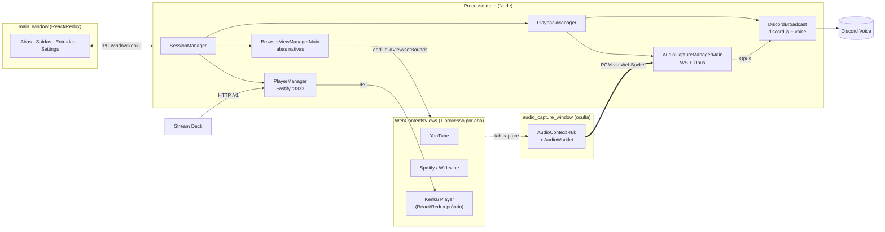
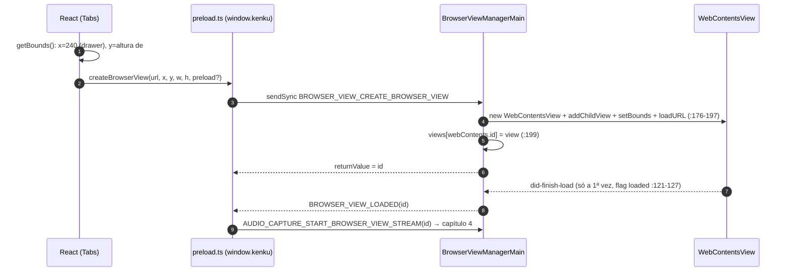
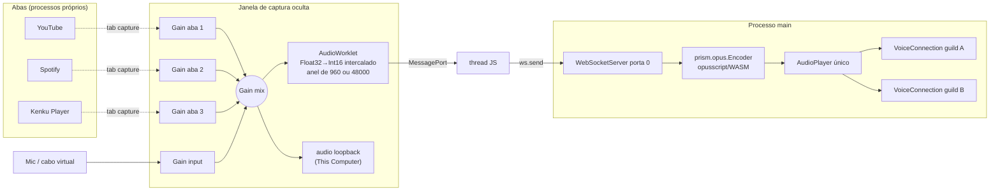
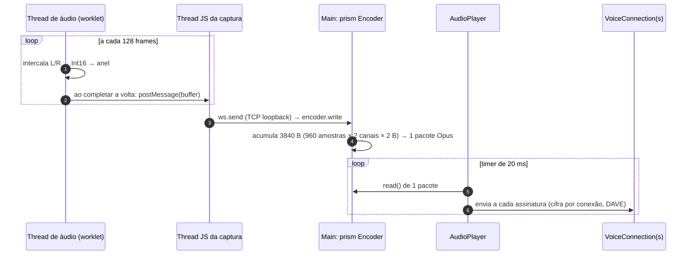
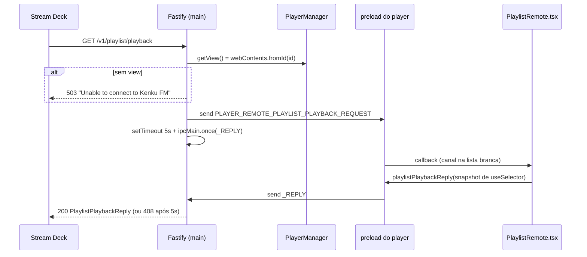

# Kenku FM — Análise de Arquitetura

> **Repositório:** [owlbear-rodeo/kenku-fm](https://github.com/owlbear-rodeo/kenku-fm) · branch `main` @ `dd534f1` (v1.5.5, 04/03/2026)
> **Escopo:** ~10,9 mil linhas de TypeScript/React (sem testes no repositório) · modo de análise **Padrão**, com foco no **pipeline de áudio**
> **Data:** 26/09/2026

---

## Sumário

1. [O problema do mestre de RPG](#1-o-problema-do-mestre-de-rpg)
2. [Panorama: quatro mundos, uma cola](#2-panorama-quatro-mundos-uma-cola)
3. [As fontes de som: um navegador dentro do app](#3-as-fontes-de-som-um-navegador-dentro-do-app)
4. [O pipeline de áudio (capítulo central)](#4-o-pipeline-de-áudio-capítulo-central)
5. [O player interno: "mais uma aba"](#5-o-player-interno-mais-uma-aba)
6. [Controle remoto: do Stream Deck ao Redux](#6-controle-remoto-do-stream-deck-ao-redux)
7. [A UI de orquestração](#7-a-ui-de-orquestração)
8. [Evolução: o motor JS do `main` vs. o motor Rust "Severus"](#8-evolução-o-motor-js-do-main-vs-o-motor-rust-severus)
9. [Avaliação e lições](#9-avaliação-e-lições)

---

## 1. O problema do mestre de RPG

Imagine um mestre de D&D que joga online pelo Discord. Ele quer uma trilha épica do Spotify durante o combate, um ambiente de taverna do YouTube e, na hora certa, o estrondo de um trovão. As opções tradicionais são ruins:

- **Bots de música na nuvem** (Rythm, Groovy, Jockie) baixam o áudio num servidor. Não tocam arquivos locais nem conteúdo com DRM (Spotify), e vários foram derrubados por questões de copyright.
- **Compartilhar tela ou aba** no Discord manda o áudio pelo perfil de voz da conta pessoal do mestre, com uma única fonte e sem mixagem.
- **Cabo de áudio virtual** (VB-Cable, Voicemeeter) exige instalar driver e configurar roteamento. É inviável para a maioria dos mestres, e ainda mistura a voz do mestre e as notificações do sistema.

O **Kenku FM**, criado pela equipe do Owlbear Rodeo (um VTT) em 2022, é um app desktop que resolve isso **localmente**. Ele é um navegador com player embutido, e o som de cada aba é capturado, mixado e enviado a um **bot do Discord que o próprio usuário cria** (o usuário fornece o token).

| Alternativa | Rota técnica | O que o Kenku faz diferente |
|---|---|---|
| Bots de música | Servidor baixa e transmite streams | Roda local: toca DRM, arquivos locais, qualquer site |
| Syrinscape, Tabletop Audio | Conteúdo curado com player próprio | São **fontes**: o Kenku os abre dentro do navegador embutido |
| Cabo virtual + conta pessoal | Roteamento de áudio do SO | Isolamento por aba sem driver; o cabo virtual vira uma *entrada* opcional |
| Screen share do Discord | Captura de tela ou aba | Mixagem de várias fontes, mute por fonte, várias guilds ao mesmo tempo |

Alguns dados do projeto: ~358★ e 97 forks. Na prática, é um projeto de **duas pessoas** (506 e 425 commits), sob GPL-3.0, com a política "open source, not open contribution": só PRs de correção de bug são aceitos (`.github/CONTRIBUTING.md`). Esse contexto de equipe pequena explica quase todas as decisões que veremos.

---

## 2. Panorama: quatro mundos, uma cola

O Kenku FM é um app Electron com **três entrypoints de renderer** declarados no Electron Forge (`forge.config.js:62-87`): `main_window` (UI), `player_window` (player interno) e `audio_capture_window` (janela invisível de captura). Somando o processo main e as abas de sites de terceiros, o som atravessa quatro "mundos":



A **filosofia do projeto** cabe numa frase: *o Chromium é o motor; nós escrevemos a cola*. Ela se desdobra em três princípios, que vão aparecer em todos os capítulos:

1. **Aba = fonte de som.** A unidade de composição é o processo do Chromium. Qualquer coisa nova que produza som (inclusive o player da casa) vira mais uma aba, e com isso ganha captura, mute e mixagem sem nenhuma linha nova de código de áudio.
2. **Main sem estado, renderers com Redux.** O processo main roteia IPC e é dono dos recursos nativos (janelas, sockets, cliente Discord). O estado do produto mora em dois stores Redux: o da UI e o do player.
3. **Zero código nativo.** Usa `opusscript` (WASM) em vez de `@discordjs/opus`, tab capture do Chromium em vez de loopback do SO, e Howler/`<audio>` em vez de decodificadores próprios. O resultado é um app que roda em 3 sistemas operacionais e 2 arquiteturas, mantido por 2 pessoas.

Um detalhe que o leitor do README vai estranhar: o README ainda diz que o áudio vai para o Discord "usando Eris" (`README.md:29`), mas o código usa `discord.js ^14.25` e `@discordjs/voice ^0.19` (`package.json:60,73`). A documentação ficou para trás de uma migração, e essa migração foi o que trouxe de graça o suporte ao **DAVE**, a criptografia ponta a ponta de voz do Discord, lançado na v1.5.5 via `@snazzah/davey`.

---

## 3. As fontes de som: um navegador dentro do app

Antes de existir mixagem ou bot, o Kenku precisa **ser um navegador**, porque é isso que torna cada fonte de som isolável.

### 3.1 A ideia: UI em HTML, conteúdo em views nativas

A janela principal é uma UI React "oca", que desenha barra de abas, barra de URL e a coluna lateral. O conteúdo web de verdade é uma pilha de **`WebContentsView`s nativas** sobrepostas à janela. O **renderer mede** a área livre e o **main aplica** o retângulo (`getBounds.ts:3-12` → `BrowserViewManagerMain.ts:243-255`).

| Alternativa | Por que não |
|---|---|
| `<iframe>` | YouTube, Spotify e Google bloqueiam via `X-Frame-Options`. O áudio sairia misturado com o da UI, no mesmo `webContents` |
| Tag `<webview>` | Desencorajada pela própria equipe do Electron |
| `BrowserView` | Era o caminho antigo, depreciado no Electron 30. O código já migrou para `WebContentsView` (`BrowserViewManagerMain.ts:1,176-181`), mas os nomes `BrowserView*` e `BROWSER_VIEW_*` ficaram por inércia |
| Navegador externo | Perderia o controle do áudio. Voltaríamos a ter que capturar o som do sistema |

A decisão central, e a mais barata do projeto: cada aba tem seu próprio `webContents` e seu próprio processo. Assim o Chromium **já sabe** qual áudio pertence a qual aba. O `webContents.id` vira a chave que costura o sistema inteiro: é o `id` da aba no Redux, o `viewId` da captura, o alvo do mute e o `registeredViewId` do controle remoto (`BrowserViewManagerMain.ts:199-202`).



Trocar de aba **não destrói** a view: ela é removida da janela e recolocada depois (`hideBrowserView`/`showBrowserView`, `:227-241`). A aba escondida **continua tocando**, e é exatamente isso que o mestre quer quando alterna para a aba de efeitos sem parar a música. Pop-ups (`window.open`) não viram janelas: são convertidos em novas abas, ou seja, em novas fontes (`:117-120`).

### 3.2 DRM e logins: a parte "adversarial"

Duas coisas precisam funcionar para o produto fazer sentido: tocar Spotify (DRM) e fazer login no Google/YouTube.

- **Widevine** vem do fork **castlabs** do Electron (`package.json:46`, `37.6.0+wvcus`). O boot espera o componente carregar (`index.ts:105-122`). Se ele falhar, o app **abre mesmo assim** e só avisa "Licensed music playback is disabled" (`:128-135`), uma degradação graciosa. O custo aparece no CI: há assinatura VMP para macOS e Windows, mas não para Linux, onde o Spotify não funciona. No ARM Linux não existe Widevine nenhum. Na v1.5.5, o Windows arm64 ainda saiu sem assinatura de código (`publish-stable.yaml:220,234`).
- **Spoof de user agent**: todas as requisições usam um UA de "Chrome 138 limpo", e URLs contendo `google.com` usam um UA **propositalmente malformado** (`userAgent.ts:9-20`, `index.ts:92-100`), porque o Google bloqueia login em navegadores embutidos. É um jogo de gato e rato: as releases 1.5.1 e 1.5.2 foram inteiras de "consertar login do YouTube/Spotify".

### 3.3 Ciclo de vida: "reset por construção"

O `SessionManager` agrega os quatro managers do main e é **destruído e recriado a cada `did-start-loading`** da janela principal (`index.ts:63-69`). O raciocínio é que o estado das abas mora no Redux do renderer. Se a UI recarrega, as views antigas no main seriam órfãs, sem UI e **tocando áudio sem controle**. Então o main joga tudo fora e recomeça, o que é mais simples do que reconciliar estado entre processos. Esse padrão tem duas consequências:

- O evento também dispara na carga inicial, então o `SessionManager` nasce **duas vezes** no boot (e com ele a janela oculta de captura). É inofensivo, mas mostra que tudo depende de `destroy()` ser completo.
- Um F5 derruba o bot do Discord, a captura e o servidor remoto.

### 3.4 O padrão "manager espelhado" e suas bordas

Cada capacidade do main é uma classe `XxxManagerMain` que registra `ipcMain.on(...)` no construtor e faz `off` no `destroy()`. No renderer existe uma classe espelho `XxxManagerPreload` que traduz métodos em `ipcRenderer.send`. É um RPC artesanal: os **nomes de canal são strings repetidas** em dois ou três arquivos, e as assinaturas (`id, x, y, width, height`) são copiadas à mão.

As proteções padrão do Electron 37 estão ativas: `contextIsolation`, `sandbox` e nada de `nodeIntegration`. A API `window.kenku` expõe funções fixas, não o `ipcRenderer` cru, e **abas de terceiros não têm preload**. As bordas, porém, ficaram abertas:

| Problema | Evidência |
|---|---|
| O **caminho de preload** de uma aba vem do renderer, sem validação | `preload.ts:66-83` → `BrowserViewManagerMain.ts:94,176-179` |
| Nenhum `setPermissionRequestHandler`: o Electron **aprova** por padrão pedidos de microfone, câmera e notificações de qualquer site | grep vazio em `src/` |
| `shell.openExternal(details.url)` sem checar o esquema | `index.ts:58-61` |
| Nenhum handler IPC confere `event.sender` | `BrowserViewManagerMain.ts:18-39`, `index.ts:165-178` |
| `sendSync` na criação de abas bloqueia o renderer | `BrowserViewManagerPreload.ts:17` |
| API privada `(webContents as any).destroy()` | `BrowserViewManagerMain.ts:212,221` |
| Nenhuma CSP nos HTMLs, e `devContentSecurityPolicy: ""` | `src/index.html`, `forge.config.js:89` |

Cada aba agora é uma fonte de áudio isolada. Falta responder à pergunta que sustenta o produto: **como tirar o som dela sem compartilhar a tela e fazê-lo chegar ao Discord?**

---

## 4. O pipeline de áudio (capítulo central)

O módulo é pequeno: cerca de 800 linhas em 8 arquivos. Mesmo assim ele atravessa **quatro fronteiras de execução**: o processo de cada aba, uma janela oculta de captura, a thread de áudio do Chromium (AudioWorklet) e o processo main do Node. Quase todas as boas decisões e quase todos os problemas do projeto nascem nessas travessias.

### 4.1 O problema, em quatro restrições

| Restrição | Por que é difícil |
|---|---|
| O áudio está dentro de renderers do Chromium, inclusive com DRM | O Node do main não tem acesso ao áudio de um `webContents`. O Electron não oferece nenhum "tap" nativo |
| O Discord exige **Opus 48 kHz em frames de 20 ms**, empacotado em RTP, cifrado e agora com DAVE | É preciso um encoder e um cliente de voz completos, e só o main (Node) roda `discord.js` |
| Música, ambiente, efeitos e microfone tocam **ao mesmo tempo** | É preciso um mixer com ganho por fonte |
| O mestre **também quer ouvir** | O tab capture do Chromium desvia o áudio da aba, que para de soar localmente. Alguém precisa devolvê-lo às caixas de som |

### 4.2 A solução em uma frase

> **Usar o próprio Chromium como placa de som.** Cada aba é capturada pela API interna de *tab capture*: `getUserMedia` com `chromeMediaSource: "tab"` e um `mediaSourceId` emitido pelo main. Os streams entram num `AudioContext` de 48 kHz numa janela invisível e são somados num `GainNode`. Um `AudioWorklet` converte o mix em PCM 16-bit intercalado, esse PCM atravessa um WebSocket local até o main, e lá é codificado em Opus e entregue ao Discord.

Cada peça reaproveita algo que já existe. A captura por aba vem do Chromium; a mixagem e o resampling (44,1→48 kHz), do Web Audio; a thread de tempo real, do AudioWorklet; a escuta local, de um `<audio>` ligado a um `MediaStreamDestination`; a entrada de microfone ou cabo virtual, de `getUserMedia({deviceId})`. **O único código "de áudio" escrito à mão são as ~80 linhas do worklet** (`PCMStream.worklet.js`).



### 4.3 Por que não as alternativas óbvias

| Alternativa | Por que não serve |
|---|---|
| Screen share do Discord | É o status quo que o produto substitui |
| Captura no main (WASAPI, CoreAudio) | Exigiria addons nativos, capturaria o sistema inteiro e não permitiria mute por aba. No macOS nem existe loopback sem driver |
| `desktopCapturer` / `getDisplayMedia` | Feitos para telas e janelas, com áudio limitado no macOS. `getMediaSourceId` + `"tab"` dá **um stream por webContents**, exatamente a granularidade "aba = fonte" |
| `MediaRecorder` (WebM/Opus) | Entrega blocos de centenas de ms dentro de um contêiner, o que é ruim para tempo real. O worklet entrega PCM cru a cada 128 amostras |
| WebRTC direto do Chromium | O Discord não fala WebRTC com bots, então seria preciso um tradutor nativo. É justamente o experimento "Severus" (capítulo 8) |

### 4.4 O fluxo, passo a passo

**Captura de uma aba.** A captura começa por um vai-e-volta curioso: o main avisa a UI, e a UI devolve a ordem ao main.

```mermaid
sequenceDiagram
    autonumber
    participant BVM as BrowserViewManagerMain (main)
    participant UIp as preload.ts (UI)
    participant ACM as AudioCaptureManagerMain (main)
    participant CapW as Janela de captura
    participant Tab as WebContentsView
    Tab-->>BVM: did-finish-load (1ª vez)
    BVM->>UIp: BROWSER_VIEW_LOADED(id)
    UIp->>ACM: AUDIO_CAPTURE_START_BROWSER_VIEW_STREAM(id) (preload.ts:48-51)
    ACM->>ACM: webContents.fromId(id).getMediaSourceId(capturaWC) (:187-190)
    ACM->>CapW: START_BROWSER_VIEW_STREAM(id, mediaSourceId)
    CapW->>Tab: getUserMedia chromeMediaSource "tab"
    Note over Tab,CapW: a aba para de soar localmente; o som agora é do grafo
    CapW->>CapW: MediaStreamSource → Gain(viewId) → mix
```

São duas travessias de IPC para ligar dois objetos que moram **no mesmo processo** (main). O `mediaSourceId` é emitido **para um `webContents` específico**, o da janela de captura. Por isso só o main pode intermediar: a UI não tem como obter esse token. Nas entradas externas, `noiseSuppression`, `autoGainControl` e `echoCancellation` ficam **desligados** (`AudioCaptureManagerPreload.ts:118-126`). É um detalhe fácil de esquecer e decisivo para música, porque o processamento de voz do Chromium destruiria o sinal musical.

**O caminho quente**, a cada quantum de 128 amostras (~2,67 ms):



**O detalhe mais engenhoso** fica em `PlaybackManager.ts:14`: `createAudioResource(stream)` recebe o **próprio `prism.opus.Encoder`**. O `@discordjs/voice` infere o tipo do stream por `instanceof`, reconhece `StreamType.Opus` e **não coloca FFmpeg na cadeia**. Isso só funciona se as duas bibliotecas enxergarem **a mesma cópia** do módulo `prism-media`. É por isso que ele é `external` no webpack (`webpack.main.config.js:16`) e copiado inteiro pelo `forge-externals-plugin` (`forge.config.js:93-96`). É esperto e frágil ao mesmo tempo: um bump de dependência que duplique o `prism-media` faria o `instanceof` falhar, e o áudio passaria a exigir um FFmpeg que o app não empacota.

### 4.5 Decisões-chave e seus trade-offs

**Por que uma janela oculta, e não o main nem a UI?** O main não tem Web Audio. Na UI, o `port.onmessage → ws.send` rodaria na mesma thread do React, e um re-render pesado atrasaria o PCM. O comentário em `src/audioCapture/renderer.ts:1-7` diz exatamente isso: a janela existe "para rodar na sua própria thread, livre de atualizações de UI". O custo é um processo a mais, dezenas de MB de memória em troca de isolamento. Ficou uma dívida pendurada: a janela é a única com `sandbox: false`, justificado por um "web worker no preload" que **não existe mais** (`AudioCaptureManagerMain.ts:30-35`), porque o worklet o substituiu.

**Por que WebSocket, e não IPC ou MessagePort?** O código não explica. O mais plausível é herança do desenho original, anterior à popularização do `MessageChannelMain`, somada à conveniência de os dados chegarem como `Buffer` no Node. O preço são duas cópias, uma pilha TCP e uma porta aberta (§4.7).

**Buffers e modos: os comentários mentem.**

| Grandeza | O comentário diz | O que o código faz |
|---|---|---|
| `FRAME_SIZE = 960` | "tamanho em **bytes**" (`Preload.ts:18-28`) | 960 **amostras por canal** (um frame Opus de 20 ms). A conta `·2/2` se cancela por coincidência |
| Buffer `lowLatency` | "20 ms" (`:83`) | `Int16Array(960)` intercalado = **10 ms** |
| Buffer `performance` (**padrão**) | "1 segundo" (`:82`) | 48 000 int16 = **500 ms** |

Nada quebra, porque o encoder acumula bytes até fechar um frame. Mas o modo padrão é, na prática, um **jitter buffer fixo de meio segundo na origem**: o main recebe rajadas de 25 pacotes a cada 0,5 s. A escolha revela a experiência dos autores: para música ambiente, estabilidade vale mais que latência. Para um trovão disparado no momento certo, meio segundo incomoda.

**Não existe compensação de deriva de relógio.** O produtor segue o relógio da placa de som; o consumidor segue o timer de 20 ms do `AudioPlayer`. `_handleStreamData` ignora o *backpressure* de `write()` (`AudioCaptureManagerMain.ts:169-171`). Se o produtor for mais rápido, o buffer cresce e **a latência aumenta ao longo de uma sessão longa**. Isso bate com as queixas de latência que motivaram o blog dos autores.

**`NoSubscriberBehavior.Play` + `maxMissedFrames: 3000`** (`DiscordBroadcast.ts:26-32`). Com `Play`, o player continua consumindo pacotes mesmo sem nenhum canal conectado, então o stream fica sempre "ao vivo". Com `Pause`, o bot entraria no canal despejando minutos de áudio atrasado. O `3000` (60 s, contra 100 ms do padrão da biblioteca) é a rede de segurança, porque o `AudioResource` é criado **uma única vez por sessão** e nada o recria depois de `Idle` (`PlaybackManager.ts:13-19`). As rajadas do modo performance estourariam o limite padrão o tempo todo.

**Um `AudioPlayer` para várias guilds.** Cada `joinVoiceChannel` faz `connection.subscribe(this.audioPlayer)` (`:128`). É assim que funciona o "multiple outputs" do README: o áudio é codificado uma vez e enviado para N guilds, **um canal por guild**, todas com **o mesmo mix**. A regra "um canal por guild" é aplicada **na UI** (`OutputListItems.tsx:70-90`), não no main. Mandar música para a guild A e efeitos para a B está fora do desenho atual.

### 4.6 Destaques

- **Tab capture** via `getMediaSourceId` + `"tab"`: por aba, com DRM, sem diálogo de compartilhamento e sem driver. É o truque que viabiliza o produto.
- **`createAudioResource(encoder)`** pulando o FFmpeg.
- **Mute feito no grafo, não no `webContents`** (`Preload.ts:100-104`). O comentário explica que o som que sai é o capturado, não o que a aba tocaria. Mostra domínio do fluxo real.
- Constraints de voz desligadas nas entradas externas.

### 4.7 Problemas concretos

| # | Gravidade | Onde | Problema e consequência |
|---|---|---|---|
| 1 | **Alta (segurança)** | `AudioCaptureManagerMain.ts:42,102-104,169-171` | `new WebSocketServer({ port: 0 })` **sem `host`** escuta em **todas as interfaces**, sem token e sem checagem de `Origin`, e **qualquer** mensagem vai para o encoder. Um processo local, uma máquina da LAN (se o firewall deixar) ou uma página que descubra a porta pode **injetar áudio no canal do Discord**. O `maxPayload` padrão (100 MiB) permite estourar a memória. *Correção:* `host: "127.0.0.1"` + token na URL + uma única conexão, ou trocar por `MessagePortMain` |
| 2 | Média | `PlaybackManager.ts:13-19` | O recurso de áudio nunca é recriado. Mais de 60 s sem dados (renderer travado, ou nenhuma fonte ativa, ver #8) **mata a transmissão até recarregar a janela** |
| 3 | Média | `AudioCaptureManagerMain.ts:169-171` | Sem backpressure e sem controle de deriva, a latência cresce durante a sessão |
| 4 | Média | `DiscordBroadcast.ts:119-154` | Canal existente mas **não `joinable`**: nenhuma resposta (falta um `else` em `:121`). A UI marca o canal como selecionado e o bot nunca entra. A mensagem "canal cheio/sem permissão" aparece no ramo errado (cliente ausente) |
| 5 | Média | `DiscordBroadcast.ts:157-167` | `_handleLeaveChannel` só trata `GuildVoice`: em **canais Stage** o bot fica preso no palco. Também não checa se `client` e a conexão existem |
| 6 | Média | `DiscordBroadcast.ts:107-113` | `_handleDisconnect` chama `this.client.destroy()` sem checar `undefined`, gerando uma rejeição não tratada |
| 7 | Média | `DiscordBroadcast.ts:123-138` | Um listener `error` novo a cada join na mesma guild. Não trata `Disconnected` (queda de rede, kick): a UI mostra "conectado" e não há reconexão |
| 8 | Baixa/Média | `PCMStream.worklet.js:22` | Só processa entrada com **exatamente 2 canais**. Com o mix vazio (nenhuma fonte ativa), o Web Audio entrega 0 ou 1 canal e nenhum PCM é enviado, o que leva ao #2. *Hipótese a validar em runtime; a correção é `channelCount: 2, channelCountMode: "explicit"`* |
| 9 | Média | `AudioCaptureManagerMain.ts:106-111`, `Preload.ts:113,210` | **Corridas de inicialização sem handshake**: `AUDIO_CAPTURE_START` pode chegar antes do preload da janela de captura estar pronto, e uma aba carregada antes do `start()` nunca é capturada (o erro é engolido) |
| 10 | Baixa | `PCMStream.worklet.js:52,71` | Aloca `Float32Array`/`Int16Array` **a cada quantum** na thread de tempo real (~750 alocações/s), o que gera pressão de GC e risco de glitches |
| 11 | Baixa | `Preload.ts:227-234`; `preload.ts:88-91` | `GainNode`s de abas fechadas nunca são desconectados. `AUDIO_CAPTURE_STOP_ALL_BROWSER_VIEW_STREAMS` **não tem handler** no main |
| 12 | Baixa | `Preload.ts:162-168` | Se o WS cai, `ipcRenderer.emit("ERROR")` dispara um evento **local**, que ninguém escuta. Não há reconexão |

### 4.8 Leitura do capítulo

É **pragmatismo bem-sucedido**. Com cerca de 800 linhas e zero código nativo, o módulo entrega algo que produtos maiores não entregam: captura por aba com DRM, mixagem e envio para várias guilds, em três sistemas operacionais. As fragilidades se concentram em dois eixos. Um é **tempo**: buffer fixo, deriva, backpressure, recurso que não se recria. O outro são as **junções**: corridas de IPC, WS exposto, respostas IPC ausentes. O diagrama do pipeline é quase um mapa das fronteiras do Electron, e **tudo o que dá errado acontece nas junções, nunca dentro de uma ilha**. A maioria dos problemas se corrige com uma linha (`?.`, `host`, `else`). Os de tempo são exatamente o que levou os autores a prototipar WebRTC em Go e Rust.

O som já chega ao Discord e às caixas do mestre. Mas YouTube e Spotify não bastam para uma mesa de RPG: o mestre precisa das **suas** músicas e de efeitos na hora certa.

---

## 5. O player interno: "mais uma aba"

A resposta do Kenku é deliberadamente modesta. Em vez de criar um segundo caminho de áudio, ele escreve **um pequeno app web** que toca arquivos locais e o coloca **numa aba**. Para o pipeline, o player é só mais uma fonte capturada. Isso se confirma no código: a `PlayerTab` cria a view pelo mesmo `_handleCreateBrowserView`, e a única diferença é um preload próprio.

### 5.1 Onde o player roda

| Opção | Prós | Contras |
|---|---|---|
| **WebContentsView próprio (escolhida)** | Reusa 100% da captura; falhas isoladas; `localStorage` próprio; o volume do player é "mais um fader" do mixer | O estado fica ilhado (controlá-lo de fora exige IPC, ver cap. 6); bundle React/MUI duplicado; dois stores Redux |
| Dentro da UI principal | Um só store | A UI não é capturada; seria preciso um caminho paralelo até o worklet |
| No main (FFmpeg/prism → Opus) | Sem Chromium no caminho | Reimplementar decodificação, fades, MediaSession e mixagem com as abas. Contraria a filosofia |

É a escolha certa para uma equipe de duas pessoas: **nenhuma linha nova de código de áudio**.

### 5.2 Anatomia

O app monta `Provider → PersistGate → ThemeProvider → MemoryRouter → App` (`src/player/index.tsx:21-39`). O tema, o CSS e utilitários são **importados direto do renderer principal**, o que forma um monorepo informal por import relativo. O desenho separa três camadas:

- **Estado declarativo**: quatro slices Redux Toolkit, em dois pares. Um par é a **biblioteca** (`playlists`, `soundboards`, persistida); o outro é a **reprodução** (`playlistPlayback`, que persiste só volume/mute/shuffle/repeat, e `soundboardPlayback`, efêmero).
- **Objetos imperativos**: instâncias `Howl` guardadas em `useRef` dentro dos hooks `usePlaylistPlayback`/`useSoundboardPlayback`, porque não são serializáveis.
- **Componentes-ponte invisíveis**: `*PlaybackSync`, `PlaylistMediaSession` e `*Remote` renderizam `<></>` e ligam store e mídia. Apesar do nome, os `*PlaybackSync` **não** sincronizam com o main. Eles ligam o Redux do player aos `Howl` dentro da própria view (`PlaylistPlaybackSync.tsx:12-13`: "componente vazio para evitar re-renderizar os filhos").

Esse padrão "Redux primeiro, mídia depois" permite que **qualquer origem de comando** (botão, tecla de mídia, requisição HTTP) apenas despache uma action, deixando o efeito sincronizar o `Howl`.

```mermaid
sequenceDiagram
    participant UI as TrackItem
    participant Store as Redux (playlistPlayback)
    participant Hook as usePlaylistPlayback
    participant Howl as Howl (html5)
    participant Sync as PlaylistPlaybackSync
    UI->>Store: startQueue (shuffle com a faixa clicada na posição 0)
    UI->>Hook: play(track)
    Hook->>Howl: new Howl({src: file://..., html5, volume 0})
    Howl-->>Hook: load → dispatch playTrack
    Hook->>Howl: crossfade de 1 s (anterior 1→0 e unload; nova 0→vol)
    Store-->>Sync: playing=true → howl.play()
    Howl-->>Hook: end → repeat track / próxima / stop
```

### 5.3 Decisões que definem o player

1. **Howler em modo HTML5 por padrão.** O `<audio>` faz streaming de trilhas de 1 h em FLAC sem decodificar tudo em RAM, e fade e crossfade custam uma linha. O preço são fades por timer JS (menos suaves que um `GainNode`) e acesso a campos privados (`(howl as any)._sounds[0]`). Como o som vai ser recapturado e mixado de qualquer jeito, precisão de amostra não importa.
2. **Dois modos de loop nos efeitos** (`Sound.ts:18-23`, documentados no próprio código):
   - *Loop com crossfade* (o padrão, com fades de 100 ms): usa `<audio>` e, `fadeOut` ms antes do fim, cria uma **nova instância** sobreposta. É a técnica clássica de "ambient bed" sem costura.
   - *Loop "perfeito"* (fades zerados): usa Web Audio, decodifica o arquivo inteiro em RAM e dá loop *sample-accurate*.
   É uma troca explícita entre memória e precisão.
3. **Arquivos locais como URL `file://` absoluta** (`webUtils.getPathForFile` → `encodeFilePath`, `renderer/common/drop.ts:3-7`). Não usa data URL nem copia o arquivo. O `localStorage` fica leve e importar pastas enormes é instantâneo. Em compensação, **mover ou renomear a pasta quebra a biblioteca**, e ela não é portátil entre máquinas.

### 5.4 Problemas relevantes

| # | Problema | Evidência | Impacto |
|---|---|---|---|
| P1 | `queue.current` tem **duas semânticas** (índice em `tracks` sem shuffle, em `shuffled` com shuffle), e `removeTrackFromQueue` sempre usa a segunda | `playlistPlaybackSlice.ts:109,127-138` vs `:63` | Apagar uma faixa sem shuffle faz "próxima" pular para a faixa errada |
| P2 | Importar pasta chama `readEntries` **uma vez só** (o Chromium devolve ≤100 entradas por chamada) | `useFolderDrop.ts:50-57,84` | Pastas com mais de 100 arquivos entram **truncadas**, em silêncio |
| P3 | Faixa com arquivo sumido **para** a playlist em vez de pular | `usePlaylistPlayback.ts:43-48` | Uma pasta movida interrompe a sessão |
| P4 | O loop com crossfade faz `stop()` mas nunca `unload()` nas instâncias antigas | `Sound.ts:54-58` | Provável vazamento de `<audio>` em ambiências tocando por horas (não verificado em runtime) |
| P5 | Erro emitido **dentro do construtor** de `Sound`, antes de existir um listener | `Sound.ts:88-98` | A falha some sem Snackbar |
| P6 | Apagar um som que está tocando não o interrompe | `SoundItem.tsx:76-79` | "Som fantasma" |
| P7 | Persistência a cada tecla ou movimento de slider, num `localStorage` de ~5–10 MB | `store.ts:17`, `SoundItem.tsx:89-91` | Custo de serialização; limite para bibliotecas grandes |
| P8 | Laços `requestAnimationFrame` que nunca param | `usePlaylistPlayback.ts:74-87` | A view nunca fica ociosa |
| P9 | Lógica de "próxima faixa" **triplicada**; playlists e soundboards quase idênticos (diff de 4 linhas entre `PlaylistAdd` e `SoundboardAdd`) | `usePlaylistPlayback.ts:116-242` | Toda correção precisa ser feita duas ou três vezes |

**Se eu redesenhasse:** um modelo genérico `Collection<Item>` com factory de slice para playlists e soundboards; uma fila com uma única semântica (`order[]` + ponteiro); um `createListenerMiddleware` para manter fila e biblioteca coerentes (hoje **cada componente** precisa lembrar de despachar as duas actions); caminho + tamanho/hash com "relocalizar pasta" e export/import em JSON; IndexedDB no lugar do `localStorage`.

Tudo isso vive dentro de uma view isolada: o store, os `Howl`, a fila. Nenhum outro processo enxerga esse estado. **Como um Stream Deck, do outro lado da mesa, consegue dizer "toque a playlist da taverna"?**

---

## 6. Controle remoto: do Stream Deck ao Redux

O controle remoto é a **única interface programável** do Kenku. É por ele que falam o plugin oficial de Stream Deck (repositório separado), o Bitfocus Companion e scripts caseiros. A dificuldade é arquitetural: quem sabe responder "o que está tocando?" é o renderer do player, que não tem porta de rede.

### 6.1 A ideia: o main como central telefônica

A hipótese se confirma: **o main é "burro"**. O `PlayerManager` guarda só o id da view registrada, a instância Fastify e endereço/porta (`PlayerManager.ts:9-12`). Nenhuma rota consulta estado no main; todas repassam via `webContents.send`. As rotas vêm em dois estilos:

- **Comandos fire-and-forget** (`PUT .../play`, `PUT .../mute`, `POST .../next`...): o main envia o IPC e responde **200 na hora, ecoando o corpo**. Esse 200 quer dizer "entreguei a mensagem", não "executei".
- **Consultas** (`GET /v1/playlist`, `/v1/playlist/playback`, `/v1/soundboard`, `/v1/soundboard/playback`): o main envia `*_REQUEST`, registra `ipcMain.once("*_REPLY")` com timeout de 5 s e responde 200, 408 (timeout) ou 503 (sem view).



Do lado do player, os *handlers* são **componentes React invisíveis** (`PlaylistRemote`, `SoundboardRemote`), o mesmo truque do MediaSession. Eles têm acesso direto a `useSelector`, `useDispatch` e aos callbacks de áudio, sem camada de serviço. Um detalhe bem pensado para a mesa de jogo: `PUT /v1/soundboard/play` com o id **de um soundboard** toca um **som aleatório** dele (`SoundboardRemote.tsx:21-31`). Um botão "taverna" soa diferente a cada toque.

### 6.2 Trade-offs

| Decisão | Ganho | Custo |
|---|---|---|
| HTTP REST (Fastify + TypeBox) | Consumível de qualquer lugar (`curl`, Companion "Generic HTTP"); um schema gera validação, tipo TS e serializador | Sem push: o Stream Deck precisa fazer **polling** para acompanhar o progresso |
| OSC | — | **Não existe.** `@types/node-osc` está em `package.json:37` sem dependência e sem import: um experimento abandonado |
| Estado só no player | Não duplica estado | O round-trip de IPC tem timeout; o GET falha se o player estiver carregando |
| `/v1` no prefixo | Permite evoluir sem quebrar o plugin, que tem release própria | Os tipos de resposta não têm schema, então o formato do Redux vaza para a API |

### 6.3 Problemas

**Segurança.** O servidor é opcional, desligado por padrão e escuta em `127.0.0.1`, uma boa decisão de partida. Mas:

1. **Não há autenticação, e o endereço é texto livre.** O `pattern` de validação está quebrado (`"d{1,3}.d{1,3}..."` sem `\`, e fora de um `<form>`, `Settings.tsx:182`). Com `0.0.0.0`, um caso legítimo para controlar o app de um celular, qualquer pessoa no Wi-Fi da loja de jogos controla o áudio que vai para o Discord.
2. **CSRF:** `POST .../next` e `.../previous` não exigem corpo nem content-type (`playback.ts:172-190`). Qualquer página, **inclusive uma aberta no navegador embutido do próprio Kenku**, pode pular a faixa com um `fetch(..., {mode: "no-cors"})`. O impacto é baixo, mas o risco é real.
3. **DNS rebinding nos GETs** (sem validação de `Host`): expõe a biblioteca, incluindo **caminhos de arquivos locais** nos campos `url`.

**Correção.**

4. **O bug mais sério do módulo:** o efeito de `GET_ALL` em `SoundboardRemote.tsx:66-75` **não tem cleanup**. Confirmei no código: os outros efeitos do arquivo têm. A cada mudança na biblioteca de soundboards, mais um listener fica ativo. Numa requisição, todos respondem, e o main aceita **o primeiro**, que carrega a closure **mais antiga**. O resultado provável é que `GET /v1/soundboard` devolva a lista **como estava quando o player abriu**.
5. Não há id de correlação: a "correlação" é temporal, e em caso de timeout o listener `once` fica pendurado (`playback.ts:41-43`).
6. `fastify.listen(port, address, cb)` usa uma assinatura **depreciada no Fastify 4 e removida no 5** (`PlayerManager.ts:45`). Além disso, `stopRemote` não espera o `close()`, e religar rápido pode dar `EADDRINUSE`.
7. A UI grava `remoteEnabled = true` **antes** de saber se o `listen` deu certo. A confirmação do main vai para outro campo, `player.remoteEnabled`, que **nenhum componente lê**. Com a porta ocupada, o botão mostra "Stop Remote" com o servidor parado, e esse estado ainda fica persistido para o próximo boot.

**Se eu redesenhasse:** um `requestId` com `Map<id, resolver>` no main e checagem de `event.sender.id === registeredViewId`; handlers fora do React, lendo `store.getState()`; comandos com confirmação (`{ok, reason}` → 404/409 honestos); `GET /v1/events` via SSE (quase de graça no Fastify) para acabar com o polling; um token exibido nas Settings e exigido em header. É o que o OBS WebSocket faz: autenticação, `requestId` e eventos, justamente os três eixos em que o Kenku ficou do outro lado.

O remote só controla o que está no player. Ligar o servidor, registrar a view, escolher portas e canais é trabalho de outra camada: **a UI que orquestra tudo**.

---

## 7. A UI de orquestração

O renderer principal (`src/renderer/`, ~3 mil linhas de React, Redux Toolkit e MUI) é o painel do mestre. O `App` desenha só a coluna lateral (bookmarks, entradas, saídas, configurações) e a barra de abas. **O conteúdo das abas não é React**: são as views nativas do capítulo 3, posicionadas pela geometria que o DOM calcula.

### 7.1 Onde mora a verdade

| Estado | Fonte de verdade | Persistido? | Sincronização |
|---|---|---|---|
| Token, flags, remote, modo de streaming | Redux `settings` | Sim, `localStorage` **em texto puro** | UI → main no boot |
| Bookmarks | Redux | Sim | Nenhuma (só abrem abas) |
| Abas | Redux | Não | UI → main (create/show/hide/bounds); main → UI (título, favicon, mídia) |
| Status do Discord, guilds | Main | Não | Main → UI |
| Saídas selecionadas | Redux (**otimista**) | Não | UI → main; o main confirma com `CHANNEL_JOINED/LEFT` |
| Remote ativo | **Ambíguo** (`settings.remoteEnabled` × `player.remoteEnabled`) | Parcial | A confirmação cai num campo não lido |

O padrão dominante é **otimismo sem reconciliação**: a UI assume que o main fez o que foi pedido, e a confirmação, quando existe, nem sempre volta ao lugar certo. Exemplos: um canal não "joinable" fica marcado (cap. 4, #4); desligar "Multiple Outputs" com três canais ativos não sai de nenhum deles (`Settings.tsx:270-272`); e o caso do remote (cap. 6, #7).

### 7.2 Decisões notáveis

- **O boot do app mora num diálogo.** `connect(token)`, `playerStartRemote` e **`startAudioCapture`** rodam nos `useEffect` do componente `Settings` (`Settings.tsx:64-73,160-167,234-236`). Isso só funciona porque ele fica sempre montado, escondido. Trocar para `{open && <Settings/>}` derrubaria o bot, o remote e **toda a captura de áudio**. Esses efeitos deviam morar num `useBootstrap` no `App`.
- **A regra do Discord "um canal por guild"** é implementada **no renderer** (`OutputListItems.tsx:70-90`): conhecimento de domínio do Discord na camada de apresentação.
- **O ErrorBoundary remove as views nativas** (`ErrorBoundary.tsx:42-45`). Sem isso, a tela de erro ficaria escondida **atrás** das páginas, porque views nativas sempre ficam por cima do DOM. Só quem entende bem o modelo de janela composta lembra desse detalhe.
- **Efeito colateral dentro de reducer:** `selectTab` chama IPC (`tabsSlice.ts:45-51`), então um replay do DevTools dispara comandos no main.

### 7.3 Bugs confirmados

| Problema | Evidência |
|---|---|
| **Token do bot em texto puro** no `localStorage` (LevelDB no perfil do usuário), sem `safeStorage` | `store.ts:65`, `settingsSlice.ts:7` |
| **Soltar arquivo na barra de URL ou no bookmark falha em silêncio**: `drop.ts` usa `window.player`, que só existe no preload do player. A janela principal só expõe `window.kenku`. Encontrado de forma independente por dois subagentes e confirmado | `common/drop.ts:13`; `URLBar.tsx:12`; `preload.ts:183` |
| Drag de aba ou bookmark solto fora de um alvo lança `TypeError` (`over` nulo) | `TabBar.tsx:56`, `BookmarkListItems.tsx:71` |
| Os 7 listeners IPC de `Tabs` são re-registrados a cada mudança de qualquer aba | `Tabs.tsx:182` |
| `clearCache` sem `finally`: o spinner pode girar para sempre | `Settings.tsx:275-279` |

A UI trata o áudio como uma caixa-preta: chama `startAudioCapture(streamingMode)` e confia. Mas os autores não confiaram tanto assim, e isso aparece nos galhos do repositório.

---

## 8. Evolução: o motor JS do `main` vs. o motor Rust "Severus"

O repositório remoto conta uma história que o `main` esconde. Há mais de 30 branches, e os nomes formam um diário de bordo da luta contra latência e CPU: `feature/stream-worklet`, `feature/stream-sender-worker`, `feature/SAB` (SharedArrayBuffer), `buffer-scaling`, `fix/audio-slowdown`, `feature/rtc-stream`, `disgo`, `experimental/severus-{SAB,librtc,opus-buffer}` e uma série `experimental/v1.6.0…v1.6.7`, cujo último commit tem **a mesma data** da v1.5.5 estável.

O blog dos autores ("Kenku FM Discord Derby") descreve o diagnóstico: o pipeline "Web Audio → buffer → WebSocket → Opus em WASM" tinha **latência por buffering e CPU alto** em máquinas fracas. A resposta foi usar WebRTC, e como a biblioteca WebRTC do Node não suportava ARM, eles prototiparam em **Go ("Disgo")** e em **Rust ("Severus")**. O Rust venceu pela integração com o Electron via Neon. Num i5-6500 sob 50% de carga artificial, o Severus tocou sem engasgos onde a versão original falhava.

### 8.1 O que muda na arquitetura

```mermaid
flowchart TB
    subgraph S["main (v1.5.5) — JS puro"]
      direction LR
      a1[Web Audio mix] --> a2[AudioWorklet PCM] --> a3[WebSocket] --> a4[opusscript encode<br/>no main] --> a5["@discordjs/voice<br/>RTP + cripto + DAVE"] --> a6[(UDP Discord)]
    end
    subgraph E["experimental/v1.6.7 — Severus"]
      direction LR
      b1[Web Audio mix] --> b2["RTCPeerConnection local<br/>Opus codificado pelo Chromium"] --> b3["Rust: crate webrtc<br/>recebe RTP (rtc.rs)"] --> b4["Broadcast fan-out<br/>DashMap + flume"] --> b5["rtc_udp: reempacota,<br/>cifra (encrypt.rs) + DAVE (dave.rs)"] --> b6[(UDP Discord)]
    end
```



Duas ideias centrais do Severus:

1. **Sem reencode.** Quem codifica o Opus é **o próprio WebRTC do Chromium**, com encoder nativo e controle de ritmo do libwebrtc. O Rust só recebe pacotes RTP (`rtc_broadcast.rs`: `track.read_rtp()` → `broadcast.send`) e os reenvia ao Discord. Isso elimina o opusscript, o buffering do worklet e o WebSocket, justamente os problemas #3, #8 e #10 do capítulo 4.
2. **Separação plano de controle / plano de dados.** O `discord.js` foi **abandonado**: o gateway e o voice gateway são reimplementados em TypeScript (`src/discord/gateway/*`, `src/discord/voice/{VoiceGateway,DaveControlPlane}.ts`), enquanto RTP, UDP e criptografia (aes-gcm, xchacha20 e DAVE via crate `davey`) ficam em Rust. As funções exportadas pelo Neon mostram essa fronteira: `voiceConnection*`, `daveSession*`, `rtc*`, `broadcast*` (`severus/src/lib.rs:14-77`). É o mesmo padrão de Lavalink e dos SFUs.

### 8.2 Por que o estável continua em JS

É a filosofia do projeto cobrando seu preço nos dois sentidos. O Severus resolve o calcanhar de Aquiles do `main` (tempo real), mas **rompe o "zero nativo"**. Ele traz toolchain Rust + Neon por plataforma, uma reimplementação do gateway do Discord e a manutenção do **DAVE (MLS)** por conta própria. No `main`, o DAVE chegou praticamente de graça com `@discordjs/voice 0.19` + `@snazzah/davey`. Para uma equipe de dois, manter duas linhas de release em paralelo (a 1.5.x estável e a 1.6.x experimental, recebendo as mesmas correções) é caro. O fato de o Severus continuar "experimental" há várias versões diz muito sobre esse equilíbrio.

---

## 9. Avaliação e lições

### 9.1 Visão geral

| Dimensão | Avaliação |
|---|---|
| **Arquitetura** | Muito boa para o problema. "Aba = fonte" é uma ideia de composição simples e poderosa, que faz o player, as entradas externas e novas fontes caberem sem código de áudio novo |
| **Consistência da filosofia** | Alta. Pipeline, player e remote seguem os mesmos princípios (reuso do Chromium, main como relé, Redux nos renderers). As exceções (fork castlabs, Severus) são conscientes |
| **Qualidade temporal do áudio** | O ponto fraco estrutural: buffer fixo de 500 ms por padrão, sem compensação de deriva nem backpressure. Foi exatamente onde os autores investiram pesquisa |
| **Segurança** | Frágil nas bordas: WS de áudio em todas as interfaces, remote sem auth, IPC sem checar o remetente, token em texto puro, nenhum handler de permissões para sites de terceiros. Aceitável para um app pessoal, mas as correções são baratas |
| **Engenharia** | **Zero testes**, CI que publica sem lint, README desatualizado, comentários com unidades erradas no parâmetro mais sensível do sistema |
| **Manutenibilidade** | Boa legibilidade e módulos pequenos, mas com duplicação (playlists × soundboards, lógica de "próxima" triplicada, canais IPC repetidos em 3–4 lugares) |

### 9.2 Padrões transversais que um leitor deve levar

1. **Composição por isolamento de processo.** O `webContents.id` virou a chave estrangeira do sistema inteiro. Vale estudar como uma única decisão (views nativas por aba) resolveu isolamento de áudio, mute, captura e o player sem nenhuma abstração extra.
2. **O main como relé sem estado.** `AudioCaptureManagerMain` tem sete relays de uma linha, `PlayerManager` só repassa e `BrowserViewManagerMain` só aplica retângulos. Isso simplifica muito, mas exige **contratos IPC** fortes, e aqui eles são strings.
3. **Componentes React invisíveis como adaptadores de efeito colateral.** É elegante (`*PlaybackSync`, MediaSession), mas quando **recursos** passam a depender do ciclo de vida de componentes, surgem os bugs do projeto: boot escondido num diálogo e listeners sem cleanup no remote.
4. **Otimismo sem reconciliação.** A UI assume sucesso, e a confirmação às vezes não existe.

### 9.3 Se eu redesenhasse (ordenado por custo/benefício)

1. **Fechar as bordas (cerca de 1 dia):** WS com `host: "127.0.0.1"` e token (ou `MessagePortMain`); remote com token, checagem de `Host`/`Origin` e aviso ao sair do loopback; `safeStorage` para o token; `setPermissionRequestHandler` negando por padrão para abas de terceiros; validação de `event.sender` e preload escolhido por enum no main.
2. **Tempo real sem sair do Chromium:** usar o **WebCodecs `AudioEncoder`** (Opus nativo do Chromium do Electron 37) na janela de captura, enviando **pacotes Opus prontos** ao main por `MessagePort`, com cerca de 20× menos bytes que PCM e sem opusscript. Somar um jitter buffer adaptativo no main e recriar o `AudioResource` em `Idle`. Isso captura boa parte do ganho do Severus **sem Rust**, mantendo a filosofia.
3. **Contrato IPC tipado único** (`invoke<K>` genérico, ou `electron-trpc`) e `requestId` no remote.
4. **`useBootstrap`/`AppController`** fora do diálogo de Settings, e handlers remotos fora do React.
5. **Player:** modelo `Collection` genérico, fila com uma única semântica, listener middleware e persistência em IndexedDB.
6. **Uma rede mínima de testes:** reducers da fila (P1 teria sido pego) e um teste de integração do pipeline com um `AudioContext` offline.

### 9.4 O que aprender com o Kenku FM

- **Escolha a unidade de composição certa e o resto vem de graça.** "Aba = fonte" transformou o problema difícil ("capturar áudio de apps diferentes com DRM em 3 sistemas operacionais") numa chamada de API do Chromium.
- **Reuso agressivo da plataforma é uma estratégia de produto**, não preguiça. Duas pessoas entregam o que exigiria uma equipe de C++. O preço fica concentrado em um lugar previsível (tempo real), e é para lá que a pesquisa dos autores foi.
- **As junções são onde os sistemas quebram.** Nenhum bug grave do Kenku está dentro de uma ilha: todos estão entre processos, entre componente e recurso, entre UI e main.
- **Documentação e comentários envelhecem mais rápido que o código.** Eris no README, "bytes" que são amostras, "1 segundo" que é meio, um `sandbox: false` justificado por um worker que não existe mais. Em sistemas de tempo real, um comentário errado no parâmetro de latência é um bug esperando um mantenedor.

---

*Fontes externas: [repositório](https://github.com/owlbear-rodeo/kenku-fm) e [releases](https://github.com/owlbear-rodeo/kenku-fm/releases); [blog "Kenku FM Discord Derby"](https://blog.owlbear.rodeo/kenku-fm-discord-derby/); [AlternativeTo](https://alternativeto.net/software/kenku-fm/about/); [StartPlaying — D&D audio tools](https://startplaying.games/blog/posts/best-dnd-audio-tools-software-app). O site kenku.fm/docs não pôde ser lido (SPA). Hipóteses marcadas como "a validar em runtime" não foram executadas.*
