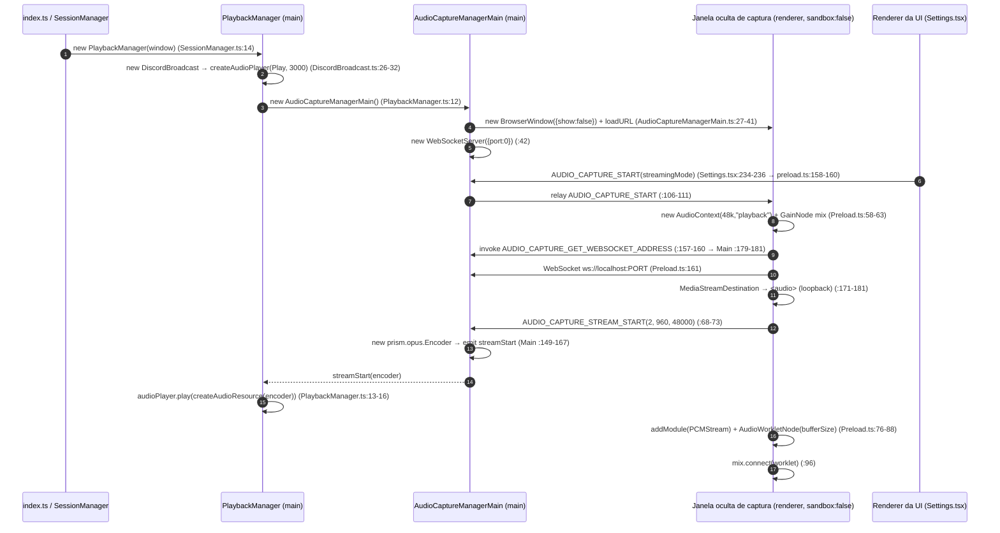
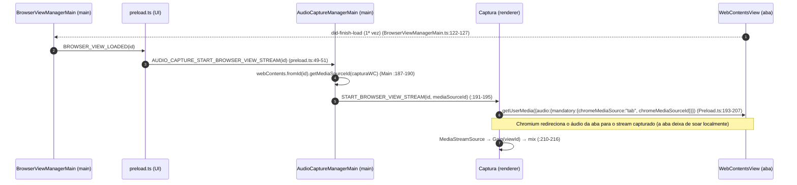
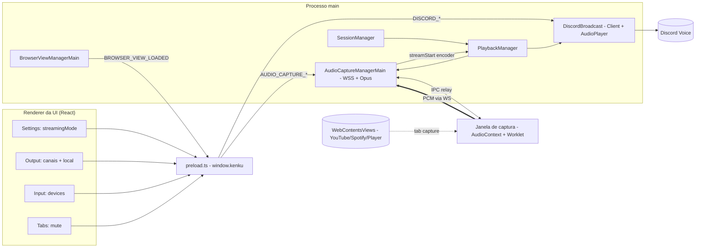

# 06 — Pipeline de áudio: da aba ao canal de voz do Discord

> No capítulo anterior vimos que cada fonte de som do Kenku FM é um `WebContentsView` isolado: uma aba do YouTube, outra do Spotify, o player interno. Fica a pergunta que sustenta o produto inteiro: **como tirar o som de uma aba sem compartilhar a tela, misturá-lo com os demais e fazê-lo chegar, como um bot, ao canal de voz do Discord?**

Este é o capítulo central do relatório. O módulo é pequeno (cerca de 790 linhas em 8 arquivos), mas atravessa **quatro fronteiras de execução**: o processo de cada aba, uma janela oculta de captura, a thread de áudio do Chromium (AudioWorklet) e o processo main do Node. Quase todas as decisões e quase todos os problemas nascem dessas travessias.

---

## 1. Papel no projeto

O Kenku FM se resume a "um navegador cujo som vai para o Discord". O navegador embutido e o player interno **produzem** som. Este módulo é o único caminho pelo qual esse som **sai** do computador. Ele tem três funções:

1. **Captura**: pega o áudio de cada aba (e de dispositivos externos, como microfone ou cabo virtual) sem ajuda do usuário;
2. **Mixagem e controle**: soma tudo num único sinal estéreo, com mudo por aba e escuta local ("This Computer");
3. **Transmissão**: codifica em Opus e entrega a um `AudioPlayer` do `@discordjs/voice`, inscrito em uma ou mais `VoiceConnection`s.

**Sem ele**, o Kenku FM vira um navegador com abas bonitas. O mestre teria de voltar ao fluxo que o produto quer eliminar: compartilhar a tela ou a aba pelo cliente do Discord (áudio com compressão de voz, preso à conta pessoal e a um único canal), ou instalar um cabo de áudio virtual (VB-Cable, BlackHole) e apontar um bot de música para ele.

## 2. O problema resolvido

O problema técnico tem quatro partes, e cada uma elimina alguma solução ingênua:

| Restrição | Por que é difícil |
|---|---|
| O áudio está **dentro de processos renderer do Chromium**, incluindo conteúdo com DRM (Widevine no Spotify) | O Node do main não tem acesso ao áudio de um `webContents`. Não existe "tap" de áudio nativo na API do Electron |
| O Discord exige **Opus 48 kHz, frames de 20 ms**, empacotados em RTP e cifrados (e agora com E2EE/DAVE) | É preciso um encoder e um cliente de voz completo. Só o main (Node) roda `discord.js` |
| **Várias fontes simultâneas** (música + ambiente + efeitos + microfone) | É preciso um mixer com ganho por fonte |
| O mestre **também quer ouvir** o que transmite | Tab capture no Chromium redireciona o áudio da aba (a aba deixa de tocar localmente), então alguém precisa "devolver" o som às caixas |

## 3. A ideia de design

### 3.1 A solução em uma frase

> **Usar o próprio Chromium como placa de som.** Cada aba é capturada com a API interna de *tab capture* (`getUserMedia` com `chromeMediaSource: "tab"` e um `mediaSourceId` emitido pelo main). Os streams entram num `AudioContext` de 48 kHz numa janela invisível, que mistura tudo num `GainNode`. Um `AudioWorklet` converte o mix em PCM 16-bit intercalado, e esse PCM atravessa um WebSocket local até o main, que o codifica em Opus e o entrega ao Discord.

Cada peça reaproveita algo que o Chromium ou o Electron já fornece: captura de aba (Chromium), mixagem e resampling (Web Audio), thread de tempo real (AudioWorklet), escuta local (`<audio>` + `MediaStreamDestination`), entrada de microfone e cabo virtual (`getUserMedia` com `deviceId`). O único código "de áudio" escrito à mão são as ~80 linhas do worklet. É a filosofia do projeto aplicada com rigor: **equipe de 2 pessoas, zero código nativo, o navegador faz o trabalho pesado**. Até o encoder Opus é `opusscript` (WASM/asm.js), e não o addon nativo `@discordjs/opus` (`webpack.main.config.js:14-19`).

### 3.2 Alternativas descartadas (explícita ou implicitamente)

| Alternativa | Por que não serve (ou foi abandonada) |
|---|---|
| **Screen/tab share pelo cliente do Discord** | É o status quo que o produto substitui. O áudio sai com o perfil de voz e fica na conta do usuário, não num bot. Não mistura fontes e não permite mudo por fonte |
| **Cabo de áudio virtual** + bot de música | Exige instalar driver por plataforma e configurar roteamento, o que é inviável para o público (mestres de RPG). Curiosamente, o Kenku **aceita** cabos virtuais como *input externo* (`AudioCaptureManagerPreload.ts:116-144`), ou seja, virou recurso opcional em vez de requisito |
| **Captura no main** (loopback do SO, WASAPI/CoreAudio) | Exigiria addons nativos por plataforma, capturaria o sistema inteiro (notificações, Discord) e não permitiria mudo por aba. No macOS nem existe loopback nativo sem driver. Contraria "zero nativo" |
| **`desktopCapturer` / `getDisplayMedia`** | Voltado a telas e janelas, com áudio de sistema limitado ou inexistente no macOS. `getMediaSourceId` + `chromeMediaSource: "tab"` dá um stream **por webContents**, que é exatamente a granularidade "aba = fonte" |
| **`MediaRecorder`** (WebM/Opus no renderer) | Produz contêiner WebM em blocos de centenas de ms, com latência e timestamps ruins para tempo real. Obrigaria a um demux no main. O worklet dá PCM cru em quanta de 128 amostras |
| **Uma thread/Worker para bufferizar** | Era o desenho descrito no blog dos autores ("buffer em thread"). O `sandbox: false` da janela de captura ainda cita "web worker no preload" (`AudioCaptureManagerMain.ts:30-35`), mas hoje não há nenhum `*.worker.*` em `src/`: o worklet substituiu o worker e o comentário ficou para trás |
| **WebRTC direto do Chromium** (sem Opus no main) | Foi a aposta seguinte dos autores (Disgo em Go, Severus em Rust, branches `experimental/*`). O Discord não fala WebRTC puro com bots, então seria preciso um "tradutor" nativo. Fica fora do main por custo e complexidade |

### 3.3 Padrões usados

- **Par de managers espelhados (Main/Preload)**: `AudioCaptureManagerMain` (processo main) e `AudioCaptureManagerPreload` (janela de captura) são metades de um mesmo objeto, separadas pela fronteira de processo. O main só **repassa** comandos IPC (`_handleStart`, `_handleSetMuted`, …, `AudioCaptureManagerMain.ts:106-147`, sete *relays* de uma linha). Toda a lógica de áudio fica no renderer.
- **Relay/Mediator via main**: o renderer da UI nunca fala direto com a janela de captura. Todo comando passa pelo main, a única entidade que conhece os dois `webContents` e a única que pode emitir `getMediaSourceId` (`AudioCaptureManagerMain.ts:183-196`).
- **Observer (TypedEmitter)**: `AudioCaptureManagerMain` emite `streamStart(stream)`/`streamEnd` (`:10-13`). O `PlaybackManager` apenas "cola" o stream no `AudioPlayer` (`PlaybackManager.ts:13-19`). Captura e Discord não se conhecem.
- **Pipes & Filters**: `MediaStreamSource → Gain(por fonte) → Gain(mix) → Worklet → WS → prism.opus.Encoder (Transform) → AudioResource → AudioPlayer → N×VoiceConnection`.
- **Fan-out por assinatura**: um `AudioPlayer` único e N conexões inscritas (`DiscordBroadcast.ts:26-32,128`). Codifica uma vez e envia para vários servidores.

## 4. Estruturas de dados centrais

**No renderer de captura** (`AudioCaptureManagerPreload.ts:35-51`), o estado é um pequeno grafo Web Audio indexado por fonte:

| Campo | Tipo | Papel |
|---|---|---|
| `_audioContext` | `AudioContext` 48 kHz, `latencyHint: "playback"` | O "mixer" e o relógio do pipeline |
| `_audioOutputNode` | `GainNode` | Barramento de mix: todas as fontes convergem aqui |
| `_mediaStreams[viewId]` / `_mediaStreamOutputs[viewId]` | `MediaStream` / `GainNode` | Uma entrada por aba. O ganho implementa o mudo por aba |
| `_externalAudioStreams[deviceId]` / `…Outputs[deviceId]` | idem | Microfones e cabos virtuais |
| `_audioOutputElement` | `HTMLAudioElement` | Escuta local (loopback) via `MediaStreamDestination` |
| `_ws` | `WebSocket` | Canal PCM até o main |

**No worklet** (`PCMStream.worklet.js:5-17`): um `Int16Array` circular (`buffer`) e um `pointer`. Quando o ponteiro dá a volta, o buffer inteiro é postado (e clonado pelo `postMessage`, o que torna seguro reutilizá-lo).

**Constantes de formato** (`AudioCaptureManagerPreload.ts:6-28`): `SAMPLE_RATE=48000`, `NUM_CHANNELS=2`, 16 bits, `FRAME_DURATION=20ms` → `FRAME_SIZE=960`. Esse `FRAME_SIZE` é o contrato entre as duas metades: vai por IPC no `AUDIO_CAPTURE_STREAM_START` (`:68-73`) e vira o `frameSize` do `prism.opus.Encoder` (`AudioCaptureManagerMain.ts:158-162`). Ele também dimensiona o buffer do worklet (`:84-85`), e é aí que mora uma confusão de unidades (ver §7.3).

**No main**: `_encoder?: prism.opus.Encoder` (um Transform stream que é, ao mesmo tempo, o sink do WS e a fonte do `AudioResource`), `_wss` (servidor WS efêmero) e, no `DiscordBroadcast`, `client?: Client` e o `audioPlayer` (campo inicializado na declaração, vive enquanto a sessão existir). As conexões de voz **não** são guardadas pela classe: ficam no registro global do `@discordjs/voice`, consultado por `getVoiceConnection(guildId)` (`DiscordBroadcast.ts:163`).

## 5. Fluxo principal

### 5.1 Inicialização (uma vez por sessão)



Um detalhe: quem dispara o pipeline é o `useEffect` de montagem do componente **Settings** (`Settings.tsx:234-236`). O modo de streaming é lido uma única vez, e por isso a UI avisa "Restart to apply change" (`Settings.tsx:250-254`). Um recarregamento da janela principal destrói e recria toda a sessão (`index.ts:65-69`), incluindo janela de captura, servidor WS e cliente Discord.

### 5.2 Captura de uma aba (por fonte)



O `mediaSourceId` é emitido **para um `webContents` específico** (o da janela de captura). O token só vale ali, o que evita que outro renderer reutilize a captura. Por isso o main precisa intermediar: a UI não tem como obter esse token. Inputs externos seguem o mesmo esquema, sem o token: `getUserMedia({deviceId})` com `noiseSuppression`, `autoGainControl` e `echoCancellation` **desligados** (`Preload.ts:118-126`), a escolha certa para música e cabos virtuais, já que o pipeline de voz do Chromium destruiria sinal musical.

### 5.3 Caminho quente: cada quantum de 128 amostras

```mermaid
sequenceDiagram
    autonumber
    participant AT as Thread de áudio (PCMStream.worklet)
    participant RT as Thread JS da janela de captura
    participant WS as WebSocket (loopback TCP)
    participant M as Main (Node) — prism Encoder
    participant AP as AudioPlayer (@discordjs/voice)
    participant VC as VoiceConnection(s) (DAVE/UDP)

    loop a cada 128 frames (~2,67 ms)
        AT->>AT: interleave L/R → Float32 → Int16 (worklet :19-28, :51-83)
        AT->>AT: bufferPCM no anel; ao completar a volta: port.postMessage(buffer) (:35-44)
    end
    AT->>RT: MessagePort (clone de Int16Array)
    RT->>WS: ws.send(data) se OPEN (Preload.ts:89-93)
    WS->>M: 'message' → _encoder.write(Buffer) (Main :102-104, :169-171)
    M->>M: Encoder acumula 3840 B (960 amostras × 2 canais × 2 B) → 1 pacote Opus
    loop timer de 20 ms do AudioPlayer
        AP->>M: read() de 1 pacote Opus (StreamType.Opus inferido)
        AP->>VC: dispatch para cada assinatura (cifra por conexão, DAVE)
    end
```

**O detalhe mais engenhoso do módulo** está em `PlaybackManager.ts:14`: `createAudioResource(stream)` recebe o **próprio `prism.opus.Encoder`**. O `@discordjs/voice` infere o tipo do stream por `instanceof` (`inferStreamType`): um `prism.opus.Encoder` é reconhecido como `StreamType.Opus`, então **nenhum transcoder FFmpeg entra na cadeia**. Isso só funciona se as duas partes usarem a mesma instância do módulo `prism-media`. Por isso o `prism-media` é declarado como `externals` no webpack do main (`webpack.main.config.js:16`) e copiado inteiro pelo `forge-externals-plugin` (`forge.config.js:93-96`), e o `yarn.lock` resolve uma única versão (1.3.5). É uma dependência implícita e frágil: um bump que duplique `prism-media` faria o `instanceof` falhar, e o resource cairia em `StreamType.Arbitrary`, exigindo FFmpeg, que o app não empacota.

### 5.4 Controle em tempo de execução

| Ação do usuário | Canal IPC | Efeito no grafo |
|---|---|---|
| Mudo numa aba (`TabItem.tsx:58`) | `AUDIO_CAPTURE_SET_MUTED(viewId, muted)` → `AUDIO_CAPTURE_BROWSER_VIEW_MUTED` | `gain.value = 0/1` no `GainNode` da aba (`Preload.ts:99-106`). O comentário explica por que não se usa `webContents.setAudioMuted()`: o som que sai é o **capturado**, não o que a aba tocaria |
| Selecionar/deselecionar "This Computer" (`OutputListItems.tsx:59-68,104-113`) | `AUDIO_CAPTURE_SET_LOOPBACK(bool)` | `<audio>.muted = !loopback` (`Preload.ts:112-114`). Como o loopback sai **depois** do mix, o mudo por aba vale para as duas saídas |
| Ligar microfone/cabo virtual (`InputListItems.tsx:56-76`) | `…START/STOP_EXTERNAL_AUDIO_CAPTURE(deviceId)` | Nova fonte `MediaStreamSource → Gain → mix` |
| Fechar aba (`preload.ts:84-87`) | `AUDIO_CAPTURE_STOP_BROWSER_VIEW_STREAM` | `track.stop()` nos tracks da aba (`Preload.ts:227-234`) |
| Entrar/sair de canal (`OutputListItems.tsx:62,89-92,108,115`) | `DISCORD_JOIN_CHANNEL` / `DISCORD_LEAVE_CHANNEL` | `joinVoiceChannel` + `connection.subscribe(audioPlayer)` / `connection.destroy()` (`DiscordBroadcast.ts:115-167`) |

## 6. Colaboração com outros módulos



- **BrowserViewManager → captura.** A ligação é **indireta e passa pela UI**. O main emite `BROWSER_VIEW_LOADED` para o renderer da UI (`BrowserViewManagerMain.ts:122-127`), e o *preload* da UI devolve imediatamente `AUDIO_CAPTURE_START_BROWSER_VIEW_STREAM` ao main (`preload.ts:48-51`). São duas travessias de IPC para ligar dois objetos que moram no mesmo processo. O acoplamento baixo tem um preço: se a UI recarregar entre os dois eventos, a aba não é capturada. [a verificar pelo agente principal: se o `BrowserViewManagerMain` poderia chamar o `AudioCaptureManagerMain` diretamente dentro do `SessionManager`]
- **Captura só na primeira carga.** O flag `loaded` (`BrowserViewManagerMain.ts:121-127`) garante uma única captura por view. Navegar dentro da aba não recria a captura, e isso está certo: o tab capture segue o `webContents`, não o documento.
- **Player interno.** Não tem caminho especial. É um `WebContentsView` como os outros, então é capturado pelo mesmo `BROWSER_VIEW_LOADED`. [a verificar pelo agente principal, no capítulo do Player]
- **Fechar todas as abas.** `removeAllBrowserViews` envia `AUDIO_CAPTURE_STOP_ALL_BROWSER_VIEW_STREAMS` (`preload.ts:88-91`), mas **nenhum `ipcMain.on` escuta esse canal**: o grep em `src/` só encontra o emissor. As capturas não são paradas explicitamente. Na prática, o `webContents` destruído encerra o track, mas o grafo fica com nós órfãos (§10).
- **SessionManager.** O pipeline inteiro vive dentro de `PlaybackManager` (`SessionManager.ts:14`), que é destruído e recriado a cada `did-start-loading` da janela principal (`index.ts:65-69`). É um "reset por recarga" simples e robusto, mas desconecta o bot do Discord a cada F5.
- **Renderer de output.** A UI é a dona do estado "em quais canais estou" (`outputSlice`, não persistido: `store.ts` só persiste `bookmarks` e `settings`). O main apenas responde com `DISCORD_CHANNEL_JOINED/LEFT`. A regra "um canal por guild" é imposta **na UI** (`OutputListItems.tsx:70-90`), não no main. Como `outputs` começa em `["local"]` (`outputSlice.ts:22`) e o `<audio>` nasce não-mudo, estado e grafo começam coerentes sem precisar de sincronização.

## 7. Decisões-chave e trade-offs

### 7.1 Por que uma janela oculta separada (e não o renderer da UI nem o main)?

- **Não no main**: o main não tem Web Audio nem `getUserMedia`. Levar tab capture para o Node exigiria código nativo.
- **Não na janela da UI**: o comentário em `src/audioCapture/renderer.ts:1-7` diz que a janela foi *"criada como uma view separada para rodar na sua própria thread, livre de atualizações de UI"*. O caminho quente passa pela **thread JS do renderer** (o `port.onmessage` que chama `ws.send`, `Preload.ts:89-93`). Se fosse a thread do React, um re-render pesado atrasaria o envio de PCM. Uma janela invisível ganha contexto de renderer próprio e isola o áudio do jank da UI.
- **Bônus e dívida**: é o único `webContents` com `sandbox: false` (`AudioCaptureManagerMain.ts:30-35`). A justificativa do comentário, um web worker no preload, **não vale mais**: não há `*.worker.*` em `src/`, só o worklet, carregado via `worklet-loader` inline (`webpack.renderer.config.js:9-12`). O risco é baixo porque a janela carrega só conteúdo local, mas é uma superfície que poderia ser fechada.
- **Trade-off**: um processo renderer a mais (dezenas de MB) e uma camada de IPC relay. Para uma equipe de dois, é isolamento barato, pago em memória.

### 7.2 Por que WebSocket em vez de IPC ou MessagePort?

O código não justifica a escolha. As razões plausíveis:
- **Dados binários chegam como `Buffer` no Node**, prontos para `encoder.write()`. Com `ipcRenderer.send`, o `Int16Array` passaria pelo *structured clone* do IPC do Electron a cada 10 ms, com desserialização no event loop do main.
- **Herança histórica**: o desenho original do blog ("buffer em thread → WebSocket") é anterior à popularização do `MessageChannelMain` do Electron.
- **Custo**: o PCM viaja **worklet → (clone) → thread JS → (framing WS + TCP loopback) → main**. São duas cópias e uma pilha TCP para ~188 KB/s (48000 × 2 × 2 B). A CPU é irrelevante nessa taxa, mas cada hop acrescenta *jitter*. Um `MessagePortMain` eliminaria o TCP; um port transferido ao worklet eliminaria também o salto pela thread JS.
- **Efeito colateral de segurança**: `new WebSocketServer({ port: 0 })` sem `host` (`AudioCaptureManagerMain.ts:42`) escuta **em todas as interfaces**, sem autenticação e sem checagem de origem (§10).

### 7.3 Buffer, frames e os modos `lowLatency` vs `performance`

**48 kHz estéreo** é o formato nativo do Opus e do Discord. O `AudioContext` já nasce a 48 kHz (`Preload.ts:58-62`), então o Chromium faz o resampling de cada fonte (44,1 kHz do YouTube, por exemplo) de graça, e o main não precisa reamostrar nada.

A conta tem uma **confusão de unidades** que merece destaque:

| Grandeza | O comentário diz | O que o código faz |
|---|---|---|
| `FRAME_SIZE` | "tamanho em **bytes** de cada frame", `48000·0,02·2/2 = 960` (`Preload.ts:18-28`) | 960 é o número de **amostras por canal** de um frame Opus de 20 ms, o valor correto para o `frameSize` do prism. O `·2/2` (canais ÷ bytes por amostra) se cancela por coincidência. Em bytes, um frame tem 3840 |
| Buffer `lowLatency` = `FRAME_SIZE` | "20 ms" (`:83`) | `Int16Array(960)` **intercalado** = 480 amostras estéreo = **10 ms**, com 100 mensagens/s |
| Buffer `performance` = `FRAME_SIZE × 50` | "1 segundo" (`:82`) | 48 000 int16 = 24 000 amostras estéreo = **500 ms**, com 2 mensagens/s |

Nada quebra, porque o `prism.opus.Encoder` acumula bytes até completar 3840 e só então emite um pacote. Mas o modo "performance" é, na prática, um **jitter buffer de 0,5 s na origem**: o main recebe rajadas de 25 pacotes a cada meio segundo, e o `AudioPlayer` os consome a 1 pacote a cada 20 ms. O modo absorve travadas do renderer (GC, CPU ocupada) e custa ~0,5 s de latência. Ele é o **default** (`settingsSlice.ts:27`; migração v1.1 em `store.ts:49-57`), o que revela a experiência dos autores: para música ambiente, estabilidade vale mais que latência. Para um efeito sonoro disparado no momento certo, meio segundo incomoda.

**Não há compensação de deriva de relógio.** O produtor segue o relógio da placa de som (`AudioContext`), e o consumidor segue o timer de 20 ms do `AudioPlayer`. Se o produtor for mais rápido, o buffer interno do Transform cresce sem limite (`_handleStreamData` ignora o retorno de `write()`, `AudioCaptureManagerMain.ts:169-171`), e **a latência aumenta ao longo de uma sessão longa**. Se for mais lento, surgem *missed frames* e micro-cortes. Isso bate com as queixas de latência do blog.

### 7.4 `NoSubscriberBehavior.Play` e `maxMissedFrames = 3000`

- **`Play`** (`DiscordBroadcast.ts:28`): o player continua consumindo pacotes **mesmo sem nenhuma conexão inscrita**. Neste desenho, isso é essencial. Com `Pause`, o encoder acumularia áudio enquanto o bot não está em canal, e ao entrar o canal receberia minutos de áudio atrasado. Com `Play`, os pacotes são descartados em tempo real e o stream fica sempre "ao vivo".
- **`maxMissedFrames: 3000`** (`:29-30`) equivale a 60 s. O default da biblioteca é 5 (100 ms). O `AudioPlayer` vai a `Idle` quando o recurso fica sem dados por esse número de frames. Como o `streamStart` é emitido **uma vez por sessão** e **ninguém recria o recurso** depois de `Idle` (`PlaybackManager.ts:13-19`), o valor alto é a rede de segurança que impede o pipeline de morrer por um soluço do renderer. O modo `performance`, com rajadas de 500 ms, estouraria o default de 100 ms o tempo todo. Mesmo assim, mais de 60 s sem dados ainda mata a transmissão até reiniciar (§10).

### 7.5 Um único `AudioPlayer` para várias guilds

O `audioPlayer` é único (`DiscordBroadcast.ts:26`), e cada `joinVoiceChannel` faz `connection.subscribe(this.audioPlayer)` (`:128`). O `@discordjs/voice` mantém **uma `VoiceConnection` por guild** (chave `guildId`), e o player envia o mesmo pacote Opus a todas as assinaturas, cifrando por conexão (DAVE/E2EE via `@snazzah/davey`, transparente aqui). Então o **"multiple outputs" do README funciona assim**: várias guilds ao mesmo tempo, mais a saída local, com **um canal por guild**. Um segundo `joinVoiceChannel` na mesma guild **move** a conexão existente, e por isso a UI sai do canal anterior antes (`OutputListItems.tsx:86-90`). O custo de encode não cresce com o número de destinos, mas **todos os destinos ouvem o mesmo mix**: não dá para mandar música para a guild A e efeitos para a B.

## 8. Insights

### 8.1 O custo real das alternativas

| Abordagem | Custo de engenharia | Latência típica (estimativa) | Observação |
|---|---|---|---|
| **Kenku (tab capture + WS + opusscript)** | Baixo: ~800 linhas, zero nativo, 3 SOs | dezenas de ms (`lowLatency`); ≥ 0,5 s (`performance`), mais a deriva | CPU concentrada no opusscript (WASM) e nas alocações por quantum no worklet |
| Screen share do Discord | Zero | ~100–200 ms | Conta pessoal, perfil de voz, 1 canal, sem mix por fonte |
| Cabo virtual + bot de música | Alto para o usuário | Baixa | Driver por SO; sem "aba = fonte" |
| OBS (captura por app + mixer nativo) | Muito alto (C/C++, anos) | Muito baixa | Relógio único e resampler com compensação de deriva, exatamente o que falta aqui |
| Bots Lavalink | Médio (servidor Java) | Baixa | Decodificam arquivos ou URLs no servidor; não tocam conteúdo com DRM nem "o que está numa aba" |
| WebRTC (Disgo/Severus) | Alto (Go/Rust + ponte para o protocolo do Discord) | Muito baixa | Jitter buffer e pacing do libwebrtc; foi a direção de pesquisa dos autores |

O ponto forte do Kenku está na primeira linha: **é a única opção que captura conteúdo com DRM, por aba, sem driver e em três sistemas operacionais**, com uma fração do código das outras. O preço é a qualidade temporal (latência e deriva), justamente onde os autores foram investigar.

### 8.2 Se eu redesenhasse (mantendo a filosofia)

1. **Encode no renderer com WebCodecs `AudioEncoder`** (Opus, 48 kHz, 20 ms, disponível no Chromium do Electron 37): o grafo entrega `AudioData` ao encoder nativo do Chromium, e o main recebe **pacotes Opus prontos**, cerca de 20× menos bytes que PCM. Remove o `opusscript` (a parte mais cara em CPU) e continua no espírito de "reuso do Chromium". Os pacotes seriam entregues ao `AudioPlayer` como um `Readable` em modo objeto com `inputType: StreamType.Opus`.
2. **`MessagePortMain` em vez de WebSocket**: elimina TCP, a porta exposta e o risco de injeção. Se continuar em PCM, um **ring buffer em `SharedArrayBuffer`** entre worklet e thread JS evita alocação e clone por mensagem (o padrão recomendado para worklets).
3. **Jitter buffer adaptativo no main**: medir a ocupação do buffer e descartar ou duplicar frames para mantê-la num alvo (por exemplo, 60 ms). Substitui "performance = 500 ms fixos" e resolve a deriva.
4. **Recursos resilientes**: escutar `AudioPlayerStatus.Idle` para recriar o `AudioResource`, e tratar `VoiceConnectionStatus.Disconnected` com `entersState(…, Signalling/Connecting, 5s)` antes de destruir (padrão da documentação do discord.js).
5. **Captura ligada no main**: `BrowserViewManagerMain` notifica o `AudioCaptureManagerMain` diretamente (mesmo processo), sem o pingue-pongue pela UI.

### 8.3 Como as fronteiras de processo do Electron desenharam o módulo

O diagrama do pipeline é quase um mapa das fronteiras do Electron. **Cada capacidade mora num lugar só**: tab capture e Web Audio no renderer, Node e `discord.js` no main, tempo real na thread do worklet, e a autoridade sobre `webContents` (o `getMediaSourceId`) no main. O desenho é a menor cadeia que liga essas ilhas. O `AudioCaptureManagerMain` quase não tem lógica (sete relays de uma linha) porque seu papel é **ser a ponte**, não o mixer. A fronteira também explica os problemas: tudo o que dá errado (corridas de inicialização, deriva, WS exposto, mensagens de erro perdidas) acontece **nas junções**, nunca dentro de uma ilha.

## 9. Pontos de extensão

| Onde | Como estender | Observação |
|---|---|---|
| **Nova fonte de som** | Criar um `WebContentsView`. O `BROWSER_VIEW_LOADED` já o captura | É o ponto de extensão "grátis" da filosofia "aba = fonte". O player interno usa exatamente isso |
| **Novo tipo de input** | Qualquer `deviceId` de `enumerateDevices` passa por `startExternalAudioCapture` | Cabos virtuais viram fontes sem código novo |
| **Processamento no mix** (compressor, EQ, limiter) | Inserir nós Web Audio entre `_audioOutputNode` e o worklet (`Preload.ts:96`) | Um `DynamicsCompressorNode` antes do worklet evitaria o *clipping* que hoje é só "clamp" (`worklet:55`) |
| **Volume por fonte** | `_mediaStreamOutputs[id].gain` já existe, e hoje só recebe 0/1 | Expor um slider seria trivial: um novo canal IPC que repassa o valor |
| **Novo destino** (outro serviço de voz, gravação em arquivo) | Assinar o evento `streamStart` do `AudioCaptureManagerMain` | O emitter entrega um stream Opus. Um segundo consumidor precisaria de *tee* (o Readable não é multicast) |
| **Destinos com mix diferentes** | Exigiria N `AudioPlayer`s e N grafos/worklets | Fora do desenho atual (§7.5) |

## 10. Destaques e problemas reais

### 10.1 Destaques

- **Tab capture via `getMediaSourceId` + `chromeMediaSource: "tab"`** (`Main:187-190`, `Preload.ts:193-207`): captura por aba, com DRM, sem diálogo de compartilhamento e sem driver. É o "truque" que viabiliza o produto.
- **`createAudioResource(encoder)`** usando a inferência por `instanceof` para pular o FFmpeg (`PlaybackManager.ts:14`), com `prism-media` externalizado para garantir módulo único (`webpack.main.config.js:16`).
- **`NoSubscriberBehavior.Play`** mantém o stream sempre "ao vivo" (§7.4).
- **Mudo pelo grafo, não pelo `webContents`** (`Preload.ts:100-104`): um comentário curto que mostra que os autores entendem o fluxo real do som.
- **Constraints de voz desligadas** nos inputs externos (`Preload.ts:121-123`): detalhe fácil de esquecer e decisivo para música.

### 10.2 Problemas concretos (por gravidade)

| # | Gravidade | Onde | Problema | Consequência / correção |
|---|---|---|---|---|
| 1 | **Alta (segurança)** | `AudioCaptureManagerMain.ts:42, 102-104, 169-171` | `new WebSocketServer({ port: 0 })` sem `host` escuta em **todas as interfaces** (IPv4/IPv6). Não há token, checagem de `Origin` nem limite de conexões, e **toda** mensagem de **qualquer** conexão vai para `encoder.write()` | Qualquer processo local, qualquer máquina da LAN (se o firewall permitir; o Windows vai perguntar) ou uma página web que descubra a porta pode **injetar áudio no canal do Discord** ou corromper o stream (bytes ímpares desalinham o PCM). O `maxPayload` padrão do `ws` (100 MiB) permite estourar memória. **Correção**: `host: "127.0.0.1"`, um token aleatório na URL entregue por `AUDIO_CAPTURE_GET_WEBSOCKET_ADDRESS`, aceitar uma única conexão e checar `Origin`. Ou trocar por `MessagePortMain` |
| 2 | Média | `DiscordBroadcast.ts:107-113` | `_handleDisconnect` chama `this.client.destroy()` sem checar `undefined` (clicar "Disconnect" depois de uma falha de login, por exemplo) | `TypeError` numa função `async` → *unhandled rejection*. As respostas IPC já saíram antes, então a UI fica coerente. O bug é "silencioso", mas polui logs e pode derrubar o processo se a política do Node para rejeições mudar. **Correção**: `this.client?.destroy()` |
| 3 | Média | `DiscordBroadcast.ts:157-167` | `_handleLeaveChannel`: (a) não checa `client`; (b) só trata `ChannelType.GuildVoice`, então **canais Stage** (aceitos no join por `isVoiceBased()`, `:121`) nunca são deixados e o bot fica no palco; (c) `getVoiceConnection()` pode ser `undefined` (por exemplo, se o handler de erro `:130-133` já destruiu a conexão) → `connection.destroy()` lança; (d) `channels.fetch` pode rejeitar | Bot "preso" em Stage; rejeições não tratadas; `DISCORD_CHANNEL_LEFT` não é enviado (a UI já removeu o canal localmente, então o dano visual é pequeno). **Correção**: usar `channel.isVoiceBased()` e `getVoiceConnection(guildId)?.destroy()` |
| 4 | Média | `DiscordBroadcast.ts:119-154` | Em `_handleJoinChannel`, se o canal existe mas **não é `joinable`** (sem permissão ou cheio), **nenhuma resposta** é enviada: falta um `else` em `:121`. A mensagem "canal cheio ou sem permissão" aparece no ramo **`client` ausente** (`:148-153`), onde o motivo real é "bot desconectado". `channels.fetch` (`:120`) fica fora do `try` | A UI marca o canal como selecionado (`OutputListItems.tsx:66/112`) e o bot nunca entra. O usuário não recebe feedback, e a mensagem de erro existente aparece no caso errado |
| 5 | Média | `DiscordBroadcast.ts:123-138` | Um `connection.on("error")` novo a cada join. `joinVoiceChannel` na mesma guild **devolve a conexão existente**, então os listeners acumulam, e cada um guarda o `channelId` antigo. Não há tratamento de `VoiceConnectionStatus.Disconnected` (queda de rede, bot movido ou kickado) | Em caso de erro, vários `DISCORD_CHANNEL_LEFT` com IDs antigos. Depois de uma queda, a conexão pode ficar em `Disconnected` com a UI mostrando "conectado". Sem reconexão ativa |
| 6 | Média | `PlaybackManager.ts:13-19` + `DiscordBroadcast.ts:29-30` | O `AudioResource` é criado **uma vez** (no `streamStart`). Se o player entrar em `Idle` (mais de 3000 missed frames = 60 s sem dados, ou um erro do recurso que dispara `_handleBroadcastError`), **nada o recria** | A transmissão morre em silêncio até o usuário recarregar a janela. Cenário plausível: renderer de captura travado ou throttled por mais de 60 s, ou nenhum sinal estéreo chegando ao worklet (ver #9). **Correção**: em `AudioPlayerStatus.Idle`, recriar o recurso com um encoder novo |
| 7 | Média | `AudioCaptureManagerMain.ts:169-171` | `_encoder.write()` ignora o *backpressure* e não há controle de deriva (§7.3) | A latência cresce ao longo de sessões longas; a memória cresce se o consumidor atrasar |
| 8 | Média | `AudioCaptureManagerMain.ts:106-111` + `Settings.tsx:234-236`; `Preload.ts:113, 210` | **Corridas de inicialização sem handshake**: (a) `AUDIO_CAPTURE_START` é repassado à janela de captura sem esperar o `did-finish-load` dela. Se o preload ainda não registrou o listener, a mensagem se perde e **não há áudio na sessão**; (b) uma aba que carrega antes do `start()` cai em `this._audioContext.createGain()` com `undefined`, o erro é engolido pelo `catch` e **a aba nunca é capturada**; (c) `setLoopback` antes do `start()` → `TypeError` em `_audioOutputElement.muted` | Falhas intermitentes e difíceis de reproduzir. A ordem normal (janela de captura criada antes do React montar) costuma vencer a corrida, mas nada a garante. [a verificar pelo agente principal: ordem real de criação em `index.ts:56-63`] **Correção**: enfileirar comandos no preload até `start()` resolver, e o main aguardar `did-finish-load` da janela de captura |
| 9 | Baixa/Média | `PCMStream.worklet.js:22` | O `process()` só trata entrada com **exatamente 2 canais**. Se o barramento de mix estiver mono (só um microfone mono, ou nenhuma fonte ativa, caso em que o Web Audio entrega 1 canal de silêncio), **nenhum PCM é enviado** | Sem dados, o player acumula missed frames e, depois de 60 s, cai no #6. **Correção**: fixar `channelCount: 2, channelCountMode: "explicit"` no `AudioWorkletNode` para forçar o upmix. Hipótese sobre o comportamento de canais do Chromium, a validar empiricamente |
| 10 | Baixa | `PCMStream.worklet.js:52, 71` | `new Float32Array` e `new Int16Array` **a cada quantum** (375×2 alocações/s) na thread de tempo real | Pressão de GC na thread de áudio, com risco de *glitches* sob carga. É uma das fontes de "CPU alto" do blog. **Correção**: pré-alocar e converter direto para o anel |
| 11 | Baixa | `Preload.ts:227-234`, `146-155`; `preload.ts:88-91` | `stopBrowserViewStream` para os tracks mas **não desconecta nem remove** o `GainNode` (`_mediaStreamOutputs` cresce). `stopExternalAudioCapture` remove a referência sem `disconnect()`. `AUDIO_CAPTURE_STOP_ALL_BROWSER_VIEW_STREAMS` **não tem handler** no main | Vazamento lento de nós de áudio numa sessão com muitas abas abertas e fechadas |
| 12 | Baixa | `Preload.ts:162-168` | No `close` do WS, `ipcRenderer.emit("ERROR", …)` dispara um evento **local** no `ipcRenderer` da própria janela de captura, onde ninguém escuta. Não há reconexão | Se o WS cair, o usuário não vê erro nenhum e o áudio para até a recarga |
| 13 | Baixa | `AudioCaptureManagerMain.ts:187-190` | `webContents.fromId(viewId)` pode ser `undefined` (aba fechada entre o `LOADED` e o relay) → `TypeError` num handler síncrono do main | Exceção não tratada no processo main. **Correção**: `?.` e um retorno antecipado |
| 14 | Baixa | `DiscordBroadcast.ts:42-49, 66-99` | O `destroy()` não faz `audioPlayer.stop()` nem destrói as `VoiceConnection`s explicitamente. O `client.on("error")` responde "desconectado" mas mantém o `client`. O `ClientReady` assíncrono não tem `catch` (uma falha no `guilds.fetch` deixa a UI sem lista de servidores) | Estados inconsistentes em cenários de erro |
| 15 | Baixa | `AudioCaptureManagerMain.ts:30-35` | `sandbox: false` justificado por um worker que não existe mais | Superfície de ataque desnecessária (baixa, porque o conteúdo é local) |
| 16 | Cosmético | `Preload.ts:18-28, 82-83` | Comentários de unidade errados (bytes vs amostras; 20 ms vs 10 ms; 1 s vs 500 ms) | Engana quem for ajustar latência, justamente o parâmetro mais sensível do sistema (§7.3) |

### 10.3 Leitura geral

O módulo é um exemplo de **pragmatismo bem-sucedido**: com cerca de 800 linhas e nenhum código nativo, entrega algo que produtos maiores não entregam (captura por aba com DRM, mixagem e multi-guild). As fragilidades se concentram em dois lugares: **tempo** (buffer fixo, deriva, falta de backpressure, recurso que não se recria) e **junções** (corridas de IPC, WS exposto, respostas IPC ausentes no `DiscordBroadcast`). Nenhuma exige reescrita. A maioria se resolve com uma linha (`?.`, `host`, `else`), e as de tempo são exatamente o que levou os autores a prototipar WebRTC em Go e Rust.

---

> O som agora chega ao Discord, a uma ou várias guilds, e às caixas do mestre. Mas YouTube e Spotify não bastam para uma mesa de RPG: o mestre precisa das **suas** músicas e de efeitos disparados na hora certa. É aí que entra o **player interno**, que, fiel à filosofia do projeto, é apenas mais uma "aba" capturada por este mesmo pipeline.

---

## Apêndice — Cobertura de leitura

| Arquivo | Linhas totais | Linhas lidas | Cobertura % | Motivo não lido |
|---|---|---|---|---|
| src/main/managers/AudioCaptureManagerMain.ts | 204 | 204 | 100% | — |
| src/main/managers/PlaybackManager.ts | 26 | 26 | 100% | — |
| src/main/broadcast/DiscordBroadcast.ts | 173 | 173 | 100% | — |
| src/preload/managers/AudioCaptureManagerPreload.ts | 235 | 235 | 100% | — |
| src/preload/managers/PCMStream.worklet.js | 86 | 86 | 100% | — |
| src/audioCapture/index.html | 10 | 10 | 100% | — |
| src/audioCapture/preload.ts | 51 | 51 | 100% | — |
| src/audioCapture/renderer.ts | 7 | 7 | 100% | — |
| src/preload.ts | 183 | 183 | 100% | — (arquivo lido inteiro; trechos de áudio: 48-51, 84-91, 146-160) |
| **Total** | **975** | **975** | **100%** | ✅ (meta 90%) |

*Leitura complementar (não conta na cobertura; usada só para rastrear gatilhos IPC e configuração): trechos de `Settings.tsx` (220-265), `OutputListItems.tsx` (35-120), `ActionDrawer.tsx` (30-90), `BrowserViewManagerMain.ts` (110-135), `SessionManager.ts`, `index.ts` (55-80), `store.ts` (40-75), `webpack.main.config.js`, `webpack.renderer.config.js` (regras de worklet), `forge.config.js` (externals), `yarn.lock` (prism-media, @discordjs/voice), além de um grep dos canais IPC em `src/renderer/features/{input,output,settings,tabs}`.*
