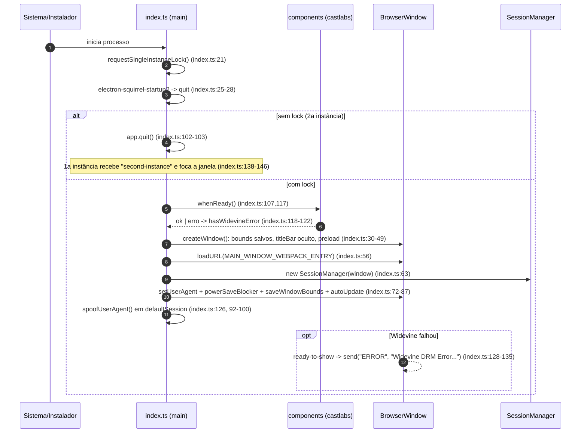
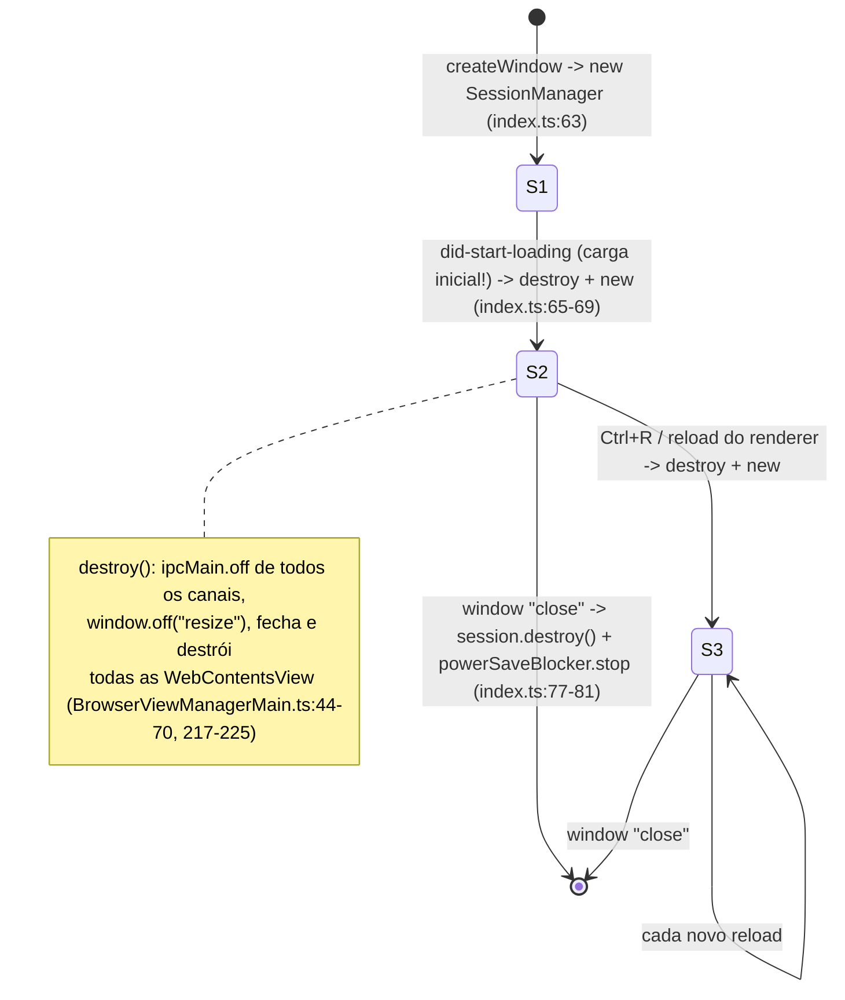
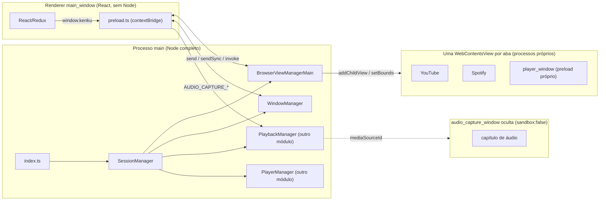

# Capítulo 6 — Shell Electron e navegador embutido (as fontes de som)

> O panorama mostrou o Kenku FM como uma "mesa de som" que leva áudio do desktop do mestre até um canal de voz do Discord. Este primeiro capítulo técnico abre a caixa por fora: antes de existir mixagem ou bot, o app precisa **ser um navegador**, e cada aba desse navegador é, por construção, uma fonte de som isolada.

---

## 1. Papel no projeto

O módulo é a **casca** (shell) da aplicação: o processo main do Electron, a janela principal, o preload que serve de ponte e o gerenciador de "abas" (views nativas que carregam YouTube, Spotify, Tabletop Audio ou o player interno). Ele cuida de:

- **Boot**: trava de instância única, espera o componente Widevine (DRM) da build castlabs, cria a janela e registra o spoof de user agent (`src/index.ts:21`, `:102-136`).
- **Ciclo de vida da sessão**: um `SessionManager` que agrega os managers do main e é destruído/recriado a cada recarga do renderer (`src/index.ts:63-69`, `src/main/managers/SessionManager.ts:13-25`).
- **Abas como views nativas**: criação, exibição, ocultação, posicionamento e navegação de `WebContentsView`s (`src/main/managers/BrowserViewManagerMain.ts`).
- **Ponte segura para a UI React**: `window.kenku`, exposto via `contextBridge` (`src/preload.ts:53-183`).
- **Cromo de janela**: barra de título escondida com botões próprios (`WindowManager.ts`), menu nativo com atalhos Ctrl/Cmd+T/W (`src/menu.ts:66-90`), persistência de posição/tamanho (`src/bounds.ts`) e auto-update (`src/autoUpdate.ts`).
- **Empacotamento**: Electron Forge + webpack com três entrypoints de renderer (`forge.config.js:62-87`) e pipeline de release multiplataforma (`.github/workflows/publish-stable.yaml`).

Nada aqui processa áudio. Mas é aqui que nasce o **identificador** de cada fonte (o `webContents.id` da aba), que todo o resto do sistema usa como chave.

## 2. Problema resolvido

O mestre de RPG quer tocar "a playlist épica do Spotify" e "o ambiente de taverna do YouTube" para jogadores no Discord. As alternativas óbvias são ruins:

- **Compartilhar tela/áudio do sistema** no Discord mistura notificações, voz do próprio mestre e qualquer outro som da máquina; e exige o cliente oficial do Discord transmitindo.
- **Bots de música** do Discord dependem de APIs (YouTube, Spotify) que proíbem ou quebram esse uso, e não tocam conteúdo com DRM.

A solução do Kenku FM: **trazer os sites para dentro do app**. Se o conteúdo roda num `webContents` controlado pelo processo main, o Chromium sabe exatamente qual áudio pertence a qual página, e o app pode capturá-lo isoladamente. O problema técnico deste módulo é então: *como construir um navegador mínimo, com DRM funcionando e logins funcionando, cuja unidade de composição seja "uma aba = uma fonte"*.

## 3. Ideia de design e alternativas descartadas

**Ideia central:** a janela principal é uma UI React "vazia" que desenha barra de abas, barra de URL e sidebars; o conteúdo web de verdade é uma pilha de `WebContentsView`s nativas sobrepostas à janela, posicionadas pelo main a partir de coordenadas que o renderer mede e envia. É o mesmo padrão de "chrome desenhado em HTML + área de conteúdo nativa" que Brave/Min/Wexond (navegadores Electron) e apps como Slack/Discord desktop usam para conteúdo de terceiros.

| Alternativa | Por que não serve (ou foi abandonada) |
|---|---|
| **`<iframe>`** no renderer React | YouTube/Spotify/Google bloqueiam via `X-Frame-Options`/CSP; o áudio do iframe sai misturado ao da própria UI (mesmo `webContents`), impossível isolar por fonte; conteúdo de terceiros compartilharia processo e privilégios com a UI. |
| **Tag `<webview>`** | Oficialmente desencorajada pela equipe Electron (arquitetura frágil, baseada em OOPIF, desabilitada por padrão desde o Electron 5). Funcionaria para isolar áudio, mas o time trocou por views controladas pelo main. |
| **`BrowserView`** | Foi o caminho histórico (o nome das classes e dos canais — `BrowserViewManager*`, `BROWSER_VIEW_*` — denuncia isso), mas foi depreciada no Electron 30. O código atual já usa **`WebContentsView`** + `window.contentView.addChildView` (`BrowserViewManagerMain.ts:1`, `:176-181`), mantendo os nomes antigos por inércia. |
| **`WebContentsView`** (escolhida) | API atual, cada aba tem seu próprio `webContents` (processo renderer próprio, sessão comum), com `getMediaSourceId` para captura por aba e eventos de mídia (`media-started-playing`). |
| **Abrir navegador externo** | Perderia o controle do áudio (voltaria ao problema de capturar o som do sistema). O app só usa `shell.openExternal` para links que saem da própria UI (`src/index.ts:58-61`) e para "Learn More" (`src/menu.ts:114`). |

A filosofia "pragmatismo de equipe pequena + reuso máximo do Chromium" aparece em cada decisão: nada de motor de renderização próprio, nada de SDKs de streaming; o app **é** o Chromium, com um pouco de cola.

## 4. Estruturas de dados centrais

O módulo é pobre em tipos — e isso é deliberado; o estado rico (abas, bookmarks, configurações) vive no Redux do renderer. No main há apenas:

- **`BrowserViewManagerMain.views: Record<number, WebContentsView>`** (`BrowserViewManagerMain.ts:11`) — o registro de abas vivas. A **chave é `view.webContents.id`** (`:199`, `:202`), um inteiro global do Electron. Esse mesmo número é o `id` da aba no Redux, o `viewId` da captura de áudio e o `viewId` registrado pelo player remoto (`preload.ts:137-139`). É a "chave estrangeira" que costura o sistema inteiro.
- **`topView: WebContentsView`** (`:12`) — a aba visível no topo; usada só pelo `_resizeListener` (`:72-85`) para esticar a view quando a janela muda de tamanho. É zerada em `hide`/`remove` (`:207-209`, `:229-231`) e reatribuída em `show`/`create` (`:200`, `:239`).
- **`SessionManager`** (`SessionManager.ts:7-11`) — um agregado de quatro managers (`PlaybackManager`, `BrowserViewManagerMain`, `WindowManager`, `PlayerManager`) com construtor/`destroy()` simétricos. Não guarda estado próprio.
- **Tipo `Channel` + `validChannels`** (`preload.ts:7-46`) — lista branca de 18 canais que o renderer pode **escutar**. Os canais que o renderer **envia** não têm lista: estão fixados em cada função do objeto `api`.
- **`api` / `window.kenku`** (`preload.ts:53-175`, `:177-183`) — a superfície pública do main para a UI; o tipo é inferido (`typeof api`) e aumentado em `Window`, o que dá tipagem ao renderer de graça.
- **Store de bounds** (`bounds.ts:5-8`) — `electron-store` com `{ bounds: Rectangle, maximized: boolean }`.
- **User agents** (`userAgent.ts:3-20`) — mapa plataforma→fragmento de UA e versão do Chrome fixada em `138.0.7204.251` (`:9`).

## 5. Fluxos principais

### 5.1 Boot do app: instância única, Widevine e janela



Pontos finos:
- A linha `const widevine = components` (`index.ts:107`) é um *workaround* documentado para o webpack não eliminar/reescrever o módulo `components` da build castlabs (issue castlabs/electron-releases#116).
- A falha de Widevine **não impede** o app de abrir — ela só degrada (sem Spotify/Netflix-like DRM) e avisa o usuário. Pragmatismo: o player interno e o YouTube (sem DRM na maioria dos vídeos) continuam funcionando.
- A janela nasce com `width: 800, height: 600` mas é sobrescrita por `...bounds` salvos (`index.ts:37-49`); `getSavedBounds` só reaproveita posição se a janela couber inteira no display atual (`bounds.ts:21-31`).

### 5.2 Criação e posicionamento de uma aba (bounds vindos do renderer)

```mermaid
sequenceDiagram
    autonumber
    participant UI as React (Tabs/AddTabButton)
    participant Pre as preload.ts / BrowserViewManagerPreload
    participant BVM as BrowserViewManagerMain (main)
    participant V as WebContentsView (aba)
    participant Cap as AudioCaptureManagerMain [a verificar]
    UI->>UI: mede área de conteúdo (getBounds, ResizeObserver)
    UI->>Pre: window.kenku.createBrowserView(url,x,y,w,h,preload?) (preload.ts:66-83)
    Pre->>BVM: sendSync("BROWSER_VIEW_CREATE_BROWSER_VIEW") (BrowserViewManagerPreload.ts:17-25)
    BVM->>V: new WebContentsView({preload}) + addChildView (BrowserViewManagerMain.ts:176-181)
    BVM->>V: setBounds, loadURL, setUserAgent (…:183-197)
    BVM->>BVM: views[webContents.id]=view; topView=view (…:199-200)
    BVM->>V: assina did-start-navigation, title, favicon, media-*, windowOpenHandler, did-finish-load (…:97-128)
    BVM-->>Pre: event.returnValue = id (…:129)
    Pre-->>UI: Promise<number> id
    V-->>BVM: did-finish-load (1a vez)
    BVM-->>Pre: event.reply("BROWSER_VIEW_LOADED", id) (…:122-128)
    Pre->>Cap: send("AUDIO_CAPTURE_START_BROWSER_VIEW_STREAM", id) (preload.ts:49-51)
    Note over Cap: main obtém getMediaSourceId e repassa à janela oculta de captura [a verificar pelo agente principal]
    UI->>Pre: setBrowserViewBounds(id,...) quando aba/URL bar muda (Tabs.tsx:184-194)
    Pre->>BVM: send("BROWSER_VIEW_SET_BROWSER_VIEW_BOUNDS") -> view.setBounds (…:243-255)
```

Observações:
- **Quem manda nas coordenadas é o renderer.** O main não conhece o layout da UI; ele só aplica retângulos. A exceção é o `_resizeListener` (`BrowserViewManagerMain.ts:72-85`), que, ao redimensionar a janela, estica a `topView` até a borda direita/inferior mantendo x/y. É uma heurística que presume que a aba sempre ocupa o canto inferior direito da janela.
- **Trocar de aba = remover/adicionar a child view** (`hideBrowserView`/`showBrowserView`, `:227-241`), não destruir. A aba oculta continua viva e **continua tocando** — requisito essencial: o mestre alterna para a aba de efeitos sem parar a música de fundo.
- **Abas-filhas (`window.open`, `target=_blank`)** não viram janelas: o handler nega e reenvia a URL ao renderer como `BROWSER_VIEW_NEW_TAB` (`:117-120`), que abre uma nova aba (nova fonte de som).
- **O gatilho da captura está no preload da janela principal**, não no main: o main só avisa `BROWSER_VIEW_LOADED`, e o preload reenvia `AUDIO_CAPTURE_START_BROWSER_VIEW_STREAM` (`preload.ts:48-51`). Pelo que se vê em `AudioCaptureManagerMain.ts:184-196`, o handler chama `webContents.fromId(viewId).getMediaSourceId(...)` e envia `mediaSourceId` à janela de captura. **[a verificar pelo agente principal]** Na remoção, o preload também envia `AUDIO_CAPTURE_STOP_BROWSER_VIEW_STREAM` (`preload.ts:84-91`).
- O player interno reutiliza exatamente o mesmo caminho: o renderer pede `PLAYER_GET_URL`/`PLAYER_GET_PRELOAD_URL` via `sendSync` (`preload.ts:130-135`) e cria uma aba com esse preload (`playerSlice.ts:17`, `PlayerTab.tsx:19`). "Cada fonte de som é uma aba" vale até para o player da casa.

### 5.3 Ciclo de vida do SessionManager em reload



O raciocínio: o estado das abas vive no Redux do renderer (persistido com `redux-persist`). Se o renderer recarrega, ele vai recriar as abas a partir do estado persistido; as views antigas no main seriam órfãs, sem UI e — pior — **tocando áudio sem controle**. Então o main joga tudo fora e recomeça com managers limpos. É um "reset por construção": mais simples que reconciliar estado entre processos.

Um detalhe revelador: `did-start-loading` dispara também na **carga inicial**, logo o `SessionManager` criado em `index.ts:63` é destruído e recriado quase imediatamente. É inofensivo (ainda não há views), mas mostra que o padrão depende de `destroy()` ser realmente idempotente e completo — e o custo de um manager que esquecer um `ipcMain.off` é um handler duplicado a cada reload.

## 6. Colaboração com outros módulos

### 6.1 O padrão "manager" com espelho main/preload

Cada capacidade do main é uma classe `XxxManagerMain` que, no construtor, registra `ipcMain.on(...)` com *arrow functions* guardadas como campos (para que `off` receba a mesma referência) e, em `destroy()`, desfaz tudo (`BrowserViewManagerMain.ts:18-41` × `:44-70`; `WindowManager.ts:7-9` × `:12-16`). No lado do renderer, uma classe espelho `XxxManagerPreload` traduz chamadas de método em `ipcRenderer.send` com o mesmo nome de canal (`BrowserViewManagerPreload.ts:29-76`). O `SessionManager` apenas compõe os managers do main.

É um RPC artesanal: **os nomes de canal são strings duplicadas em dois arquivos** e a assinatura (`id, x, y, width, height`) é repetida à mão em três lugares (preload.ts, \*Preload, \*Main). Funciona porque a equipe é pequena e a superfície é estável.

### 6.2 Fronteiras de processo e o preload como ponte



- **contextIsolation / sandbox:** nenhum `webPreferences` de segurança é declarado (`index.ts:40-42`; `BrowserViewManagerMain.ts:176-180`), então valem os padrões do Electron 37: `contextIsolation: true`, `nodeIntegration: false`, `sandbox: true`. O preload só importa `contextBridge` e `ipcRenderer` (`preload.ts:1`), compatível com sandbox. A única janela que desliga o sandbox é a de captura de áudio (`AudioCaptureManagerMain.ts:30-35`) **[a verificar pelo agente principal]**.
- **Abas de terceiros não têm preload** (o parâmetro chega `undefined` para abas normais), logo YouTube/Spotify não enxergam `window.kenku` nem `ipcRenderer`. Só a aba do player recebe um preload (o de `player_window`).
- **O que o preload expõe:** conectar o bot com o **token do Discord** (`preload.ts:54-56`), criar abas com URL e **caminho de preload arbitrários** (`:66-83`), controle de captura, remoto do player (abre servidor HTTP em endereço/porta escolhidos, `:140-142`), limpar cache (`:170-172`). A lista branca filtra só canais de **escuta** (`:119-129`); os de envio são fixos por função — o modelo recomendado (não expor `ipcRenderer` cru).
- **Os handlers do main não validam `event.sender`/`senderFrame`.** Qualquer `webContents` com acesso a `ipcRenderer` (janela principal, player, janela de captura) pode acionar `BROWSER_VIEW_*`. **[a verificar pelo agente principal]** se o preload do player permite a uma página carregada nele alcançar esses canais.
- **Conclusão cross-módulo [a verificar pelo agente principal]:** o `webContents.id` criado aqui (`BrowserViewManagerMain.ts:199-202`) é a chave do Redux de abas, do `AudioCaptureManager` (streams por `viewId`), de `setMuted(id)` (`preload.ts:149-151`) e do `PlayerManager.registeredViewId`. Refatorar o identificador de aba atravessa quatro módulos.

## 7. Decisões-chave e trade-offs

| Decisão | Onde | Ganho | Custo / risco |
|---|---|---|---|
| **Spoof de user agent** (UA "Chrome 138 limpo" em tudo; UA *malformado*, sem o token `Chrome/`, para URLs com `google.com`) | `userAgent.ts:9-20`; `index.ts:92-100`, `:72`; `BrowserViewManagerMain.ts:196-197` | O Google bloqueia login em navegadores embutidos detectando Electron/CEF; com o UA malformado o login passa. Sites deixam de reclamar de "navegador não suportado". | Adversarial e frágil: versão fixa do Chrome (hoje coerente com castlabs 37 ≈ Chromium 138) precisa ser atualizada à mão; `details.url.includes("google.com")` casa qualquer URL que apenas *contenha* a string. Pode quebrar a qualquer mudança do Google. |
| **Electron castlabs (ECS) com Widevine** | `package.json:46` (`37.6.0+wvcus`); `index.ts:105-122`; workflow `:65-96`, `:169-172`, `:247-253` | Toca Spotify e conteúdo com DRM sem licença própria. | Fork de terceiros com atraso sobre o Electron oficial; exige assinatura VMP (castlabs EVS) no CI para macOS e Windows. **O job Linux não faz assinatura VMP** (`publish-stable.yaml:8-40`), o que limita DRM no Linux; e não há auto-update no Linux (`autoUpdate.ts:17`). |
| **`powerSaveBlocker("prevent-app-suspension")`** | `index.ts:74-81` | Evita App Nap/suspensão com a janela minimizada — fatal para áudio em background. | Ligado desde o boot, mesmo sem nada tocando. |
| **`setWindowOpenHandler`** duplo | janela: `index.ts:58-61` (navegador do SO); abas: `BrowserViewManagerMain.ts:117-120` (nova aba) | Nenhuma janela filha solta; pop-ups viram abas (e fontes de som). | `shell.openExternal(details.url)` sem validar esquema (item do checklist de segurança do Electron). Fluxos de login por pop-up que dependem de `window.opener` quebram. |
| **Sessão recriada em `did-start-loading`** | `index.ts:65-69` | Reload do renderer nunca deixa abas órfãs tocando. | Dispara na carga inicial (criação dupla); qualquer manager que vaze listener duplica handlers a cada reload. |
| **IPC por strings + `sendSync`** | `BrowserViewManagerPreload.ts:9-27`; `preload.ts:130-135`, `:173-174` | Criar aba devolve o id na hora; zero dependências. | `sendSync` **bloqueia o renderer** enquanto o main cria a view; o `async` de `createBrowserView` é cosmético. Canais sem verificação de tipos entre processos. |
| **`WebContentsView` sobre a janela** | `BrowserViewManagerMain.ts:176-188` | Processo próprio por aba; áudio isolado por `webContents`. | Views nativas ficam sempre por cima do HTML: menus/diálogos React não sobrepõem a aba. |
| **Barra de título oculta + botões próprios** | `index.ts:43-44`; `WindowManager.ts:24-38` | Visual de navegador moderno. | Mais três canais IPC e comportamento nativo replicado à mão. |

## 8. Insights

**Comparações.** O Kenku FM fica entre um *app Electron comum* (Slack, VS Code) e um *navegador Electron* (Min, Wexond): pega do segundo só o mínimo — abas, navegação, título/favicon, abrir-em-nova-aba. Não há gestão de permissões, downloads, histórico ou perfis, porque o "usuário" do navegador é um mestre abrindo meia dúzia de sites conhecidos. Frente a OBS/captura de aplicativo, o isolamento vem de graça do modelo de processos do Chromium, sem drivers de áudio virtuais.

**Se eu redesenhasse:**
1. **IPC tipado de ponta a ponta**: um contrato único (`{ "tabs:create": (req) => res, ... }`) compartilhado por main e preload, com `handle<K>`/`invoke<K>` genéricos (ou `electron-trpc`), trocando `sendSync` por `invoke`.
2. **Validar remetente** em todo `ipcMain.*` (`event.senderFrame.url` contra o entrypoint da janela principal).
3. **Não aceitar caminho de preload vindo do renderer**: `preload?: string` vira um enum (`"player" | "none"`) resolvido no main.
4. **`session.setPermissionRequestHandler`** negando por padrão para abas de terceiros, e `partition` separada para o player interno.
5. **Renomear `BrowserView*` → `TabView*`**, refletindo a API real (`WebContentsView`) e o conceito de domínio.
6. `powerSaveBlocker` condicionado a stream ativo; `getContentBounds()` no redimensionamento.
7. Um `AppController` dono de janela, sessão e auto-update, no lugar de closures soltas em `index.ts`.

## 9. Pontos de extensão

- **Novo manager no main**: criar `XxxManagerMain` com o par construtor/`destroy()` e instanciá-lo em `SessionManager` (`SessionManager.ts:13-25`); expor a API em `preload.ts` (`:53-175`) e, se houver eventos para o renderer, incluir o canal em `Channel`/`validChannels` (`:7-46`). Esquecer este último faz o `on` falhar silenciosamente.
- **Novo tipo de fonte "de casa"** (como o player): um novo entrypoint em `forge.config.js:62-87` com HTML/renderer/preload próprios, cujo URL/preload o main entrega ao renderer (como `PLAYER_GET_URL`), e que então é aberto via `createBrowserView` — ganhando captura de áudio automaticamente pelo gatilho `BROWSER_VIEW_LOADED` (`preload.ts:48-51`).
- **Novos eventos de aba** (ex.: `audio-state-changed`, `did-fail-load`): acrescentar em `_handleCreateBrowserView` (`BrowserViewManagerMain.ts:97-128`) com `event.reply`.
- **Atalhos globais**: menu nativo em `src/menu.ts:66-90`, que faz broadcast para todas as janelas.
- **Compatibilidade com sites**: `userAgent.ts` e o filtro `onBeforeSendHeaders` (`index.ts:92-100`) são o lugar para regras por domínio.
- **Novas plataformas/instaladores**: `makers` do Forge (`forge.config.js:10-41`) e jobs do workflow.

## 10. Destaques e problemas reais

**Destaques**
- Isolamento de fonte sonora **sem código de áudio**: basta cada aba ser um `webContents` (`BrowserViewManagerMain.ts:176-202`). Um exemplo de reuso máximo do Chromium.
- Ciclo de vida simétrico (on/off) disciplinado nos managers (`BrowserViewManagerMain.ts:18-70`, `WindowManager.ts:7-16`).
- Degradação graciosa quando o Widevine falha (`index.ts:113-135`) e restauração de bounds robusta a troca de monitor (`bounds.ts:20-38`).
- `contextBridge` com API de funções fixas, em vez de expor `ipcRenderer` (`preload.ts:53-183`).

**Problemas (com evidência)**
1. **Caminho de preload controlado pelo renderer** — `createBrowserView(..., preload?)` repassa a string ao `WebContentsView` sem validação (`preload.ts:66-83` → `BrowserViewManagerMain.ts:94`, `:176-179`). Uma XSS na UI (que renderiza títulos/URLs de sites de terceiros) poderia abrir uma página hostil com um preload privilegiado. Severidade média (exige comprometer o renderer).
2. **Nenhum handler de permissões** para conteúdo web arbitrário — não há `setPermissionRequestHandler` nos arquivos analisados; o padrão do Electron é **aprovar** pedidos (microfone, câmera, notificações, geolocalização). **[a verificar pelo agente principal]** em outros módulos.
3. **`shell.openExternal` sem validação de esquema** (`index.ts:58-61`).
4. **IPC sem verificação de remetente** em todos os handlers (`BrowserViewManagerMain.ts:18-39`, `WindowManager.ts:7-9`, `index.ts:165-178`).
5. **API `on` não removível individualmente** — o preload embrulha o callback (`preload.ts:121`), então só `removeAllListeners(channel)` funciona (`:125-129`); dois componentes que escutam o mesmo canal se atropelam (o `Tabs.tsx:173-181` remove *todos*). O callback ainda recebe os argumentos como um único array (`callback(args)`), contrato pouco intuitivo.
6. **Uso de API privada** — `(webContents as any).destroy()` (`BrowserViewManagerMain.ts:212`, `:221`) depois de `close()`; pode mudar sem aviso entre versões do Electron.
7. **Redimensionamento impreciso** — `_resizeListener` usa `window.getBounds()` (inclui moldura) em vez de `getContentBounds()`, e só ajusta a `topView` (`BrowserViewManagerMain.ts:72-85`); em Windows a aba pode estender-se além da área visível até o renderer reenviar bounds (o que só ocorre em `Tabs.tsx:184-194` quando muda a aba ou a barra de URL). Provável, não reproduzido.
8. **`sendSync` no caminho quente** da criação de abas e na carga do preload (`BrowserViewManagerPreload.ts:17`; `preload.ts:131-134`, `:173-174`).
9. **`SessionManager` criado duas vezes no boot** por `did-start-loading` disparar na carga inicial (`index.ts:63-69`).
10. **Erros de auto-update engolidos** — `handleError = () => {}` (`autoUpdate.ts:23`); updates quebrados passam despercebidos.
11. **`devContentSecurityPolicy: ""`** desliga CSP no modo dev (`forge.config.js:89`), e o HTML de produção não foi verificado quanto a CSP **[a verificar pelo agente principal]**.
12. **Ausência de testes** — `package.json:7-13` não tem script `test`, não há arquivos `*.test.*` no repositório e o workflow de release (`publish-stable.yaml`) não roda lint nem testes antes de publicar.
13. **CI**: Windows arm64 é publicado **sem assinatura de código** (os passos de assinatura têm `if: arch == 'x64'`, `publish-stable.yaml:220`, `:234`).
14. **README desatualizado** — cita [Eris](https://github.com/abalabahaha/eris) como biblioteca de voz (`README.md:29`), mas as dependências são `discord.js ^14.25.1` e `@discordjs/voice ^0.19.0` (`package.json:60`, `:73`).
15. **Nomenclatura herdada** — tudo se chama `BrowserView*` embora use `WebContentsView` (`BrowserViewManagerMain.ts:1`), confundindo quem consulta a documentação do Electron.

---

Cada aba é uma fonte de áudio isolada — como tirar o som dela sem compartilhar tela? É o que o próximo capítulo, sobre o pipeline de áudio, responde.

---

### Cobertura de leitura

| Arquivo | Linhas totais | Linhas lidas | Cobertura % | Motivo não lido |
|---|---|---|---|---|
| src/index.ts | 179 | 179 | 100% | — |
| src/preload.ts | 183 | 183 | 100% | — |
| src/main/managers/SessionManager.ts | 26 | 26 | 100% | — |
| src/main/managers/BrowserViewManagerMain.ts | 288 | 288 | 100% | — |
| src/main/managers/WindowManager.ts | 39 | 39 | 100% | — |
| src/preload/managers/BrowserViewManagerPreload.ts | 77 | 77 | 100% | — |
| src/main/userAgent.ts | 20 | 20 | 100% | — |
| src/menu.ts | 123 | 123 | 100% | — |
| src/bounds.ts | 61 | 61 | 100% | — |
| src/autoUpdate.ts | 42 | 42 | 100% | — |
| forge.config.js | 102 | 102 | 100% | — |
| webpack.main.config.js | 20 | 20 | 100% | — |
| webpack.renderer.config.js | 27 | 27 | 100% | — |
| webpack.rules.js | 33 | 33 | 100% | — |
| webpack.plugins.js | 3 | 3 | 100% | — |
| package.json | 93 | 93 | 100% | — |
| .github/workflows/publish-stable.yaml | 280 | 280 | 100% | — |
| **Total** | **1596** | **1596** | **100%** | ✅ (mínimo 60%) |

*Trechos consultados fora do escopo, apenas para ancorar as referências cruzadas: `AudioCaptureManagerMain.ts:180-198`, `PlayerManager.ts:20-45`, `Tabs.tsx:170-195`, `README.md:29`.*
