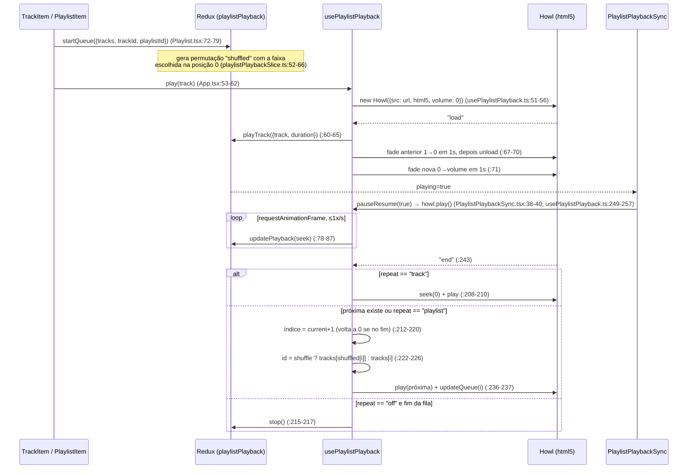
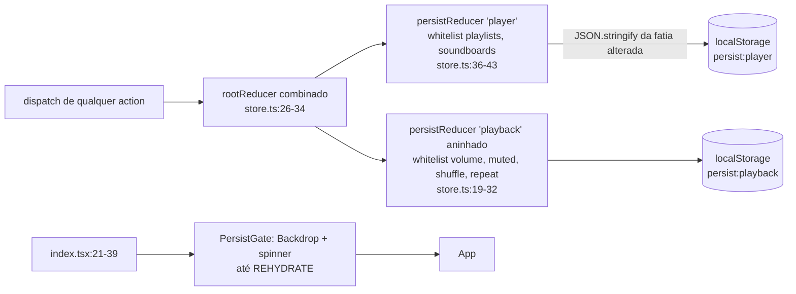

# Capítulo 3 — O player interno: playlists e soundboards como "mais uma aba"

> Ponte do capítulo anterior: o pipeline de áudio já entrega ao Discord o som de qualquer aba do navegador embutido. Mas o mestre de RPG raramente vive só de YouTube: ele tem uma pasta com a trilha do "Skyrim", um MP3 de taverna e cinquenta efeitos curtos (porta rangendo, espada, trovão). Ele precisa de **música local e efeitos sob demanda**. A resposta do Kenku FM é deliberadamente modesta: em vez de criar um segundo caminho de áudio, ele escreve **um pequeno app web** que toca esses arquivos — e o coloca numa aba. Para o pipeline, o player é só mais uma fonte capturada.

Escopo analisado: `src/player/**` (exceto `preload.ts` e os componentes `*Remote.tsx`, tratados no capítulo de controle remoto) e `src/types/player.ts`.

---

## 1. Papel no projeto

O player é o **terceiro entrypoint de renderer** declarado no Electron Forge (`forge.config.js:72-78`, `name: "player_window"`, com HTML `src/player/index.html` e preload próprio). O processo main apenas devolve a URL e o preload desse entrypoint via IPC síncrono (`src/main/managers/PlayerManager.ts:86-92`, canais `PLAYER_GET_URL` / `PLAYER_GET_PRELOAD_URL`); o renderer principal cria a aba "Player" com essa URL (`src/renderer/features/player/playerSlice.ts:16-17`) [a verificar pelo agente principal: detalhes de como `PlayerTab.tsx` instancia o WebContentsView].

Dentro dessa aba roda um app React autônomo:

- `src/player/index.tsx:21-39` monta `Provider` (Redux) → `PersistGate` (redux-persist) → `ThemeProvider` (tema **reaproveitado** do renderer principal, `../renderer/app/theme`) → `MemoryRouter` → `App`.
- `src/player/app/App.tsx:36-110` é o "painel de controle": instancia os dois motores de reprodução (`usePlaylistPlayback`, `useSoundboardPlayback`), define as rotas (Home, lista de playlists, playlist, lista de soundboards, soundboard), a barra de player fixa no rodapé e **componentes invisíveis** que fazem ponte com o mundo externo (`PlaylistMediaSession`, `PlaylistPlaybackSync`, `SoundboardPlaybackSync`, `PlaylistRemote`, `SoundboardRemote`).

Do ponto de vista arquitetural, o player tem três responsabilidades:

1. **Biblioteca**: CRUD de playlists/faixas e soundboards/sons, com reordenação por drag-and-drop e importação de pastas.
2. **Reprodução**: tocar uma faixa por vez (com fila, shuffle e repeat) e N efeitos simultâneos (com fade in/out e loop), usando Howler.js em modo HTML5.
3. **Superfície de controle**: expor o estado a teclas de mídia do SO (MediaSession) e ao controle remoto HTTP (via preload + `*Remote.tsx`).

Ele **não** sabe nada de Discord, Opus ou captura. O áudio sai pelo `<audio>` do Chromium como o de qualquer página, e a janela oculta de captura o apanha como apanharia o de uma aba do YouTube [a verificar pelo agente principal: confirmar que a captura da aba do player usa exatamente o mesmo caminho das abas web].

## 2. Problema resolvido

| Necessidade do mestre | Como o player resolve |
|---|---|
| Tocar arquivos locais (MP3/FLAC/OGG/WAV…) | Armazena **caminhos `file://`** e deixa o Chromium decodificar (`src/renderer/common/drop.ts:3-7`) |
| Organizar trilhas por cena | Playlists com imagem de fundo, reordenáveis (`playlistsSlice.ts`) |
| Música contínua com variação | Fila com shuffle estável e repeat off/playlist/track (`playlistPlaybackSlice.ts`) |
| Transições sem corte seco | Crossfade de 1 s entre faixas (`usePlaylistPlayback.ts:66-71`) |
| Efeitos pontuais e ambiências em loop, sobrepostos à música | Soundboards com sons independentes, cada um com volume/fade/loop próprios |
| Montar tudo rápido a partir do disco | Arrastar uma pasta cria playlists por subpasta (`Playlists.tsx:88-106`) |
| Controlar sem olhar para a tela | MediaSession (teclas de mídia) e controle remoto HTTP (próximo capítulo) |
| Não perder a biblioteca ao fechar | redux-persist em `localStorage` (`app/store.ts:19-43`) |

## 3. Ideia de design e alternativas

### 3.1 "Cada fonte de som é uma aba"

A decisão estrutural é **onde** o player roda. Havia três opções:

| Opção | Prós | Contras |
|---|---|---|
| **Player num WebContentsView próprio (escolhida)** | Reusa 100% do pipeline de captura por aba; isolamento de falhas (um bug no player não derruba a UI principal); o player tem seu próprio `localStorage`/store; o volume dele é mais um fader no mixer | Estado fica "preso" numa view isolada — controlar de fora exige IPC + preload (capítulo seguinte); duplica bundle React/MUI; dois stores Redux independentes |
| Player dentro do renderer principal | Um só store, UI integrada | O renderer principal não é uma "aba" capturada; exigiria um caminho paralelo de áudio até o mixer (ex.: rotear um `MediaElementSource` direto para o worklet) |
| Player no processo main (Node: ffmpeg/prism-media → Opus) | Sem Chromium; decodificação direta para o Discord | Sem UI de reprodução nativa, sem MediaSession, reimplementar decodificação de formatos, fade, mixagem com as abas; contraria a filosofia de "reuso do Chromium" |

A escolha é coerente com a filosofia do projeto: uma equipe pequena não quer manter dois caminhos de áudio. Ao fazer do player "mais uma aba", toda a complexidade (captura, mix, encoder, DAVE) é escrita uma vez só.

### 3.2 Motor de reprodução: Howler vs HTMLAudio vs Web Audio

O código usa **Howler.js com `html5: true`** tanto para faixas (`usePlaylistPlayback.ts:51-56`) quanto para efeitos (`soundboards/Sound.ts`, ver §5.3).

| Motor | Por que (não) usar aqui |
|---|---|
| `HTMLAudioElement` puro | Faz streaming de arquivos grandes sem decodificar tudo em memória; mas fade, eventos de "load/end" e controle de múltiplas instâncias ficam manuais |
| Web Audio (`AudioBuffer`) | Fades precisos por `GainNode`, mixagem sample-accurate; porém **decodifica o arquivo inteiro em RAM** — inviável para trilhas de 1 h em FLAC |
| **Howler, modo HTML5 (escolhido)** | API de alto nível (`fade`, `seek`, `loop`, eventos) em cima de `<audio>`; streaming; código de fade/crossfade reduzido a uma linha |

O custo do modo HTML5 é que os fades do Howler são **implementados por timer em JS** alterando `audio.volume` (menos suaves que um `GainNode`), e há acesso a campos privados (`(howl as any)._sounds[0]`, `usePlaylistPlayback.ts:94`) para detectar falhas precoces. Como o áudio vai de qualquer forma ser recapturado e mixado pelo pipeline, precisão de amostra não importa — conveniência sim.

### 3.3 Redux como "fonte da verdade" e hooks imperativos como "motor"

O desenho separa:

- **Estado declarativo** em slices Redux Toolkit (a mesma stack do renderer principal — tema, MUI e dnd-kit também são compartilhados).
- **Objetos imperativos** (`Howl`) guardados em `useRef` dentro de hooks (`usePlaylistPlayback`, `useSoundboardPlayback`), fora do Redux (não são serializáveis).
- **Componentes-ponte vazios** (`*PlaybackSync`, `PlaylistMediaSession`) que observam o store e chamam o motor. O comentário em `PlaylistPlaybackSync.tsx:12-13` explica: isso é feito "num componente vazio para evitar re-renderizar os filhos".

Esse padrão ("Redux → efeito → objeto de mídia") permite que *qualquer* origem de comando — botão da UI, tecla de mídia, requisição HTTP — apenas despache uma action (`playPause(true)`), e o efeito sincroniza o `Howl`.

## 4. Estruturas de dados centrais

### 4.1 Biblioteca de playlists (persistida)

`src/player/features/playlists/playlistsSlice.ts:3-22`:

- `Track { id, url, title }` — `url` é uma string arbitrária: `file://…` codificada, `http(s)://…` ou qualquer coisa colada pelo usuário.
- `Playlist { id, title, background, tracks: string[] }` — `tracks` é uma lista **ordenada de IDs**; `background` é **ou** a chave de uma imagem embutida (`backgrounds/index.ts`) **ou** uma URL de imagem (`file://`/`http`).
- `PlaylistsState { playlists: { byId, allIds }, tracks: Record<id, Track> }` — forma normalizada clássica do Redux; `allIds` guarda a ordem das playlists.

Observação: embora `tracks` seja um dicionário global, **cada faixa pertence a exatamente uma playlist** — `removePlaylist` apaga as faixas da playlist (`playlistsSlice.ts:41-43`) e `removeTrack` apaga do dicionário (`:86`). Não há compartilhamento de faixa entre playlists; a normalização serve à ordenação e à busca por ID (usada pelo controle remoto), não ao reuso.

### 4.2 Estado de reprodução de playlist (parcialmente persistido)

`playlistPlaybackSlice.ts:6-38`:

- `Queue { playlistId, tracks: string[], shuffled: number[], current: number }` — uma **cópia** da ordem da playlist no momento do play, mais uma permutação de índices (`shuffled`). `current` é índice em `tracks` quando shuffle está desligado e índice em `shuffled` quando ligado — um campo com duas semânticas (fonte de bugs, §10).
- `playing`, `volume`, `muted`, `shuffle`, `repeat: "off" | "track" | "playlist"` (padrão `"playlist"`).
- `track?: Track` — **cópia** da faixa em execução (não uma referência por ID).
- `playback?: { progress, duration }` — em segundos inteiros.

### 4.3 O que é persistido e o que é efêmero

`app/store.ts` usa **dois `persistReducer` aninhados**, ambos sobre `localStorage` (`redux-persist/lib/storage`):

| Chave localStorage | Conteúdo | Linha |
|---|---|---|
| `persist:player` | `playlists` e `soundboards` inteiros (biblioteca) | `store.ts:36-43` |
| `persist:playback` | só `volume`, `muted`, `shuffle`, `repeat` da playlist | `store.ts:19-32` |

Efêmeros: `queue`, `track`, `playing`, `playback` (a reprodução **não** retoma após reiniciar o app) e todo o `soundboardPlayback`. O `localStorage` é o da origem do bundle do player dentro da sessão Electron [a verificar pelo agente principal: se a aba do player usa a mesma `session`/partition das abas web, o que afetaria limpeza de dados de navegação].

## 5. Fluxos principais

### 5.1 Tocar uma faixa, próxima, shuffle e repeat



Pontos sutis:

- **Quem dá o "play" de fato não é `play()`**: ela cria o `Howl` com volume 0 e dispara `playTrack`, que põe `playing=true`; é o `PlaylistPlaybackSync` que, reagindo a `playing`/`track`, chama `howl.play()` (`PlaylistPlaybackSync.tsx:38-40`, com `playbackTrack` na lista de dependências justamente para re-disparar quando muda de faixa). O fluxo é "Redux primeiro, mídia depois".
- **Crossfade**: a faixa anterior só é descarregada no evento `fade` (`usePlaylistPlayback.ts:67-70`), então durante 1 s dois `<audio>` tocam juntos — um crossfade real, gratuito.
- **"Anterior" estilo Spotify**: se a faixa passou dos 5 s, "previous" reinicia a faixa; senão volta uma (`usePlaylistPlayback.ts:167-171`).
- **Shuffle estável**: `startQueue` embaralha os índices uma vez (Fisher–Yates em `common/shuffle.ts:1-6`) e põe a faixa clicada no início; alternar shuffle no meio da reprodução reembaralha o restante mantendo a atual como posição 0 (`playlistPlaybackSlice.ts:201-221`). Não há reembaralhamento ao dar a volta na fila com `repeat: "playlist"`.
- **Edição da playlist durante a reprodução** mantém a fila coerente: `addTrackToQueueIfNeeded`/`addTracksToQueueIfNeeded` deslocam índices (`:141-173`), `moveQueueIfNeeded` só age sem shuffle (`:73-96`), `removeTrackFromQueue` reconstrói a permutação (`:97-140`). Cada componente de UI precisa lembrar de despachar **as duas** actions (biblioteca + fila), p.ex. `TrackAdd.tsx:42-43`, `PlaylistTracks.tsx:63-76`, `TrackItem.tsx:68-71`.
- **Erros** (`loaderror`/`playerror`, ou `Howl` sem `_sounds[0]`) param a reprodução e mostram um Snackbar (`usePlaylistPlayback.ts:43-48, 90-97`; `App.tsx:100-107`). Não há "pular para a próxima em caso de erro": uma faixa com arquivo sumido **interrompe** a playlist.

### 5.2 Modelo de soundboard

`soundboards/soundboardsSlice.ts:3-26` espelha o de playlists:

- `Sound { id, url, title, loop, volume (0–1), fadeIn (ms), fadeOut (ms) }` — ao contrário de `Track`, cada som carrega **seus próprios parâmetros de mixagem**.
- `Soundboard { id, title, background, sounds: string[] }`, normalizado em `byId`/`allIds` + dicionário global `sounds`.
- Estado de reprodução (`soundboardPlaybackSlice.ts:4-15`): `playback: Record<soundId, SoundPlayback>`, onde `SoundPlayback` = **cópia** do `Sound` + `progress`/`duration`. Não há conceito de fila, "tocando/pausado" ou volume mestre: um som está no dicionário (tocando) ou não. Nada disso é persistido.

### 5.3 Tocar um efeito com fade e loop

```mermaid
sequenceDiagram
    participant UI as SoundItem / SoundboardItem
    participant Hook as useSoundboardPlayback
    participant S as Sound (wrapper TypedEmitter)
    participant H as Howl
    participant Store as Redux (soundboardPlayback)
    UI->>Hook: play(sound) (SoundItem.tsx:81-87)
    Hook->>S: se já tocando: stop(false) e descarta (useSoundboardPlayback.ts:18-21)
    Hook->>S: new Sound({src, volume, fadeIn, fadeOut, loop}) (:23-29)
    S->>H: new Howl({autoplay, html5: crossFade, loop: crossFade?false:loop}) (Sound.ts:35-45)
    H-->>S: "load" → emit("load", duration) (:66-68)
    S-->>Hook: load → dispatch(playSound) (useSoundboardPlayback.ts:31-38)
    alt crossFade (fadeIn≠0 e fadeOut≠0)
        H-->>S: "play" → fade 0→volume em fadeIn ms (Sound.ts:47-49)
        S->>S: setTimeout(duração − fadeOut) (:51-63)
        alt loop
            S->>H: fade atual →0 e stop no fim do fade (:54-57)
            S->>H: createHowlerInstance() — nova instância sobreposta (:58)
        else sem loop
            S->>H: fade out simples (:61)
            H-->>S: "end" → emit("end") → stopSound (:70-74; useSoundboardPlayback.ts:40-44)
        end
    else sem crossFade
        Note over H: Web Audio (html5:false) e loop nativo do Howler<br/>"perfect loop" (Sound.ts:18-23, 43-44)
    end
    loop rAF, ≤1x/s
        Hook->>Store: updatePlayback([{id, progress}]) em lote (useSoundboardPlayback.ts:57-82)
    end
    UI->>Hook: stop(id) → stopSound + Sound.stop(true) (fade-out e unload) (:89-96; Sound.ts:101-115)
```

A ideia central de `Sound.ts` está no docstring (`Sound.ts:18-23`): há **dois modos de loop** mutuamente exclusivos.

1. **Loop com crossfade** (padrão, já que sons novos nascem com `fadeIn = fadeOut = 100` ms — `SoundAdd.tsx:31-32`, `Soundboards.tsx:108-114`): usa `<audio>` (streaming, pouca RAM) e, `fadeOut` ms antes do fim, cria **uma nova instância** que entra em fade-in enquanto a antiga faz fade-out. É a técnica clássica de "ambient bed" sem costura audível, ao custo de alguns ms de sobreposição.
2. **Loop sem fade** (`fadeIn`/`fadeOut` zerados): usa Web Audio (`html5: false`), que decodifica o arquivo inteiro em memória, mas permite **loop sample-accurate** — ideal para loops curtos cortados no ponto certo (chuva, motor, batida).

Isso é uma troca explícita e documentada entre memória e precisão — e é a única parte do módulo em que o autor escapa do modo HTML5.

### 5.4 Edição ao vivo de volume/loop

`SoundboardPlaybackSync.tsx:14-31` observa **o slice inteiro** `soundboards` e, a cada mudança, percorre os `Sound` ativos via o callback `sync` exposto pelo hook (`useSoundboardPlayback.ts:98-104`), aplicando `volume` e `loop` quando divergem. Assim, arrastar o slider de volume de um card (`SoundItem.tsx:89-91`, que só despacha `editSound`) altera o som que está tocando em tempo real. O comentário (`SoundboardPlaybackSync.tsx:11-13`) justifica o componente vazio: "importante para atualização de volume ao vivo de alta performance". Mudanças de `url`, `fadeIn` e `fadeOut` **não** são sincronizadas — valem só no próximo play.

### 5.5 Persistência (redux-persist)



- O `serializableCheck` ignora as actions internas do redux-persist (`store.ts:47-52`) — receita padrão do RTK.
- `version: 1` sem `migrate` (`store.ts:21, 38`): não há migrações declaradas; uma mudança de formato no futuro exigirá adicioná-las.
- A biblioteca **não** tem export/import nem backup: ela vive no `localStorage` da origem do player [a verificar pelo agente principal: se o renderer principal oferece algum export; não encontrei nada em `src/player`].

### 5.6 Como arquivos locais são referenciados

```mermaid
flowchart TD
    D1[Arrastar arquivo / clicar e escolher<br/>useFileDrop.ts:41-78] --> GP["window.player.getPathForFile(file)<br/>(webUtils no preload)"]
    D2[Arrastar pasta<br/>useFolderDrop.ts:113-122] --> WE[webkitGetAsEntry → varredura recursiva<br/>useFolderDrop.ts:59-89] --> GP
    GP --> ENC["encodeFilePath(path) → 'file://C:/.../M%C3%BAsica.mp3'<br/>renderer/common/drop.ts:3-7"]
    ENC --> ST[(Track.url / Sound.url no Redux<br/>→ localStorage)]
    ST --> HW["new Howl({src: url})<br/>&lt;audio src=file://...&gt;"]
    U[Colar URL http(s)] --> ST
```

Resposta direta: **nem data URL, nem cópia do arquivo — uma URL `file://` absoluta**, construída a partir do caminho real que o preload obtém com `webUtils.getPathForFile` (necessário desde o Electron 32, que removeu `File.path`). Isso mantém o `localStorage` pequeno (só strings) e deixa o Chromium fazer streaming e decodificação. As consequências (§10): a biblioteca **quebra** se o usuário mover/renomear arquivos, e não é portátil entre máquinas. A mesma lógica vale para imagens de fundo customizadas (`ImageSelector.tsx:40-45`). O `title` é derivado do nome de arquivo por `cleanFileName` (remove extensão, capitaliza — `drop.ts:20-30`).

Os helpers `encodeFilePath`/`getDropURL`/`cleanFileName` vivem em `src/renderer/common/drop.ts`, mas `getDropURL` referencia `window.player` — ou seja, esse arquivo "do renderer" na verdade é código do player [a verificar pelo agente principal: se o renderer principal também o importa, `window.player` seria indefinido lá].

A filtragem de tipo é por MIME: `useFileDrop` aceita `audio/*` com um teste de prefixo (`useFileDrop.ts:80-87`, com um TODO admitindo que é grosseiro), enquanto `useFolderDrop` usa uma lista fixa (`useFolderDrop.ts:12-22`, com `audio/ogg` e `audio/webm` duplicados e sem `audio/x-wav`/`audio/x-m4a`). O `AudioSelector` apenas **avisa** se a URL não termina numa extensão conhecida (`AudioSelector.tsx:21, 54-55, 74-89`), sem bloquear.

## 6. Colaboração e fronteiras

### 6.1 Biblioteca vs reprodução

O módulo mantém **quatro slices**, dois a dois:

| | Biblioteca (o que existe) | Reprodução (o que está soando) |
|---|---|---|
| Playlists | `playlists` — persistido | `playlistPlayback` — só preferências persistidas |
| Soundboards | `soundboards` — persistido | `soundboardPlayback` — efêmero |

A separação é boa (persistir biblioteca ≠ persistir "tocando agora"), mas o acoplamento entre os pares é **manual e espalhado pela UI**: não há middleware/listener que, ao remover uma faixa da biblioteca, ajuste a fila — cada componente despacha as duas actions (`TrackItem.tsx:62-71`, `TrackAdd.tsx:42-43`, `Playlist.tsx:87-93`, `PlaylistTracks.tsx:63-76`). Nota: `Playlists.tsx:88-106` (drop de pastas criando playlists novas) não precisa, mas qualquer novo ponto de entrada (ex.: uma rota remota "adicionar faixa") teria de lembrar-se disso. Um `createListenerMiddleware` do RTK centralizaria essa regra.

O estado de reprodução guarda **cópias** (`playlistPlayback.track`, `soundboardPlayback.playback[id]`), não referências. Vantagem: o que está tocando continua consistente mesmo se a biblioteca mudar; desvantagem: renomear a faixa atual não atualiza o título no player nem no MediaSession até a próxima faixa.

### 6.2 O que os "*PlaybackSync" sincronizam

Apesar do nome, **não há sincronização com o main nem com o renderer principal**. Os dois componentes sincronizam o **store Redux do próprio player com os objetos `Howl`** dentro do mesmo web view:

- `PlaylistPlaybackSync` (`PlaylistPlaybackSync.tsx:30-40`): `volume` → `howl.volume`, `muted` → `howl.mute`, `playing` → `howl.play/pause`.
- `SoundboardPlaybackSync` (`SoundboardPlaybackSync.tsx:19-31`): `sounds[id].volume/loop` da biblioteca → instâncias `Sound` ativas.

A comunicação com fora do web view acontece em outros lugares: `PlaylistRemote`/`SoundboardRemote` (IPC via preload → respostas tipadas em `src/types/player.ts`, p.ex. `PlaylistPlaybackReply`, `SoundboardsReply`) — tema do próximo capítulo. Os tipos de `src/types/player.ts:1-64` são o **contrato** do player com o controle remoto e **duplicam à mão** as interfaces dos slices (ex.: `SoundboardsReply.sounds` repete `Sound`) em vez de importá-las, para que o main não dependa de código do renderer [a verificar pelo agente principal: confirmar consumo em `src/main/remote/routes/**`].

### 6.3 MediaSession

`PlaylistMediaSession.tsx:24-65` registra handlers de `play`, `pause`, `stop`, `seekto`, `previoustrack`, `nexttrack` e publica `metadata` (só título) e `playbackState`. Como o player é um web view do Chromium, isso conecta as **teclas de mídia do teclado / controles do SO** à playlist sem nenhuma linha de código nativo. Duas ressalvas:

- Só playlists participam; soundboards não têm presença no MediaSession.
- Todas as abas web também podem registrar MediaSession; qual delas recebe as teclas é decisão do Chromium/SO (geralmente a última que tocou) [a verificar pelo agente principal: se o main faz algo para priorizar o player, p.ex. `globalShortcut`].

### 6.4 Relação com o pipeline de áudio e com o renderer principal

- **Pipeline**: o player não chama nenhuma API de áudio do app; seu som é capturado como o de qualquer aba [a verificar pelo agente principal: confirmar no capítulo de pipeline que a aba Player é capturada pelo mesmo `AudioCaptureManager`]. Consequência elegante: o volume de playlist (0–1) é local ao player, e o mixer global ainda pode ajustar a "aba Player" como um todo — dois níveis de ganho.
- **Renderer principal**: mesma stack (React 18 + Redux Toolkit + MUI + dnd-kit + react-router), e reuso literal de arquivos: tema (`index.tsx:12`), CSS (`App.tsx:17`), `useHideScrollbar` (`Playlists.tsx:37`) e `drop.ts`. É um monorepo informal: os entrypoints compartilham código por import relativo, sem pacote comum. O `MemoryRouter` (`index.tsx:33`) evita que a navegação interna do player apareça como URL/histórico da aba.

## 7. Decisões-chave e trade-offs

1. **Player como aba (WebContentsView) em vez de fonte nativa.** Ganha-se reuso total do pipeline, isolamento e MediaSession de graça; paga-se com um bundle React duplicado, estado ilhado (daí a necessidade de IPC para o controle remoto) e latência de captura igual à das abas. Para uma equipe pequena, é a escolha certa: zero código de áudio novo.
2. **Referenciar arquivos por `file://` em `localStorage`, sem copiar nem indexar.** Simples, leve e instantâneo para importar pastas enormes; frágil a mover/renomear, sem portabilidade entre máquinas e sem detecção de arquivos ausentes até o momento do play.
3. **Howler HTML5 por padrão, Web Audio só para loops sem fade.** Streaming e baixo consumo de memória para trilhas longas; fades por timer (menos precisos) e dependência de campos privados (`_sounds`). O modo Web Audio é reservado ao caso em que precisão de loop importa mais que RAM — um trade-off consciente e documentado em `Sound.ts:18-23`.

## 8. Insights

### 8.1 Comparação com ferramentas do nicho

| Aspecto | Kenku FM Player | Syrinscape | Foundry VTT (Playlists) |
|---|---|---|---|
| Conteúdo | Arquivos do usuário | Catálogo proprietário de "soundsets" | Arquivos no servidor do mundo |
| Camadas | 1 playlist + N efeitos | Muitos elementos com aleatorização, intervalos e volumes por elemento | Várias playlists simultâneas + ambient sounds posicionais |
| Distribuição | Captura → Discord (voz) | App próprio/streaming aos jogadores | Cada cliente toca localmente, sincronizado |
| Aleatoriedade | Shuffle de fila; "tocar som aleatório" do soundboard (`SoundboardItem.tsx:32-40`) | Rica (one-shots com intervalos aleatórios) | Shuffle, modos sequencial/simultâneo |

O Kenku é o mais simples dos três, mas é o único que entrega **qualquer fonte** (inclusive YouTube/Spotify web) na mesma mixagem para o Discord. O player não compete com o Syrinscape: complementa o navegador.

### 8.2 Se eu redesenhasse

- **Unificar playlists e soundboards num modelo genérico** `Collection<Item>` com um factory de slice: hoje `soundboardsSlice.ts` e `playlistsSlice.ts` são quase idênticos (a diferença real está só nos campos extras de `Sound`), assim como `*Add.tsx`, `*Settings.tsx`, `Playlists.tsx`/`Soundboards.tsx` (um `diff` com renomeação dá 4 linhas de diferença entre `PlaylistAdd` e `SoundboardAdd`).
- **Uma fila com semântica única**: guardar sempre a ordem efetiva (`order: string[]`) e um ponteiro, recalculada ao alternar shuffle, eliminando o `current` de duplo sentido.
- **Motor único em Web Audio com `MediaElementAudioSourceNode`**: streaming do `<audio>` + `GainNode` para fades precisos e volume mestre de soundboard, sem depender de internals do Howler.
- **Listener middleware** para manter fila e biblioteca coerentes, e **`handleEnd`/`next` compartilhados** (hoje há três cópias da lógica de avanço em `usePlaylistPlayback.ts:116-156, 158-200, 205-242`).
- **Biblioteca resiliente**: armazenar caminho + tamanho/hash, verificar existência ao abrir e oferecer "relocalizar pasta"; export/import JSON.
- **Persistência fora do `localStorage`** (IndexedDB via `localforage`, ou arquivo JSON pelo main) para bibliotecas grandes.

## 9. Pontos de extensão

| Quero… | Onde mexer |
|---|---|
| Nova origem de comando (MIDI, hotkey global) | Despachar actions existentes ou chamar os callbacks de `usePlaylistPlayback`/`useSoundboardPlayback` num novo componente-ponte montado em `App.tsx:81-99`, no padrão de `PlaylistMediaSession` |
| Novo parâmetro por som (pitch, pan, intervalo aleatório) | Campo em `Sound` (`soundboardsSlice.ts:3-11`), opção em `Sound.ts:10-16`, sincronização ao vivo em `SoundboardPlaybackSync.tsx:20-29`, UI em `SoundSettings.tsx`, e espelhar em `src/types/player.ts` para o remoto |
| Novo modo de repeat/fila | `Repeat` e reducers em `playlistPlaybackSlice.ts:19, 201-224`; lógica de avanço em `usePlaylistPlayback.ts` |
| Novos formatos aceitos no drop de pasta | `supportedFileTypes` em `useFolderDrop.ts:12-22` |
| Imagens de fundo embutidas | Colocar arquivos em `src/player/backgrounds/` (carregados por `require.context`, `backgrounds/index.ts:4`); o `.gitignore` local ignora imagens, indicando que as oficiais não são distribuídas no repositório |
| Migração do formato persistido | Adicionar `migrate` aos configs em `store.ts:19-24, 36-41` |

## 10. Destaques e problemas reais

**Destaques**

- Crossfade entre faixas e loop com crossfade implementados em poucas linhas sobre Howler (`usePlaylistPlayback.ts:66-71`, `Sound.ts:47-64`).
- Shuffle que preserva a faixa atual e mantém a permutação coerente sob inserção/remoção (`playlistPlaybackSlice.ts:52-66, 141-173`).
- Componentes-ponte vazios para isolar re-renderizações de alta frequência (`PlaylistPlaybackSync.tsx:12-13`, `SoundboardPlaybackSync.tsx:11-13`).
- Throttle de progresso a 1 atualização/s via rAF (`usePlaylistPlayback.ts:78-87`, `useSoundboardPlayback.ts:57-82`), e no soundboard em **lote** num único dispatch.

**Problemas**

| # | Problema | Evidência | Impacto |
|---|---|---|---|
| P1 | `current` com semântica dupla: `removeTrackFromQueue` sempre o interpreta como índice em `shuffled`, mesmo com shuffle desligado | `playlistPlaybackSlice.ts:109, 127-138` vs `:63` | Ao apagar uma faixa sem shuffle, "próxima" pode pular para a faixa errada |
| P2 | Importação de pasta lê só o primeiro lote de `readEntries` (Chromium devolve ≤100 entradas por chamada) | `useFolderDrop.ts:50-57, 84` | Pastas com >100 arquivos são importadas **truncadas** silenciosamente |
| P3 | Caminhos `file://` absolutos sem verificação | `drop.ts:3-7`; erro só no play (`usePlaylistPlayback.ts:43-48`) | Mover/renomear a pasta quebra a biblioteca; uma faixa ausente **para** a playlist em vez de pular |
| P4 | Loop com crossfade faz `howl.stop()` na instância antiga, nunca `unload()` | `Sound.ts:54-58` | Cada volta do loop deixa um `Howl` (e `<audio>`) registrado no Howler global — vazamento em ambiências tocando por horas [a verificar em runtime] |
| P5 | Erro emitido **dentro do construtor** de `Sound`, antes de o hook registrar o listener | `Sound.ts:88-91, 96-98` vs `useSoundboardPlayback.ts:46-50` | Falha síncrona some sem Snackbar e deixa uma entrada órfã em `soundsRef` |
| P6 | Regra de crossfade inconsistente: ativa só se **ambos** fades ≠ 0, mas `loop()` só alterna o loop nativo se **ambos** = 0 | `Sound.ts:36-37` vs `:137-139` | Com um fade zerado e outro não: sem fade algum, arquivo inteiro em RAM, e alternar loop ao vivo não tem efeito |
| P7 | Remover som/soundboard não para o som em execução | `SoundItem.tsx:76-79`, `Soundboard.tsx:66-70` | Som "fantasma" continua tocando até terminar/parar pelo chip do player |
| P8 | `localStorage` + persistência a cada keystroke/slider | `TrackSettings.tsx:22-32`, `SoundItem.tsx:89-91`, `store.ts:17` | Cada movimento serializa o slice inteiro; limite de ~5–10 MB por origem para bibliotecas muito grandes |
| P9 | Laços `requestAnimationFrame` nunca param (o de playlist continua após `stop`, o de soundboard roda desde o boot) | `usePlaylistPlayback.ts:74-87`, `useSoundboardPlayback.ts:57-82` | Consumo contínuo pequeno de CPU; o web view nunca fica ocioso |
| P10 | Lógica de avanço de faixa triplicada | `usePlaylistPlayback.ts:116-156, 158-200, 205-242` | Correções precisam ser feitas em três lugares |
| P11 | `drop.ts` "do renderer" usa `window.player`, que só o preload do player expõe | `drop.ts:13`; importado por `renderer/features/tabs/URLBar.tsx:12` e `BookmarkSettings.tsx:12` | Soltar um arquivo na barra de URL da janela principal provavelmente lança `TypeError` [a verificar pelo agente principal] |
| P12 | Chave de pasta concatenada sem separador | `useFolderDrop.ts:78` (`path + entry.name`) | `/A`+`BC` e `/AB`+`C` colidem; subpastas aninhadas viram nomes estranhos (cosmético na maioria dos casos) |
| P13 | Duplicação playlists × soundboards | slices, `*Add`, `*Settings`, listas | Toda melhoria (ex.: P7, migrações) precisa ser feita duas vezes |

---

> **Gancho para o próximo capítulo.** Tudo o que vimos vive dentro de um web view isolado: o store Redux, os `Howl`, a fila. Nenhum outro processo enxerga esse estado. Então como um Stream Deck, do outro lado da mesa, consegue dizer "toque a playlist da taverna" ou "dispare o trovão"? A resposta passa por um servidor HTTP no main, um canal IPC até o preload do player e os componentes `PlaylistRemote`/`SoundboardRemote` que já apareceram, silenciosos, em `App.tsx:87-98` — e pelos tipos de `src/types/player.ts`, que são o contrato dessa conversa.

## Tabela de cobertura

| Arquivo | Linhas totais | Linhas lidas | Cobertura % | Motivo não lido |
|---|---:|---:|---:|---|
| app/store.ts | 58 | 58 | 100% | |
| app/App.tsx | 110 | 110 | 100% | |
| index.tsx | 39 | 39 | 100% | |
| renderer.ts | 1 | 1 | 100% | |
| index.html | 10 | 10 | 100% | |
| index.css | 3 | 0 | 0% | CSS trivial |
| backgrounds/index.ts | 28 | 28 | 100% | |
| backgrounds/.gitignore | 4 | 0 | 0% | Inspecionado via shell, não via Read |
| common/shuffle.ts | 6 | 6 | 100% | |
| common/SortableItem.tsx | 31 | 31 | 100% | |
| common/useFileDrop.ts | 117 | 117 | 100% | |
| common/useFolderDrop.ts | 134 | 134 | 100% | |
| common/AudioSelector.tsx | 112 | 112 | 100% | |
| common/ImageSelector.tsx | 167 | 167 | 100% | |
| features/home/Home.tsx | 156 | 156 | 100% | |
| features/player/Player.tsx | 50 | 50 | 100% | |
| features/player/PlaylistPlayer.tsx | 346 | 346 | 100% | |
| features/player/SoundboardPlayer.tsx | 63 | 63 | 100% | |
| features/playlists/playlistsSlice.ts | 135 | 135 | 100% | |
| features/playlists/playlistPlaybackSlice.ts | 245 | 245 | 100% | |
| features/playlists/usePlaylistPlayback.ts | 281 | 281 | 100% | |
| features/playlists/PlaylistPlaybackSync.tsx | 43 | 43 | 100% | |
| features/playlists/PlaylistMediaSession.tsx | 68 | 68 | 100% | |
| features/playlists/Playlists.tsx | 199 | 199 | 100% | |
| features/playlists/Playlist.tsx | 196 | 196 | 100% | |
| features/playlists/PlaylistTracks.tsx | 137 | 137 | 100% | |
| features/playlists/PlaylistItem.tsx | 115 | 115 | 100% | |
| features/playlists/PlaylistAdd.tsx | 75 | 75 | 100% | |
| features/playlists/PlaylistSettings.tsx | 68 | 68 | 100% | |
| features/playlists/TrackItem.tsx | 141 | 141 | 100% | |
| features/playlists/TrackAdd.tsx | 76 | 76 | 100% | |
| features/playlists/TrackSettings.tsx | 75 | 75 | 100% | |
| features/soundboards/soundboardsSlice.ts | 139 | 139 | 100% | |
| features/soundboards/soundboardPlaybackSlice.ts | 48 | 48 | 100% | |
| features/soundboards/useSoundboardPlayback.ts | 112 | 112 | 100% | |
| features/soundboards/Sound.ts | 141 | 141 | 100% | |
| features/soundboards/SoundboardPlaybackSync.tsx | 34 | 34 | 100% | |
| features/soundboards/Soundboards.tsx | 214 | 214 | 100% | |
| features/soundboards/Soundboard.tsx | 189 | 189 | 100% | |
| features/soundboards/SoundboardSounds.tsx | 141 | 141 | 100% | |
| features/soundboards/SoundboardItem.tsx | 90 | 90 | 100% | |
| features/soundboards/SoundItem.tsx | 198 | 198 | 100% | |
| features/soundboards/SoundAdd.tsx | 140 | 140 | 100% | |
| features/soundboards/SoundSettings.tsx | 134 | 134 | 100% | |
| features/soundboards/SoundboardAdd.tsx | 75 | 0 | 0% | Espelho de PlaylistAdd (diff com renomeação: 4 linhas) |
| features/soundboards/SoundboardSettings.tsx | 68 | 0 | 0% | Espelho de PlaylistSettings |
| src/types/player.ts | 64 | 64 | 100% | |
| **Total (escopo, sem preload.ts e *Remote.tsx)** | **5076** | **4926** | **97,0%** | ✅ (mínimo 60%) |


