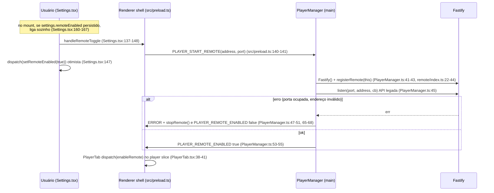
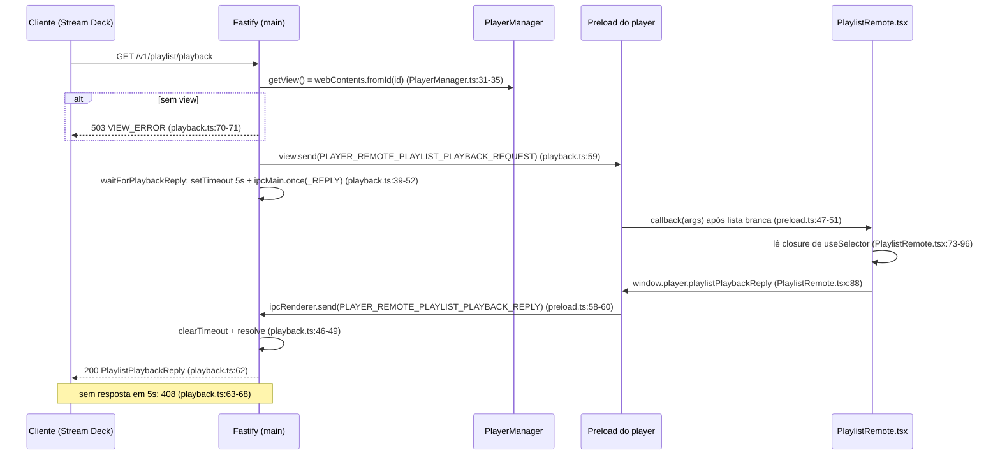
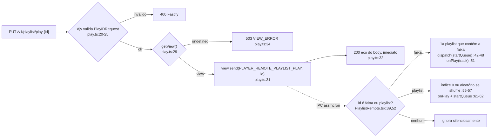

# Módulo 6 — Controle remoto (API HTTP / Stream Deck)

O capítulo anterior terminou com o player trancado num web view isolado, com todo o estado musical guardado num Redux que só ele enxerga. Este capítulo mostra como um Stream Deck, que roda em outro processo e às vezes em outra máquina, consegue apertar "play" ali dentro: um servidor HTTP no processo main que funciona como uma central telefônica entre a rede e o renderer do player.

---

## 1. Papel no projeto

O módulo de controle remoto é a **única interface pública e programável** do Kenku FM. Tudo o mais (conexão com o Discord, abas, saídas de áudio) só se controla pela UI. É por aqui que o plugin oficial de Stream Deck (repositório separado `owlbear-rodeo/kenku-fm-stream-deck`), scripts caseiros e integrações de terceiros conversam com o app.

Ele fica dividido em três camadas, cada uma num processo/contexto diferente do Electron:

| Camada | Onde roda | Arquivos | Responsabilidade |
|---|---|---|---|
| Servidor HTTP | processo main | `src/main/managers/PlayerManager.ts`, `src/main/remote/**` | Ciclo de vida do Fastify, rotas `/v1/*`, validação TypeBox, timeouts |
| Ponte IPC | preload do player | `src/player/preload.ts` | Lista branca de 16 canais de entrada e 4 funções de resposta expostas em `window.player` |
| Handlers | renderer do player (React) | `PlaylistRemote.tsx`, `SoundboardRemote.tsx` | Traduzir comandos em ações Redux ou em callbacks de áudio; montar snapshots de estado |
| Contrato de dados | compartilhado | `src/types/player.ts` | Formatos de resposta das rotas de leitura |

A configuração (endereço, porta, liga/desliga) fica na UI shell, em `src/renderer/features/settings/Settings.tsx:137-167`, e o registro do view do player acontece em `src/renderer/features/player/PlayerTab.tsx:27`.

## 2. Problema resolvido

Numa sessão de RPG o mestre tem as mãos ocupadas: escudo, fichas, dados, às vezes um VTT aberto. Trocar de janela para disparar um trovão quebra o ritmo da cena. Um Stream Deck (ou um celular, um macro de teclado, um bot) resolve isso com botões físicos, mas precisa de três coisas:

1. **Descobrir o que existe**: listar playlists, faixas, soundboards e sons, com IDs estáveis (`GET /v1/playlist`, `GET /v1/soundboard`).
2. **Mandar comandos**: tocar uma faixa/playlist/som, pausar, pular, mudar volume, shuffle, repeat, seek.
3. **Ler o estado atual**: para acender o botão "tocando" e mostrar título, progresso e volume (`GET /v1/playlist/playback`, `GET /v1/soundboard/playback`).

A dificuldade é arquitetural: quem sabe responder a qualquer uma dessas perguntas é o **renderer do player**, um `WebContentsView` sem porta de rede, e não o main. O módulo resolve essa distância.

## 3. Ideia de design e alternativas

### 3.1 A ideia central: o main como relé, o player como fonte da verdade

Confirmando a hipótese do briefing: **sim, o main é "burro"**. O `PlayerManager` guarda só três coisas: o id do webContents registrado (`PlayerManager.ts:9`), a instância Fastify (`:10`) e o par endereço/porta (`:11-12`). Nenhuma rota consulta estado no main; todas fazem `manager.getView()` (`PlayerManager.ts:31-35`) e repassam a mensagem via `webContents.send`. O estado verdadeiro (biblioteca de playlists, fila, volume, sons tocando) vive no Redux do player, persistido pelo `redux-persist` (há `PersistGate` em `src/player/index.tsx:23`).

As rotas se dividem em dois estilos:

- **Comandos fire-and-forget** (`PUT /play`, `PUT /mute`, `POST /next`, `PUT /v1/soundboard/stop`...): o main manda a mensagem IPC e responde **imediatamente** 200 ecoando o corpo da requisição. Não espera confirmação e não sabe se o comando teve efeito.
- **Consultas request/reply** (`GET /v1/playlist`, `GET /v1/playlist/playback`, `GET /v1/soundboard`, `GET /v1/soundboard/playback`): o main manda `*_REQUEST`, registra um `ipcMain.once("*_REPLY")` com timeout de 5 s e só então responde ao cliente HTTP.

### 3.2 HTTP REST vs WebSocket vs OSC

| Opção | Prós | Contras | Situação no Kenku |
|---|---|---|---|
| **HTTP REST (escolhida)** | Trivial de consumir de qualquer linguagem, `curl`, plugins de Stream Deck em JS, Bitfocus Companion (módulo "Generic HTTP"); stateless | Sem push: o cliente precisa fazer polling para acompanhar o progresso da faixa; sem correlação de respostas | Fastify 4 + TypeBox |
| WebSocket | Push de estado (fim de faixa, progresso), uma conexão só, baixa latência | Exige gerenciar conexões, reconexão e protocolo próprio; mais código no main | Não existe |
| OSC (UDP) | Padrão em áudio/iluminação (TouchOSC, QLab), latência mínima | Sem resposta natural (UDP), descoberta ruim, tipagem fraca | **Não existe no código**: `@types/node-osc` aparece em `package.json:37` como devDependency, mas não há `node-osc` em `dependencies` nem nenhum import de OSC em `src/` (grep vazio). É resquício de experimento ou de plano abandonado. |

A escolha é coerente com a filosofia de equipe pequena: HTTP é o menor denominador comum e o Fastify já traz validação de schema, prefixos e plugins "de graça". O preço é o polling: o plugin de Stream Deck precisa consultar `/playback` periodicamente para exibir progresso. [a verificar pelo agente principal: frequência de polling no repo do plugin]

### 3.3 Estado no main vs no player

Alternativa descartada (implicitamente): espelhar o estado do player no main (por exemplo, o player publicaria cada mudança de Redux via IPC e o main responderia GETs sozinho). Isso eliminaria o round-trip de IPC e o timeout, e permitiria responder mesmo com o player travado. A equipe preferiu **não duplicar estado**: o player já tem o Redux, então basta perguntar a ele. É o mesmo padrão dos outros managers IPC do projeto (o main orquestra recursos nativos, a lógica fica nos renderers), aplicado agora a uma borda de rede.

### 3.4 Handlers como componentes React

O lado do player não tem um "router" de comandos. Em vez disso, dois componentes que renderizam `<></>` (`PlaylistRemote.tsx:219`, `SoundboardRemote.tsx:77`) são montados em `src/player/app/App.tsx:87-98` e registram listeners IPC dentro de `useEffect`. Isso lhes dá acesso direto a `useSelector`, `useDispatch` e aos callbacks de áudio (`playlist.play`, `soundboard.stop`) vindos de hooks do App, sem precisar de uma camada de serviço. É o mesmo truque usado por `PlaylistMediaSession` e `PlaylistPlaybackSync` (App.tsx, logo acima e abaixo): **componentes invisíveis como adaptadores de efeitos colaterais**. Os custos desse truque aparecem na seção 10.

## 4. Estruturas de dados centrais

### 4.1 Schemas de entrada (TypeBox, validados pelo Fastify)

| Schema | Definido em | Campos | Rotas |
|---|---|---|---|
| `PlayIDRequest` | `routes/playlist/play.ts:7-9`, `routes/soundboard/play.ts:7-9` (duplicado) | `id: string` | `PUT /v1/playlist/play`, `PUT /v1/soundboard/play` |
| `StopIDRequest` | `routes/soundboard/stop.ts:7-9` | `id: string` | `PUT /v1/soundboard/stop` |
| `MuteRequest` | `routes/playlist/playback.ts:10-12` | `mute: boolean` | `PUT .../playback/mute` |
| `VolumeRequest` | `playback.ts:15-17` | `volume: number` (sem min/max no schema) | `PUT .../playback/volume` |
| `RepeatRequest` | `playback.ts:20-26` | `repeat: "off" \| "track" \| "playlist"` | `PUT .../playback/repeat` |
| `ShuffleRequest` | `playback.ts:29-31` | `shuffle: boolean` | `PUT .../playback/shuffle` |
| `SeekRequest` | `playback.ts:34-36` | `to: number` (segundos, clamp no player) | `PUT .../playback/seek` |

Cada schema é usado **duas vezes**: como `body` (validação de entrada) e como `response[200]` (serialização rápida via fast-json-stringify). Como a resposta de sucesso é o eco do corpo, o mesmo schema serve aos dois papéis. `Static<typeof X>` gera o tipo TS correspondente, e os genéricos `fastify.put<{Body; Reply}>` fecham o ciclo de tipagem.

### 4.2 Tipos de resposta (TS puro, sem schema)

Definidos em `src/types/player.ts` e compartilhados entre main e preload:

- `PlaylistsReply` (`:34-46`): lista de playlists (`id`, `title`, `background`, `tracks: string[]` de IDs) mais um dicionário achatado de `tracks` (`id`, `url`, `title`). Formato normalizado, igual ao Redux.
- `SoundboardsReply` (`:48-64`): idem para soundboards e sons, com `loop`, `volume`, `fadeIn`, `fadeOut`.
- `PlaylistPlaybackReply` (`:1-18`): `playing`, `volume`, `muted`, `shuffle`, `repeat`, e opcionais `track` (com `duration`/`progress`) e `playlist` (`id`, `title`).
- `SoundboardPlaybackReply` (`:20-32`): array `sounds` com todos os sons tocando e seu progresso.

Esses tipos **não** viram schemas TypeBox: as rotas GET não têm `schema.response` e serializam com `JSON.stringify` comum. Consequência: o TypeScript garante o formato em tempo de compilação só até a fronteira do IPC, onde tudo vira `any` (`preload.ts:47-49`).

### 4.3 Erros

- `ReplyError` e `VIEW_ERROR` (`remote/index.ts:10-20`): `{statusCode: 503, error: "Service Unavailable", message: "Unable to connect to Kenku FM"}`, usado quando não há view registrado.
- Timeout de consulta: objeto literal 408 "Request Timeout" repetido em quatro arquivos (`playlist/index.ts:34-38`, `playlist/playback.ts:64-68`, `soundboard/index.ts:34-38`, `soundboard/playback.ts:34-38`).
- Erro de validação: 400 padrão do Fastify (Ajv).

### 4.4 Mapa de canais IPC

16 canais main→player listados em `preload.ts:9-44` e 4 canais player→main enviados pelas funções `*Reply` (`preload.ts:58-69`). Convenção: `PLAYER_REMOTE_<DOMÍNIO>_<AÇÃO>`, com sufixo `_REQUEST`/`_REPLY` para pares de consulta.

## 5. Fluxos

### 5.1 Ciclo de vida: ligar o servidor

Em paralelo, na criação da aba do player, a UI shell cria o `WebContentsView` e chama `playerRegisterView(id)` (`PlayerTab.tsx:18-27` → `src/preload.ts:137-139` → `PlayerManager.ts:94-96`). Esse id é o único vínculo entre o servidor e o player.

### 5.2 Consulta com resposta: `GET /v1/playlist/playback`

Respondendo às perguntas do briefing: **sim**, é request/response sobre IPC assíncrono, mas **sem id de correlação**. A "correlação" é temporal: o primeiro `*_REPLY` que chega ao main depois do `once` resolve a promessa. Timeout fixo de 5 s, sem configuração; ao expirar, o listener `once` **não é removido** (o `reject` em `playback.ts:41-43` não chama `ipcMain.removeListener`) e fica pendurado até a próxima resposta. O resolve também não confere `event.sender` contra o view registrado.

### 5.3 Comando fire-and-forget: `PUT /v1/playlist/play`

O cliente recebe 200 mesmo quando o id não existe ou quando `PLAY`/`PAUSE` são ignorados por falta de faixa carregada (`PlaylistRemote.tsx:125-133`). O 200 significa "entreguei a mensagem ao player", não "executei".

Sobre os caminhos citados no briefing: não existem rotas soltas `/play`, `/stop`, `/playback`; todas vivem sob `/v1/playlist/*` e `/v1/soundboard/*` (`remote/index.ts:23-43`). Conjunto completo: `GET /v1/playlist`, `PUT /v1/playlist/play`, `GET /v1/playlist/playback`, `PUT .../playback/{play,pause,mute,volume,seek,repeat,shuffle}`, `POST .../playback/{next,previous}`, `GET /v1/soundboard`, `PUT /v1/soundboard/play`, `PUT /v1/soundboard/stop`, `GET /v1/soundboard/playback`. Não há rota de playback de soundboard para volume ou "stop all".

### 5.4 Semânticas do lado do player

- **IDs polimórficos**: `PUT /play` aceita id de faixa ou de playlist (`PlaylistRemote.tsx:39-64`); no soundboard, id de som toca o som e id de soundboard toca **um som aleatório** dele (`SoundboardRemote.tsx:21-31`). Ótimo para um botão "ambiente de taverna" que varia a cada toque.
- **Clamps espalhados**: volume é limitado a [0,1] no main (`playback.ts:138`), mas o eco devolve o valor original (`:140`); seek é limitado a [0, duration] no player (`PlaylistRemote.tsx:153`).
- Mute/volume/shuffle/repeat viram `dispatch` direto no slice (`PlaylistRemote.tsx:163-181`); play/seek/next/previous passam pelos callbacks de áudio do App porque mexem no elemento de áudio, não só no estado.

## 6. Colaboração e contratos

- **UI shell → main**: `PLAYER_START_REMOTE`, `PLAYER_STOP_REMOTE`, `PLAYER_REGISTER_VIEW` e os síncronos `PLAYER_GET_URL`/`PLAYER_GET_PRELOAD_URL` (`PlayerManager.ts:86-92`). O `PlayerManager` é também quem entrega ao shell as URLs do bundle do player geradas pelo webpack: ele é "o manager do player", não só do remote.
- **Main → UI shell**: `PLAYER_REMOTE_ENABLED` e `ERROR` por broadcast para todas as janelas (`PlayerManager.ts:46-56, 65-68`).
- **Main ↔ player**: os 16 + 4 canais da seção 4.4. O contrato de tipos (`types/player.ts`) é a única coisa compartilhada em tempo de compilação.
- **Ciclo de vida**: `PlayerManager` é instanciado por `SessionManager` (`src/main/managers/SessionManager.ts:17`), ao lado de `PlaybackManager`, `BrowserViewManagerMain` e `WindowManager`, e destruído com eles (`:24`), o que fecha o Fastify (`PlayerManager.ts:28`). Os handlers `ipcMain.on` são globais, não filtrados por janela. [a verificar pelo agente principal: se pode haver dois `SessionManager` vivos ao mesmo tempo (ex.: recriação de janela no macOS); nesse caso os dois responderiam ao mesmo `PLAYER_START_REMOTE` e disputariam a porta.]
- **Estado duplicado na UI**: o toggle é persistido em `settings.remoteEnabled` (`settingsSlice.ts:9-23`, migração em `src/renderer/app/store.ts:40-42`) e setado de forma otimista. O estado real vindo do main vai para outro flag, `player.remoteEnabled` (`playerSlice.ts:9,29-30`), que **nenhum componente lê** (grep). [a verificar pelo agente principal: confirmar que é estado morto no capítulo da UI shell.]
- **Stream Deck**: o plugin externo depende exatamente do contrato `/v1`. [a verificar pelo agente principal: quais rotas o plugin usa, com que frequência faz polling e se trata 408/503.]
- **Navegador embutido**: as abas de sites usam outro preload. [a verificar pelo agente principal: se ele expõe algum `ipcRenderer.send` genérico; se sim, uma página poderia forjar `*_REPLY` ou `PLAYER_REGISTER_VIEW`, já que o main nunca confere `event.sender`.]
- **Padrão de managers IPC**: o `PlayerManager` segue o molde dos demais (construtor registra `ipcMain.on`, `destroy()` faz `off`, handlers como arrow functions `_handleX`). A diferença é que ele é o único manager com uma **borda de rede**; os outros só falam com renderers.

## 7. Decisões-chave e trade-offs

| Decisão | Ganho | Custo |
|---|---|---|
| Componentes React como handlers (`*Remote.tsx`) | Acesso direto a Redux e aos hooks de áudio; zero camada extra; mesmo padrão de `PlaylistMediaSession` | Registro de listeners amarrado a arrays de dependência: cada mudança de estado desregistra e re-registra canais, e esquecer um cleanup vira vazamento (seção 10). Lógica só é testável montando React. |
| Versionamento `/v1` no prefixo (`remote/index.ts:24-42`) | Permite evoluir sem quebrar o plugin de Stream Deck, que tem release independente | Nunca houve `/v2`; os tipos de resposta não têm schema nem versão própria, então uma mudança no formato do Redux vaza para a API. |
| Validação com TypeBox + schema de resposta | Uma definição gera validação Ajv, tipo TS e serializador rápido | Só nas rotas com corpo; GETs e `play/pause/next/previous` ficam sem schema. `PlayIDRequest` duplicado. Sem `minimum/maximum` em volume/seek, o que empurra clamps para o código em dois processos diferentes. |
| 503 quando não há view (`VIEW_ERROR`) | Distingue "Kenku aberto, player indisponível" de erro do cliente | `getView()` só checa o id (`PlayerManager.ts:32-33`); um view vivo mas ainda carregando (antes do `PersistGate` liberar) recebe a mensagem e ela se perde: comando vira 200 falso, consulta vira 408 após 5 s. |
| 408 para timeout de IPC | Simples | 408 quer dizer "o cliente demorou"; o semanticamente correto seria 504. |
| Fire-and-forget com eco | Latência mínima para botões físicos | O cliente não sabe se o comando surtiu efeito e precisa de um GET depois. |
| Servidor opcional, desligado por padrão, bind padrão `127.0.0.1` (`settingsSlice.ts:21-23`) | Superfície de ataque zero para quem não usa | Campo de endereço livre, sem aviso nem autenticação (seção 10). |

## 8. Insights

**Comparação com APIs de controle conhecidas**

- **OBS WebSocket (v5)**: WebSocket com autenticação por senha (challenge SHA-256), `requestId` em cada requisição e **eventos push** (cena mudou, stream começou). O Kenku tem o oposto em três eixos: sem auth, sem correlação, sem push. Para um app de música, a ausência de eventos é o que mais pesa: o Stream Deck só sabe que a faixa acabou se fizer polling.
- **Bitfocus Companion**: é justamente o tipo de cliente que se beneficia de HTTP simples; um módulo "Generic HTTP" já controla o Kenku sem código. O próprio Companion expõe HTTP e também OSC/TCP/UDP. O `@types/node-osc` órfão sugere que a equipe pensou em OSC e desistiu, provavelmente porque HTTP já atendia o Stream Deck.
- **Spotify Connect / Web API**: controle remoto com estado autoritativo no servidor (o "dispositivo" reporta estado para a nuvem) e respostas 204 para comandos, com um `GET /me/player` separado. O Kenku repete a separação comando/consulta, mas devolve 200 com eco em vez de 202/204, o que sugere uma confirmação que não existe.

**Se eu redesenhasse**

1. **Um único canal de RPC com correlação**: o Electron não oferece `invoke` do main para um renderer, então o caminho é incluir um `requestId` no `*_REQUEST`, manter um `Map<requestId, resolver>` no main e filtrar por `event.sender.id === registeredViewId`. Isso fecha os bugs de listener pendurado e de resposta forjada.
2. **Handlers fora do React**: um `remoteBridge.ts` que recebe `store` e as funções de áudio e registra listeners uma vez, lendo `store.getState()` no momento da requisição em vez de closures. Elimina toda a classe de bugs de dependências de `useEffect`.
3. **Comandos com confirmação**: o player responderia `{ok, reason}` também aos comandos (ex.: `unknown_id`, `nothing_loaded`), permitindo 404/409 honestos.
4. **Eventos**: um endpoint SSE (`GET /v1/events`) é quase de graça no Fastify e evitaria polling sem exigir WebSocket.
5. **Segurança mínima**: token gerado na primeira execução e exibido nas Settings, exigido em header; checagem de `Host`/`Origin`; aviso visível ao usar endereço diferente de loopback.
6. **Schemas também nas respostas GET**, gerados a partir dos mesmos TypeBox, publicando um OpenAPI para autores de integração.

## 9. Pontos de extensão

- **Nova rota**: criar um plugin em `src/main/remote/routes/<domínio>/<ação>.ts` no formato `(manager) => (fastify, _, done)`, registrar com prefixo em `remote/index.ts:22-44`, adicionar o canal à lista branca em `src/player/preload.ts:9-44` (tipo e array, duplicados) e tratar num `*Remote.tsx`. São quatro lugares a manter em sincronia, sem nenhuma checagem automática entre eles.
- **Nova consulta**: além do acima, uma função `*Reply` no preload (`preload.ts:58-69`) e um tipo em `types/player.ts`.
- **Plugins Fastify**: como a instância é criada em `PlayerManager.ts:41`, é trivial acrescentar `@fastify/cors`, rate limit ou um hook `onRequest` de autenticação antes de `registerRemote`.
- **Lacunas óbvias da API** que caberiam aqui: volume e "parar todos" do soundboard, criar/importar playlists, volume por som, eventos.

## 10. Destaques e problemas reais

### Destaques

- **Separação limpa de responsabilidades**: o main não conhece o formato interno do Redux; só repassa. Trocar a implementação do player não exige mexer no servidor, desde que os canais sejam mantidos.
- **Lista branca de canais no preload** (`preload.ts:27-51`): o player só recebe o que foi explicitamente listado, e `contextBridge` isola o mundo da página (`:81`).
- **Tratamento de erro de `listen`** (`PlayerManager.ts:47-51`): porta ocupada vira mensagem para a UI em vez de crash.
- **Semântica de "tocar playlist aleatória / som aleatório"** exposta pela API, pensada para uso em mesa.

### Problemas

**Segurança**

1. **Sem autenticação e bind livre** — `PlayerManager.ts:37-45` aceita qualquer endereço vindo da UI; o campo em `Settings.tsx:172-187` é texto livre, e o `pattern` `"d{1,3}.d{1,3}.d{1,3}.d{1,3}"` (`Settings.tsx:182`) está quebrado (falta `\`) e de qualquer forma não é aplicado fora de um `<form>`. Com `0.0.0.0` (caso legítimo: Stream Deck ou celular em outra máquina), qualquer um na mesma rede (Wi-Fi de loja de jogos, evento) pode ler a biblioteca e controlar o áudio que vai para o Discord.
2. **CSRF a partir de qualquer página web** — não há `@fastify/cors` nem checagem de `Origin`. `PUT` com JSON dispara preflight e o Fastify responde 404 ao `OPTIONS`, o que bloqueia essas rotas. Mas `POST /v1/playlist/playback/next` e `/previous` (`playback.ts:172-190`) não exigem corpo nem content-type: uma página qualquer, **inclusive as abertas no próprio navegador embutido do Kenku**, pode fazer `fetch("http://127.0.0.1:3333/...", {method: "POST", mode: "no-cors"})` como "simple request" e pular a faixa. Impacto baixo, mas real. [a verificar pelo agente principal: se a versão do Chromium do Electron aplica Private Network Access e bloqueia isso.]
3. **DNS rebinding nos GETs** — sem validação de `Host`, um site com rebinding consegue ler `GET /v1/playlist` e `/v1/soundboard`, incluindo o campo `url` das faixas, que para arquivos locais revela caminhos do disco do usuário (`types/player.ts:41-45`).
4. **Respostas aceitas de qualquer remetente** — `ipcMain.once` em `playlist/index.ts:14-20` e equivalentes não confere `event.sender`; `PLAYER_REGISTER_VIEW` (`PlayerManager.ts:94-96`) aceita qualquer id de qualquer renderer.

**Bugs de concorrência e ciclo de vida**

5. **Listeners acumulados no `SoundboardRemote` → GET devolve estado velho** — o efeito de `PLAYER_REMOTE_SOUNDBOARD_GET_ALL_REQUEST` (`SoundboardRemote.tsx:66-75`) **não tem função de cleanup**. A cada mudança em `soundboards` registra-se mais um listener, todos ativos. Numa requisição, todos respondem em ordem de registro; o main resolve com o **primeiro**, que carrega a closure mais antiga. Resultado provável: `GET /v1/soundboard` retorna a lista como estava quando o player montou, sem soundboards criados depois, até recarregar o app. É o bug mais sério do módulo. [a verificar pelo agente principal em runtime: criar soundboard e chamar o GET.]
6. **Dependências erradas no STOP** — `SoundboardRemote.tsx:41-49` usa `onStop`, mas declara `[onPlay, soundboards]`: closure potencialmente desatualizada de `onStop`.
7. **Listener de seek fantasma** — `PlaylistRemote.tsx:136-140` registra um segundo handler de `SEEK` com corpo vazio, que o cleanup do mesmo efeito (`:142-145`) não remove; só desaparece porque o efeito seguinte chama `removeAllListeners` do canal (`:158`). Código morto que depende de um efeito colateral de outro efeito.
8. **Correlação por ordem temporal** — sem `requestId` (seção 5.2); em timeout o listener `once` fica pendurado (`playback.ts:41-43` e equivalentes); requisições concorrentes compartilham a mesma resposta. Hoje é inofensivo porque as respostas são snapshots equivalentes, mas combinado com o item 5 amplifica a confusão.
9. **`stopRemote` não aguarda `close()`** (`PlayerManager.ts:62`) e `startRemote` não fecha uma instância anterior (`:41`): parar e religar rapidamente pode dar `EADDRINUSE`; chamar start duas vezes sobrescreve `this.fastify` e deixa o servidor antigo escutando sem referência.
10. **Estado da UI mente em caso de erro** — `Settings.tsx:147` marca `remoteEnabled = true` antes do resultado de `listen`; se falhar, o main envia `PLAYER_REMOTE_ENABLED false`, que vai para `player.remoteEnabled` (não lido), e o botão continua mostrando "Stop Remote". Pior: fica persistido como ligado e tenta subir de novo no próximo boot (`Settings.tsx:160-167`).
11. **`registeredViewId` nunca é limpo** — se o view do player for destruído, `webContents.fromId` retorna `undefined` e o 503 funciona; mas não há tratamento para recarga do view (mensagens perdidas até o `PersistGate` liberar).

**API e manutenção**

12. **API legada `fastify.listen(port, address, cb)`** (`PlayerManager.ts:45`) — assinatura posicional depreciada no Fastify 4 (aviso FSTDEP011) e removida no Fastify 5; ainda passa `port` como string. Migrar para `listen({ port: Number(port), host })` é pré-requisito para atualizar o Fastify.
13. **Eco não reflete o efeito** — volume limitado mas eco com valor original (`playback.ts:138-140`); `play`/`pause`/`next` respondem `request.body` indefinido (`:79, 89, 176, 186`), ou seja, 200 com corpo vazio.
14. **Duplicação** — quatro cópias do bloco 408, duas de `PlayIDRequest`, lista de canais duplicada entre tipo e array (`preload.ts:9-44`), e todo handler repete o `if (view) ... else 503` (poderia ser um `preHandler`).
15. **Código morto** — `getRemoteInfo()` (`PlayerManager.ts:72-76`) não é chamado em lugar nenhum (grep); `@types/node-osc` em `package.json:37` sem dependência correspondente.

### Perspectiva global

O módulo é um retrato fiel da filosofia do projeto: reaproveita o que já existe (Redux do player, IPC do Electron, Fastify pronto), mantém o main como um despachante sem estado e resolve o problema do usuário com o mínimo de código, cerca de 550 linhas no main. O custo aparece nas bordas que uma equipe pequena tende a adiar: segurança de rede, correlação de mensagens e disciplina de ciclo de vida dos listeners React. Nada disso é difícil de corrigir, e a estrutura em plugins Fastify facilita o endurecimento incremental.

Mas o remote só controla o que já está no player; ligá-lo, registrar o view, escolher a porta e mostrar erros depende de outra camada, e tudo isso precisa de uma UI que orquestre conexões, abas e saídas, que é o assunto do próximo capítulo, a UI shell.

---

## Cobertura de leitura

| Arquivo | Linhas totais | Linhas lidas | Cobertura % | Motivo não lido |
|---|---|---|---|---|
| src/main/managers/PlayerManager.ts | 97 | 97 | 100% | — |
| src/main/remote/index.ts | 44 | 44 | 100% | — |
| src/main/remote/routes/playlist/index.ts | 46 | 46 | 100% | — |
| src/main/remote/routes/playlist/play.ts | 40 | 40 | 100% | — |
| src/main/remote/routes/playlist/playback.ts | 247 | 247 | 100% | — |
| src/main/remote/routes/soundboard/index.ts | 46 | 46 | 100% | — |
| src/main/remote/routes/soundboard/play.ts | 40 | 40 | 100% | — |
| src/main/remote/routes/soundboard/playback.ts | 46 | 46 | 100% | — |
| src/main/remote/routes/soundboard/stop.ts | 40 | 40 | 100% | — |
| src/player/preload.ts | 81 | 81 | 100% | — |
| src/player/features/playlists/PlaylistRemote.tsx | 220 | 220 | 100% | — |
| src/player/features/soundboards/SoundboardRemote.tsx | 78 | 78 | 100% | — |
| src/types/player.ts | 64 | 64 | 100% | — |
| **Total** | **1089** | **1089** | **100% ✅** | Consultas auxiliares (fora da contagem): Settings.tsx:130-219 (Read), trechos de src/preload.ts, PlayerTab.tsx, App.tsx, SessionManager.ts, store.ts e slices via grep/sed |

